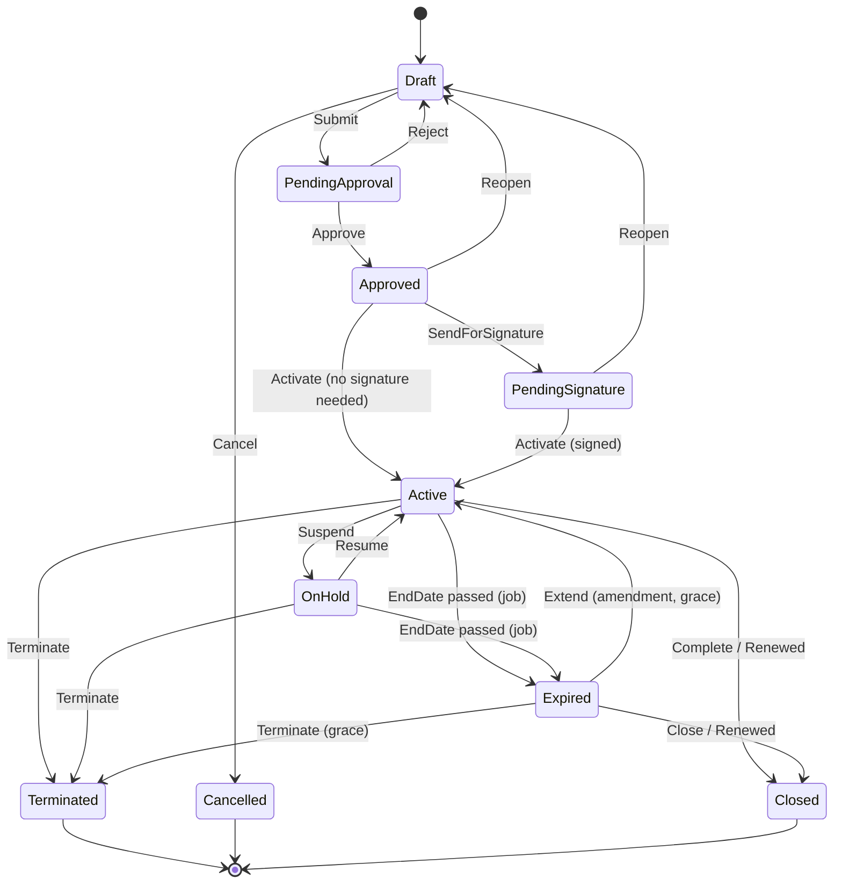

# 03 — Contract Categories, Boundaries and Lifecycle

## 1. Categories and module boundary

### 1.1 Evaluation of the categories in the brief

| Category | Own module? | Decision |
|---|---|---|
| A. Sales contracts (supply, long-term, quantity/value commitment) | No | `Profile=Agreement`, `Direction=Outgoing` in Contract Management. Sales documents stay in Sales. |
| B. Procurement contracts (supply, long-term, framework) | No | `Profile=Agreement`, `Direction=Incoming`. Subcontracting agreements = `Agreement` or `General` depending on whether commitments are measured against Procurement documents. |
| C. Service / maintenance / warranty / support | Partly | `Profile=Service` in Contract Management holds contract terms, coverage and SLA targets. Service calls, equipment cards, work orders, measurement of response time belong to a **future Maintenance/AssetsManagement implementation** (currently empty ABP templates). |
| D. General & legal (consulting, project, lease, real estate, NDA, other) | No | `Profile=General`, behaviour tuned by `ContractType` flags. Real-estate/lease billing is a payment schedule (R2); asset capitalisation is not in scope. |
| Employment-related | HR | Not a Contract Management profile in R1. HR owns employees/positions; a `General` contract may soft-link `EmployeeId`. |

### 1.2 Practical boundary

1. **Central Contract Management (shared by all)**: identity/number, type, parties, dates, value, owner, org/dimensions, status machine, approvals, amendments & versions, signatures, documents (DMS), renewals, obligations (R2), notification rules, document links, audit.
2. **Sales and Procurement agreements (Agreement profile, shared engine)**: lines + commitments + fulfillment ledger + price resolution — implemented once in Contract Management and consumed by Sales and Procurement through an integration service and events. Specific to the process: which document types count (doc 08 mapping), enforcement behaviour at document entry.
3. **Service contracts (Service profile)**: coverage windows, covered assets, targets, limits; *measurement* of SLA is the service module’s job.
4. **Specialised business contracts (HR employment, future real-estate/leasing)**: remain with their module; they may reference Contract Management through `ContractId` soft links.

**Shared** across all: lifecycle, approvals, documents, renewal alerts, audit. **Process-specific**: commitments (Agreement), coverage/SLA (Service), employee data (HR).

## 2. Statuses

| Status | Meaning | Locked fields |
|---|---|---|
| Draft | Being prepared | none |
| PendingApproval | Submitted; approval/legal review in progress | all legally significant fields |
| Approved | Internally approved, not yet signed/effective | all legal fields |
| PendingSignature | Sent for signature (outside or uploaded) | all legal fields |
| Active | In force (signed and `EffectiveDate ≤ today`, or effective date reached) | legal fields; only amendments change them |
| OnHold | Temporarily suspended; no new documents may be linked | legal fields |
| Expired | `EndDate` passed without renewal/termination | legal fields |
| Terminated | Ended early after being Active | everything |
| Cancelled | Abandoned **before** it became Active (never in force) | everything |
| Closed | Finished: fully performed, renewed (successor active) or archived after expiry | everything |

*Differences from the candidate list:* `Under Review` merged into `PendingApproval` (a review stage in the Elsa approval workflow); `Renewed` is **not a state** — it is `Closed` with `ClosureReason=Renewed` plus the successor’s `RenewedFromContractId`; `Closed` added so that terminal "completed" is distinguishable from termination.

Approved vs PendingSignature: `PendingSignature` can be skipped when the type has `RequiresSignature=false`. `Active` needs `EffectiveDate` (default = SignatureDate or StartDate); a job promotes "signed but not yet effective" contracts (Approved/PendingSignature with signature present and EffectiveDate in the future stay in that state until the date).

## 3. Transition table

| # | From | To | Command | Who (permission) | Approval needed | Guard / business rule | Side-effects |
|---|---|---|---|---|---|---|---|
| T1 | Draft | PendingApproval | `ContractSubmit` | `Contracts.Submit` | starts the Elsa approval workflow (configured trigger) | mandatory fields for profile (doc 02 §2.1.2); ≥1 line for Agreement; dates valid; counterparty rules | creates `ContractApprovalRequest`; Elsa creates the approver tasks |
| T2 | Draft | Cancelled | `ContractCancel` | `Contracts.Cancel` | no | reason required | history; draft documents kept |
| T3 | PendingApproval | Approved | `ContractApprove` (final step) | `Contracts.Approve` | yes (Elsa workflow stages) | approver ≠ creator unless setting `Approval.AllowCreatorApproval` | `ContractApprovedEvent` |
| T4 | PendingApproval | Draft | `ContractReject` | `Contracts.Reject` | yes | reason required | notify owner; unlock |
| T5 | Approved | PendingSignature | `ContractSendForSignature` | `Contracts.Activate` | no | `RequiresSignature=true` | notify owner |
| T6 | Approved/PendingSignature | Active | `ContractActivate` | `Contracts.Activate` | no (already approved) | if `RequiresSignature`: all required `ContractSignature` rows present and ≥1 `Signed` DMS document; `EffectiveDate ≤ today` else activation scheduled by job | version 1 snapshot; `ContractActivatedEvent`; Agreement lines become resolvable |
| T7 | Approved/PendingSignature | Draft | `ContractReopen` | `Contracts.Edit` | restarts approval | only before Active; reason | history |
| T8 | Active | OnHold | `ContractSuspend` | `Contracts.Suspend` | optional (type flag) | reason; cannot hold if a pending amendment is being applied | linking blocked; open documents untouched; `ContractSuspendedEvent` |
| T9 | OnHold | Active | `ContractResume` | `Contracts.Suspend` | optional | contract not past `EndDate` (else → Expired) | `ContractResumedEvent` |
| T10 | Active/OnHold | Expired | job `ContractExpiryJob` | system | no | `EndDate < today` | notification; linking blocked; open documents may complete |
| T11 | Active/OnHold/Expired | Terminated | `ContractTerminate` | `Contracts.Terminate` | yes if value ≥ policy threshold | reason + termination date; for Expired only within grace | open obligations cancelled unless `SurvivesTermination`; `ContractTerminatedEvent`; existing documents unaffected |
| T12 | Active/Expired | Closed (Renewed) | auto when successor activates, or `ContractClose` | system / `Contracts.Renew` | no | successor.RenewedFromContractId = this | predecessor counters frozen |
| T13 | Expired | Closed | `ContractClose` | `Contracts.Terminate` | no | all linked documents closed or user acknowledges | history |
| T14 | Active | Closed | `ContractClose` | `Contracts.Terminate` | no | fully fulfilled (all line remaining = 0) or `EndDate` reached; reason `Completed` | – |
| T15 | Expired | Active | applied amendment `ExtendTerm` | `Contracts.Amend` | yes | within `RenewalGraceDays`, new EndDate > today | version snapshot |

Not allowed: Active → Draft; Terminated/Cancelled/Closed → anything; Draft → Active (must be approved).

### 3.1 Answers to the lifecycle questions in the brief

| Question | Rule |
|---|---|
| Active before signing? | Only if the type has `RequiresSignature=false` (e.g., internal agreements). Default for external types = true. |
| Both parties’ signatures required? | `ContractType.RequiredSignatureRoles` (default: Counterparty + Company representative). Recording is manual in R1. |
| Can an Active contract be edited? | No for legal fields (dates, value, counterparty, lines’ price/qty, terms). Allowed without amendment: owner, responsible, internal notes, reminder settings, tags, attachments. Everything else → amendment. |
| Amendments | Create a new version; effective-dated; never overwrite prior snapshots; see §5. |
| Suspension | OnHold blocks new links and price resolution; existing orders continue; the suspended period does not extend `EndDate` unless an amendment says so. |
| Termination vs cancellation vs expiration | *Cancelled* = never entered force. *Terminated* = early end of an Active contract by decision (reason, date). *Expired* = natural end without renewal. |
| Outstanding obligations after termination | Obligations → `Cancelled` unless `SurvivesTermination`. Open Sales/Procurement documents keep their agreement link and may be completed; **no new** documents may be linked; ledger keeps recording completion/returns (so reversals remain consistent). |
| Renew an expired contract? | Yes within `RenewalGraceDays` (default 90): by successor contract or `ExtendTerm` amendment; after grace only successor. |
| Historical versions | `ContractVersion` rows (JSON snapshot of header, lines, terms, parties) created at activation and at each applied amendment; immutable; retrievable with diff (P1). |

## 4. Business rules per important transition

- **Submit (T1)**: validates via `ContractSubmitValidator` (FluentValidation) + domain `Contract.Submit()`; counterparty/direction rule; `StartDate < EndDate`; `NoticePeriodDays ≤ duration`; Agreement lines unique `(ItemId, validity overlap)` unless type allows overlap; sum of line commitments ≤ ContractValue when `ContractValue` set and type flag `CapByHeaderValue`.
- **Approve (T3)**: the approval request must be completed according to the policy resolved at submit time (policy snapshot stored so later policy edits do not retroactively change a pending request).
- **Activate (T6)**: freezes `ExchangeRate`, stores `ActivatedOn/By`, writes version 1, publishes event, enables resolution for Agreement lines. If another Active contract of same partner covers the same item/dates, a warning (not error) is shown; resolver tie-break handles the overlap (doc 08).
- **Suspend/Resume (T8/T9)**: requires reason; history rows pair them; notifications to owner and responsible.
- **Terminate (T11)**: requires termination date (not before `StartDate`); system flags documents created after that date as invalid for linking.
- **Expire (T10)**: job-driven; date comparison uses tenant timezone (setting, default server local time as other jobs use `TimeZoneInfo.Local`).

## 5. Amendments

States: `Draft → PendingApproval → Approved → Applied | Rejected | Cancelled`.
Each amendment has: type, reason, `EffectiveDate`, a **change set** (list of `{path, oldValue, newValue}` for header fields; line operations Add/Change/Close with `LineNum`), approval request, resulting `VersionNo`.
Rules:
1. At most one non-final amendment per contract at a time (simplifies concurrency).
2. Applying checks the contract is `Active`/`OnHold`/`Expired(grace)` and that the base `VersionNo` still equals the version it was drafted against (else `ContractsManagement:AmendmentStale`).
3. Effects: **Value/dates** — header updated, snapshot of previous state kept; **commitments** — line qty/value changes are forward-looking, never below Released/Fulfilled/Invoiced counters; new lines get new `LineNum` (never reuse); closed lines stay for history; **payment schedule** (R2) — unpaid/uninvoiced items re-planned, invoiced ones frozen; **previously generated documents** — untouched; price changes affect documents created at/after `EffectiveDate`.
4. Legal history: `ContractVersion.Payload` is write-once; no update/delete path exists in the API or repository.

## 6. State diagram

## 7. Roles (default seeding; tenants may change via permissions)

| Role | Permissions |
|---|---|
| Contract Requester | View, Create, Edit (own drafts), Submit |
| Contract Manager | + Activate, Suspend, Amend, Renew, Export |
| Approver / Legal | Approve, Reject, ViewConfidential |
| Contract Admin | + Terminate, Cancel, manage Types/Templates/Policies |
| Viewer | View |
Notes: segregation of duties (creator ≠ final approver) is configurable per type.
