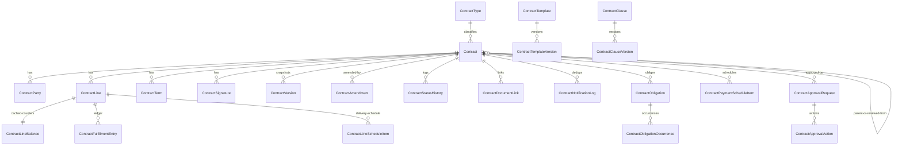

# 04 — Domain Model

All entities live in `Enki.ContractsManagement.Domain` unless stated. Conventions verified in the repository: GUID keys; aggregate roots derive from `MultiTenantAuditedAggregateRootWithUserBase<Guid>` (tenant + user audit) or `…WithUserAndOrgBase<Guid>` (adds `OrganizationId`, as `DocBase` and `PaymentTerm` do); both are `FullAudited…` (soft-delete, creation/modification/deletion audit, `ConcurrencyStamp`); private setters + factory/`Create` methods + `BusinessException` codes; decimals `decimal(19,6)`; cross-module references are **soft Guid references** (no navigation, no cross-module FK).

## 1. Aggregates (consistency boundaries)

| Aggregate root | Children (same transaction) | Why this boundary |
|---|---|---|
| **Contract** | `ContractParty`, `ContractLine`, `ContractTerm`, `ContractSignature` | Header, parties, commitment definitions, clauses and signatures must be validated together (e.g. line sum vs header value, signatures before activation). Draft edits touch several children. Typical size: ≤ 50 lines, ≤ 100 terms; EF loads children on demand per use-case. |
| **ContractLineBalance** (1:1 with a line, own root) | – | Hot, concurrent counters updated by fulfillment events; separated so document traffic never conflicts with contract edits (`ConcurrencyStamp` of the Contract). |
| **ContractFulfillmentEntry** | – | Append-only ledger row; no update, no delete. |
| **ContractAmendment** | – | Own lifecycle and approval; references `ContractId` + `BaseVersionNo`. |
| **ContractVersion** | – | Immutable snapshot; write-once. |
| **ContractApprovalRequest** | `ContractApprovalAction` | One approval flow instance. |
| **ContractType** | – | Configuration (flags, defaults). |
| **ContractStatusHistory** | – | Append-only. |
| **ContractDocumentLink** | – | Navigation links to Sales/Procurement/other documents. |
| **ContractNotificationLog** | – | Deduplication record. |
| **ContractObligation** | `ContractObligationOccurrence` (recurring) | Obligation + generated occurrences. |
| **ContractPaymentScheduleItem** | – | One row per planned billing/payment event. |
| **ContractTemplate** | `ContractTemplateVersion`, `ContractTemplateClause` | Template editing/publishing. |
| **ContractClause** | `ContractClauseVersion` | Library. |
| **ContractServiceLevel** | `ContractCoverageWindow`, `ContractCoveredAsset` | Service profile. |

Rule: **an aggregate never holds a collection of another aggregate**; cross-aggregate references use `Guid` ids. The Contract does *not* contain amendments, versions, ledger, obligations or approvals.

## 2. Entity specifications

Notation: PK `Id` (Guid) unless stated; every table also has `TenantId`, audit columns, `IsDeleted` (soft delete) where the base class provides them. "Org" = carries `OrganizationId` (data authority).

### 2.1 ContractType (config) — central
- **Purpose:** configurable contract type; drives mandatory fields, lifecycle flags, defaults.
- **Properties:** `Code` (≤20), `Name`, `NameAr`? (localised name stored via two columns because other lookup entities store a single `Name`; decide in Q-12), `Category` (enum: Sales, Procurement, Service, Legal, Lease, Project, Other), `Profile` (General/Agreement/Service), `DefaultDirection`, `RequiresSignature`, `RequiredSignatureRoles`, `RequiresApproval`, `ApprovalWorkflowDefinitionId?` (optional per-type Elsa definition), `AllowManualNumber`, `RenewalPolicyDefault`, `DefaultDurationMonths?`, `NoticePeriodDaysDefault?`, `RenewalGraceDays` (default 90), `ReminderDaysDefault` (CSV "30,15,7,1"), `EnforcementMode?`, `FulfillmentBasis?`, `ReturnsRestoreCommitment?` (all nullable overrides: **null = use the system setting**, doc 14 ADR-17), `CapByHeaderValue`, `SegregateDuties`, `IsOpenEnded`, `RequiresContractValue`, `RequiresPaymentTerm`, `IsActive`, `NumberingSubType`.
- **Relationships:** referenced by Contract (soft within module, real FK allowed — same schema).
- **Indexes/unique:** unique `(TenantId, Code)` filtered `IsDeleted=0`.
- **Validation:** for Profile `Agreement`, `EnforcementMode`/`FulfillmentBasis`/`ReturnsRestoreCommitment` are optional overrides (null ⇒ system setting); `Service` behind the `ContractsManagement.Service` feature flag.
- **Audit:** audited. **Tenancy:** tenant-wide (no org). **Placement:** central.

### 2.2 Contract (aggregate root) — central, Org
- **Purpose:** the legal/commercial agreement header.
- **Properties:** `ContractNumber` (≤25), `Title` (≤250), `ContractTypeId`, `Profile` (copied from type at creation, immutable), `Direction` (Outgoing/Incoming/Internal), `Status`, `VersionNo` (int, ≥1 after activation), `CounterpartyId?` (Core BusinessPartner), `CounterpartyName?`, `OwnerUserId`, `ResponsibleEmployeeId?`, `ProjectId?`, `CostCenterId?`, `Currency` (≤3), `ExchangeRate?` (snapshot), `ContractValue?` (decimal(19,6)), `TaxTreatment?`, `PaymentTermId?` (Finance), `DeliveryTerms?`, `StartDate`, `EndDate?`, `SignatureDate?`, `EffectiveDate?`, `TerminationDate?`, `RenewalPolicy` (None/Manual/Auto), `NoticePeriodDays?`, `AutoRenewTermMonths?`, `ReminderDaysOverride?`, `NoticeDeadline` (calculated & stored, = EndDate − NoticePeriodDays; stored for job/index performance, recomputed on every date change), `Confidentiality`, `Language`, `ExternalReference?`, `ParentContractId?`, `RenewedFromContractId?`, `SourceDocType?`/`SourceDocId?`, `AgreementMode?` (Specific/General), `OverridesPrices`, `ClosureReason?`, `ActivatedOn?/By?`, `TemplateVersionId?` , `RiskLevel?` , `LegalReviewRequired` , `Description?`, `InternalNotes?`, `ExtraProperties` (ABP).
- **Relationships:** 1—* Parties, Lines, Terms, Signatures; *—1 ContractType; self-references Parent/RenewedFrom.
- **Indexes:** unique `(TenantId, ContractNumber)` filtered; `(TenantId, OrganizationId, Status, EndDate)`; `(TenantId, CounterpartyId, Status)`; `(Status, NoticeDeadline)` filtered Active; `(ParentContractId)`; `(OwnerUserId, Status)`.
- **Validation:** see doc 03; dates `StartDate ≤ EndDate`; `SignatureDate ≤ EffectiveDate` unless type allows retroactive; `Currency` must exist in Core Currency (integration validate); cycle check on Parent/RenewedFrom.
- **Behaviour (methods):** `Create`, `UpdateDraft`, `Submit`, `Approve`, `Reject`, `SendForSignature`, `Activate`, `Suspend`, `Resume`, `MarkExpired`, `Terminate`, `Cancel`, `Close`, `ApplyAmendment(change set)`, `AddLine/ChangeLine/CloseLine` (Draft or via amendment only), `RecordSignature`. State changes go through a single private `ChangeStatus` that appends a history event; invalid transitions throw `BusinessException("ContractsManagement:InvalidStatusTransition")`.
- **Audit/tenancy:** audited; data-authority via `OrganizationId` + `CreatorId`.

### 2.3 ContractParty — child of Contract
`ContractId`, `Role` (Counterparty, Guarantor, Witness, Subcontractor, Beneficiary, Other), `BusinessPartnerId?`, `Name`, `ContactName?`, `Email?`, `Phone?`, `SignatoryTitle?`, `IsPrimary`, `SortOrder`. Unique `(ContractId, BusinessPartnerId, Role)` filtered not null; exactly one `IsPrimary` Counterparty if Contract.CounterpartyId set (kept in sync by the aggregate). Locked after PendingApproval except via amendment.

### 2.4 ContractLine — child of Contract (Agreement/Service profiles)
`ContractId`, **`LineNum`** (int ≥1, never reused, unique per contract — this is the value stored in `DocLineBase.AgreementLineNum`), `ItemId?` (Inventory item, soft), `CategoryId?` , `Description`, `UomId?`, `CommitmentType` (Quantity/Value), `AgreedQuantity?`, `AgreedValue?`, `UnitPrice`, `DiscountPercent`, `PriceFixed`, `EnforceMax`, `MinReleaseQuantity?/Value?`, `MaxReleaseQuantity?/Value?`, `ValidFrom?/ValidTo?` (inside contract dates), `Status` (Open/Closed), `ClosedReason?`, `Notes`.
Rules: Quantity commitment ⇒ `AgreedQuantity>0`, `UnitPrice≥0`, committed value = `AgreedQuantity × UnitPrice × (1−Discount%)`; Value commitment ⇒ `AgreedValue>0`, price fields ignored; at most one of ItemId/CategoryId; `Max ≥ Min`; unique `(ContractId, LineNum)`; index `(TenantId, ItemId, ContractId)` for resolution.
Not an `IDocLine`; deliberately does **not** inherit `DocLineBase` (no posting fields).

### 2.5 ContractLineBalance — own root
PK = `ContractLineId`. `ContractId`, `ReleasedQty/Value`, `FulfilledQty/Value`, `InvoicedQty/Value`, `LastSequence` (long), `RowVersion` (timestamp). Only the fulfillment service writes it. **Derived cache** of the ledger (justified: validation at document entry must be O(1); source of truth is the ledger; rebuildable by `RecalculateFulfillment`).

### 2.6 ContractFulfillmentEntry — append-only ledger
`ContractId`, `ContractLineId`, `LineNum`, `EntryType` (Release/Fulfill/Invoice), `SourceDocType` (DocumentTypeData code, ≤10), `SourceDocId`, `SourceLineId`, `SourceDocRef`, `SourceDocDate`, `SourceRevision` (long; monotonic revision of the source document, used to ignore out-of-order events), `Sequence` (int per source-line+type), `QuantityDelta`, `ValueDelta` (contract currency), `DocCurrency`, `DocValueDelta`, `DocRate`, `Reason` (Posted, Cancelled, Returned, Reversed, Edited, Recalculated), `EventId?`, `CreationTime`, `CreatorId`.
Unique `(TenantId, SourceDocType, SourceLineId, EntryType, Sequence)`. Index `(ContractLineId, EntryType)`, `(SourceDocId)`. No `IsDeleted`, no update path. Data authority via the Contract.

### 2.7 ContractDocumentLink
`ContractId`, `LinkType` (Source, Release, Fulfillment, Invoice, Related), `DocType`, `DocId`, `DocRef`, `DocDate`, `LinkedOn`. Unique `(ContractId, DocType, DocId, LinkType)`. For Agreement profile created automatically by the fulfillment handler (one per document); for General contracts created manually (e.g., source quotation, related project). Not authoritative for fulfillment.

### 2.8 ContractStatusHistory — append-only
`ContractId`, `FromStatus?`, `ToStatus`, `ChangedBy`, `ChangedOn`, `Reason?`, `RelatedApprovalRequestId?`, `RelatedAmendmentId?`. Index `(ContractId, ChangedOn)`.

### 2.9 ContractSignature
`ContractId`, `PartyId?`, `Role`, `SignerName`, `SignerTitle?`, `SignedOn`, `Method` (Wet, Uploaded, ExternalProvider), `DocumentId?` (DMS Document, soft), `ExternalSignatureId?`, `RecordedBy`. Unique `(ContractId, Role, SignerName)`. Distinguishes **recording** from provider-verified signatures (the latter reserved).

### 2.10 ContractTerm
`ContractId`, `SortOrder`, `Section?`, `Title`, `Body` (frozen text, language), `ClauseVersionId?`, `IsOptional`, `IsIncluded`. Free-text and library clauses share the table; library text is **copied**, not referenced live.

### 2.11 ContractVersion — immutable
`ContractId`, `VersionNo`, `Reason` (Activation/Amendment/Renewal), `AmendmentId?`, `Payload` (nvarchar(max) JSON: header, parties, lines, terms, signatures), `PayloadHash` (SHA-256), `CreatedOn/By`. Unique `(ContractId, VersionNo)`. No update/delete in repository interface (only `InsertAsync`, `Get…`).

### 2.12 ContractAmendment
`ContractId`, `AmendmentNo` (per contract), `Type`, `Status` (Draft, PendingApproval, Approved, Applied, Rejected, Cancelled), `Reason`, `EffectiveDate`, `BaseVersionNo`, `ChangeSet` (JSON), `ApprovalRequestId?`, `AppliedVersionNo?`, `AppliedOn?/By?`. Unique `(ContractId, AmendmentNo)`; filtered unique index enforcing ≤1 non-final amendment per contract.

### 2.13 ContractApprovalRequest / Action
Approval itself runs in the Elsa workflow (doc 09 §2); the contract keeps its own record. Request: `SubjectType` (Contract, Amendment, Termination), `SubjectId`, `ContractId`, `WorkflowInstanceId` (Elsa), `Status` (Pending, Approved, Rejected, Cancelled), `SubmittedBy/On`, `CompletedOn`. Action (one per decided stage): `RequestId`, `StageNo`, `ApproverUserId`, `Decision`, `Comment`, `TaskItemId?`, `DecidedOn`. Unique `(RequestId, StageNo)`; filtered unique "one Pending request per subject". No policy/step tables: thresholds and stages are Elsa workflow definitions.

### 2.14 ContractNotificationLog
`ContractId`, `RuleCode` (Expiry30, Notice, PendingApproval…), `DueDate` (date the rule refers to), `RecipientUserId`, `SentOn`, `NotificationId?` (Notification module). Unique `(TenantId, ContractId, RuleCode, DueDate, RecipientUserId)`. It is only a de-duplication record; message storage stays in `Enki.Notification`.

### 2.15 ContractObligation + Occurrence
`ContractId`, `Kind`, `Title`, `Description`, `DueDate`, `ResponsibleEmployeeId?`, `ResponsibleOrganizationUnitId?`, `Quantity?`, `Value?`, `Status`, `CompletedOn/By`, `AcceptedOn/By`, `AcceptanceRequired`, `SurvivesTermination`, `PenaltyType?` (None, FixedPerDay, PercentPerDay, Fixed), `PenaltyRate?`, `PenaltyCap?`, `RecurrenceRule?`, `DependsOnObligationId?` (acyclic), `LinkedPaymentItemId?`. Occurrence: `ObligationId`, `DueDate`, `Status`; unique `(ObligationId, DueDate)`. Milestones are obligations of kind `Milestone`.

### 2.16 ContractPaymentScheduleItem
`ContractId`, `ItemNo`, `Kind` (Advance, Milestone, Periodic, Retention, Final), `DueDate`, `Percent?`, `Amount`, `Currency`, `ObligationId?`, `Status` (Planned, Due, Invoiced, Paid, Cancelled), `InvoiceDocType?/InvoiceDocId?` (soft link set when the user/process creates the invoice), `Notes`. No postings.

### 2.17 Template / Clause; ServiceLevel
`ContractTemplate`(`Code`, `Name`, `ContractTypeId`, `CurrentVersionNo`, `IsActive`) → `ContractTemplateVersion`(immutable, `VersionNo`, `DefaultsJson`, `PublishedOn/By`) → `ContractTemplateClause`(`ClauseVersionId`, `SortOrder`, `IsOptional`). `ContractClause`(`Code`, `Title`, `Category`) → `ContractClauseVersion`(`VersionNo`, `Language`, `Body`, `PublishedOn`). `ContractServiceLevel`(`ContractId`, `ResponseHours`, `ResolutionHours`, `CalendarId?`, `IncludedHours?`, `IncludedVisits?`, `Limits…`) → `ContractCoverageWindow`(`DayOfWeek`, `From`, `To`, `IsExcluded`) and `ContractCoveredAsset`(`AssetId?` soft, `ItemId?`, `SerialNo?`, `WarrantyStart/End?`).

### 2.18 Entities for the moved items
- `ContractLineScheduleItem` (child of Contract via line): `ContractLineId`, `DueDate`, `Quantity`, `Value?`, `Note`; unique `(ContractLineId, DueDate)`. Delivery schedule is informational plus reporting; no automatic order creation.
- `ContractApprovalDelegation` (own root): `FromUserId`, `ToUserId`, `FromDate`, `ToDate`, `ScopeType` (All, ContractType, Organization), `ScopeId?`, `IsActive`; index `(ToUserId, FromDate, ToDate)`.
- `ContractLine.CategoryId?` + `IncludeSubcategories` (bool): Inventory `Category` has `ParentId`; membership is resolved through an Inventory integration service (not stored).

## 3. Entities deliberately **not** created

| Candidate | Decision | Reason |
|---|---|---|
| ContractCategory | folded into `ContractType.Category` | no independent behaviour |
| ContractAttachment | use DMS `Document` (`EntityType.Contract`) | DMS already stores blob, versions, metadata |
| ContractNotification | use `Enki.Notification` + `ContractNotificationLog` | avoid second inbox |
| ContractFulfillment (separate from ledger) | ledger + balance | one source of truth |
| ContractRenewal | fields on Contract + successor link | renewal is a new Contract (or extension amendment) |
| ContractMilestone | `ContractObligation(Kind=Milestone)` | same lifecycle |
| ContractLine inheriting `DocLineBase` | rejected | would drag posting/inventory/tax fields |
| Any currency, partner, payment-term, item, UoM, cost-center, project master | reuse Core/Finance/Inventory/Project | duplication |
| Accounting ledger/journal tables | none | Finance owns postings |

## 4. Relationships and cardinality

| Parent | Child | Card. | FK / delete behaviour |
|---|---|---|---|
| ContractType | Contract | 1—* | FK Restrict |
| Contract | ContractParty / ContractLine / ContractTerm / ContractSignature | 1—* | FK Restrict (soft delete only; no cascade) |
| ContractLine | ContractLineBalance | 1—1 | PK = FK, Restrict |
| ContractLine | ContractFulfillmentEntry | 1—* | FK Restrict |
| Contract | ContractVersion / Amendment / StatusHistory / DocumentLink / NotificationLog / Obligation / PaymentScheduleItem | 1—* | FK Restrict |
| ContractApprovalRequest | ContractApprovalAction | 1—* | FK Restrict |
| Contract | Contract (Parent, RenewedFrom) | *—0..1 | FK NoAction |
| Cross-module (Partner, Item, Uom, PaymentTerm, Project, CostCenter, Employee, DMS Document, Sales/Procurement documents) | – | soft | **no FK** (indexes only) |

## 5. ERD

External (soft) references: `BusinessPartner`, `Item`, `Uom`, `PaymentTerm`, `Project`, `CostCenter`, `Employee`, `User`, DMS `Document`, Sales/Procurement document lines (`DocLineBase.AgreementId/AgreementLineNum`).

## 6. Calculated values

| Value | Rule | Stored? |
|---|---|---|
| Line committed qty | `AgreedQuantity` | input |
| Line committed value | Quantity: `AgreedQuantity×UnitPrice×(1−Disc%/100)`; Value: `AgreedValue` | computed property |
| Released / Fulfilled / Invoiced (qty,value) | Σ ledger deltas by `EntryType` | cached in `ContractLineBalance` |
| Remaining (basis B) | `committed − counter(B)`, B from `ContractType.FulfillmentBasis` | computed |
| Fulfillment % | `counter(B) / committed` | computed |
| Contract committed value | Σ line committed values | computed |
| Paid / Outstanding | Σ `PaidAmount` of linked invoices (queried through integration, P1) | not stored |
| NoticeDeadline | `EndDate − NoticePeriodDays` | stored (indexed, recomputed in aggregate) |
| DaysToExpiry | `EndDate − today` | query projection |

## 7. Domain services and events

- `ContractNumberGenerator` (wraps Core `DocumentNumberingManager`).
- `ContractStateMachine` (static transition table → used by aggregate and tests).
- `AgreementLineResolver` (domain query: best matching line for partner/item/date/direction).
- `FulfillmentLedgerService` (contribution → delta → entry + balance update).
- `ContractSnapshotBuilder` (payload + hash).
- Events (Domain.Shared, `[Serializable]` event classes): `ContractActivatedEvent`, `ContractSuspendedEvent`, `ContractResumedEvent`, `ContractExpiredEvent`, `ContractTerminatedEvent`, `ContractAmendedEvent`, `ContractClosedEvent`; inbound: `AgreementDocumentLineChangedEvent` (published by Sales/Procurement). Naming follows the existing `…Event` convention (`OpenQty…Event`, `InventorySOCreatedEvent`); see doc 08.
