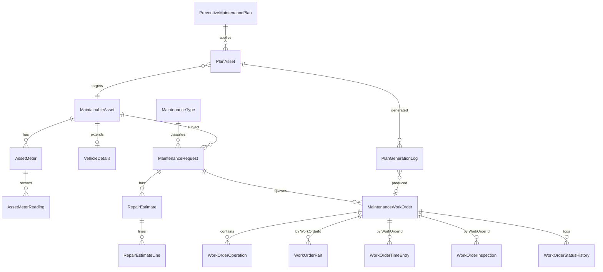
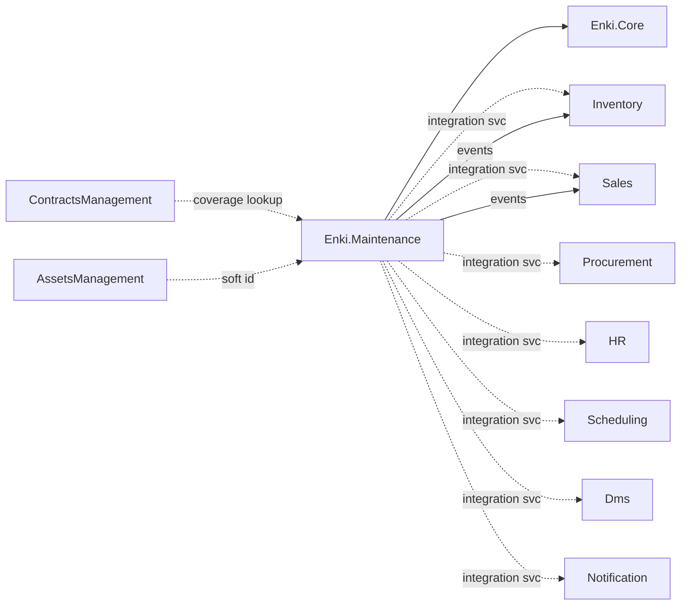
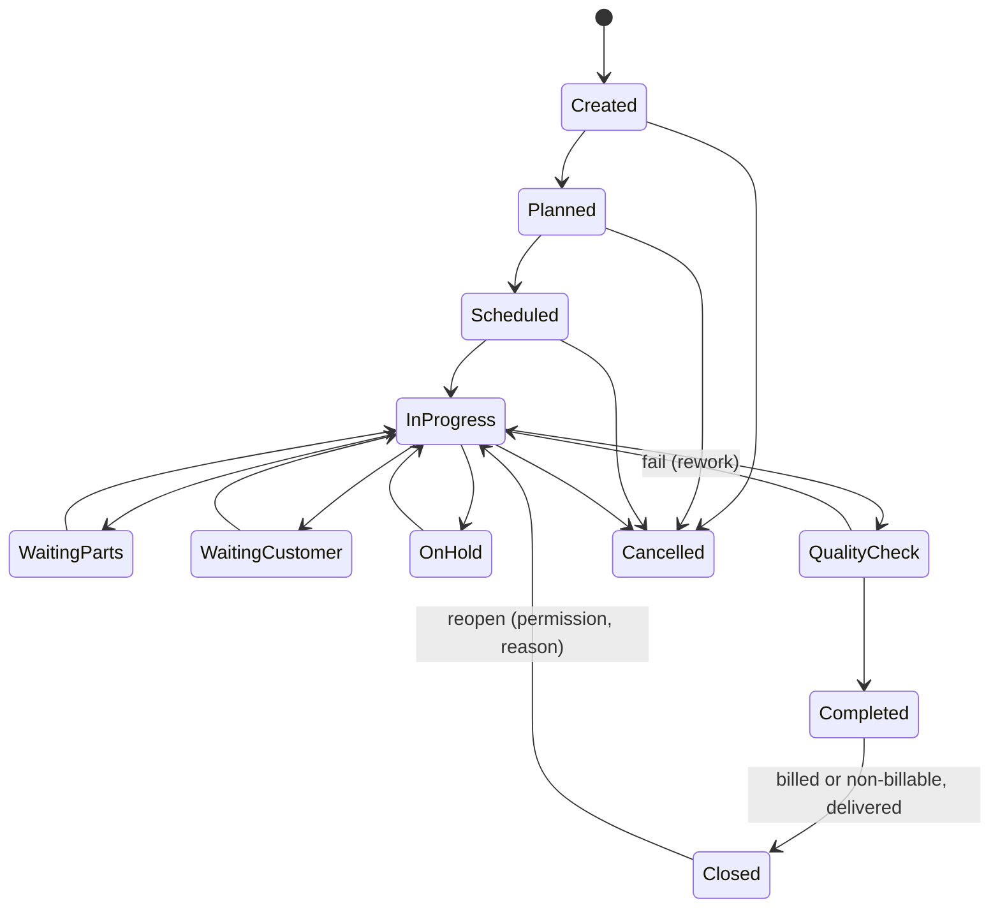
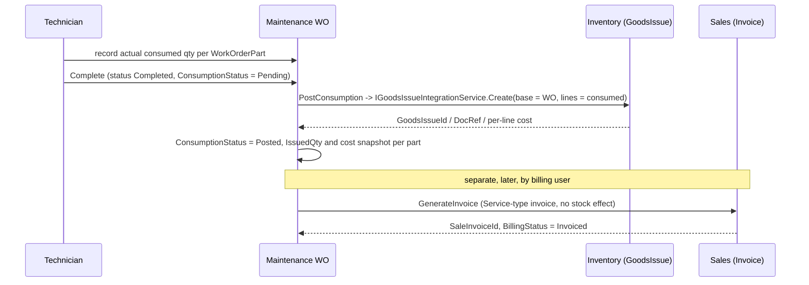
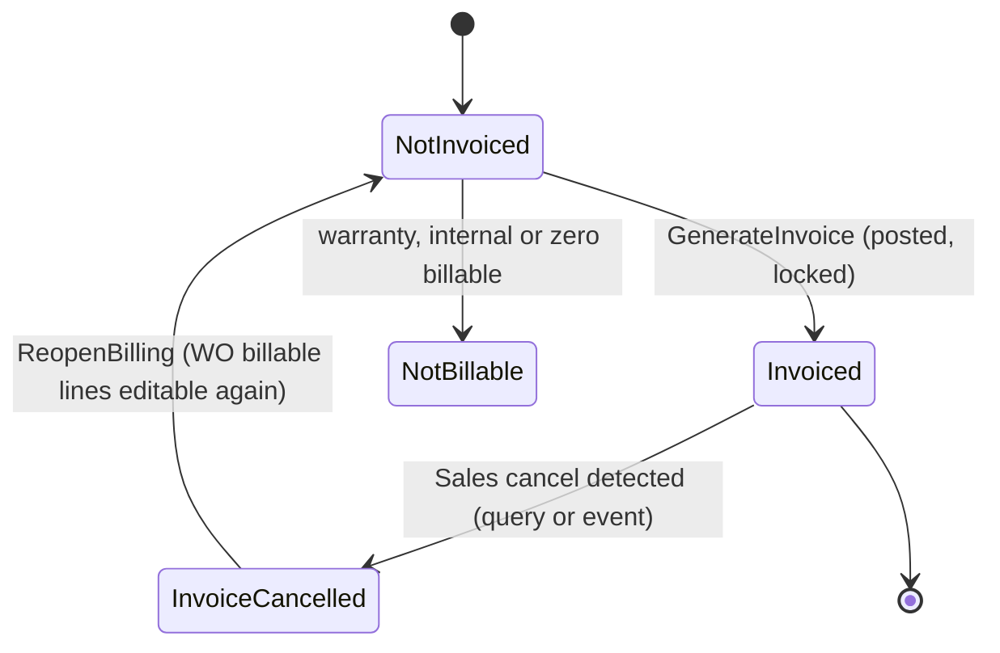
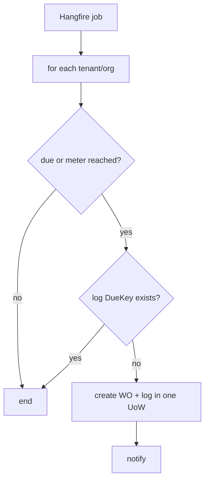
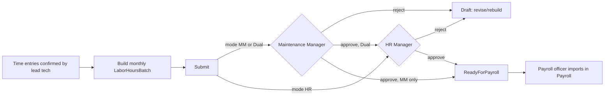
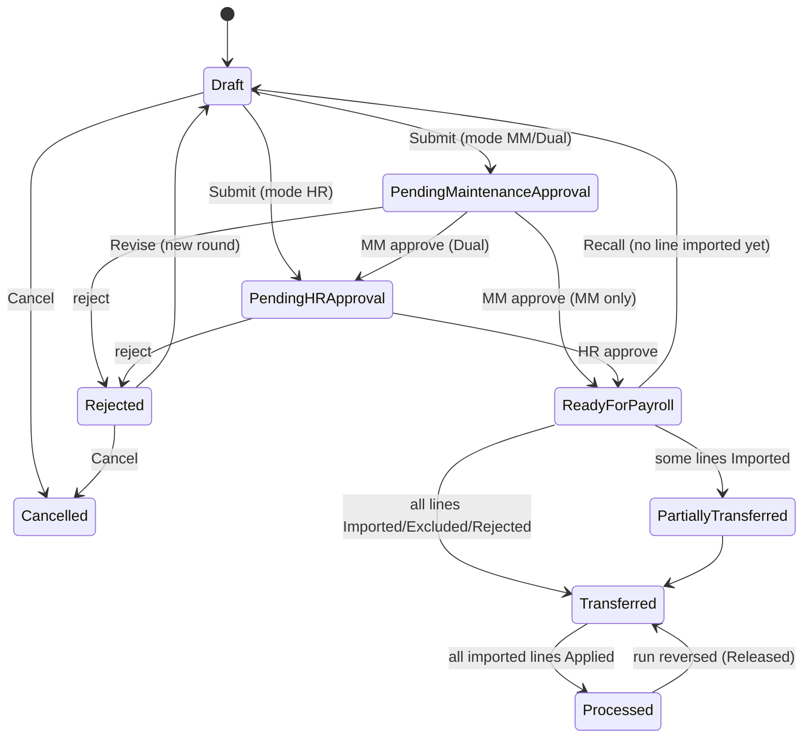
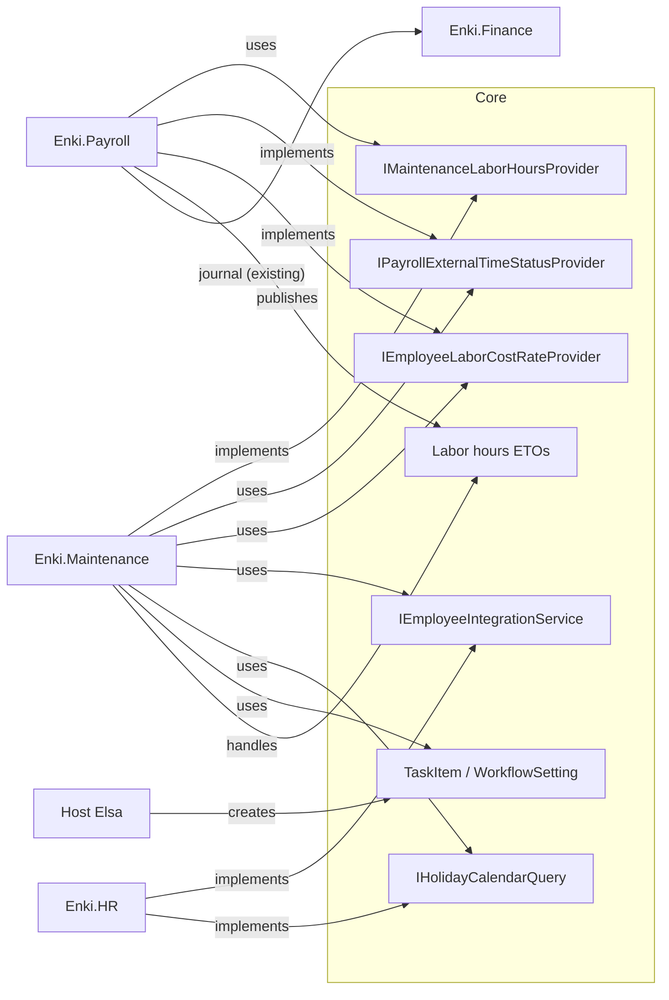

# Maintenance Management Module — Implementation Plan

> **Status:** **Approved by the owner on 2026-10-31.** All business decisions are recorded in §20.1.4, §21, §33 and §36.15. Implementation may start, subject to the cross-module prerequisites in §37 (I1 and S2 block the MVP). Planning produced no Maintenance code, migration or configuration. The only code changes in this session were Sales fixes the owner requested (§21.5.2).
> **Note:** where an earlier paragraph conflicts with a later decision, the dated decision wins. Example: §1 mentions FormService attributes, superseded by §33 item 9 (JSON plus template).
> **Legend used throughout:** **[V]** verified in repo/source this session · **[I]** architectural inference · **[P]** proposed design · **[D]** decision needing owner approval · **[U]** not verified.
> **Research caveat (important):** web searches in this session returned mostly SAP Learning, Cybrosys (Odoo community book), Microsoft Learn (localized) and vendor-blog pages, **not** help.sap.com / odoo.com/documentation pages. Vendor statements below are tagged with the source actually seen; anything else is **[U]** and must be re-verified against official docs before it is used to justify a decision. Competitor cells marked *Not Verified* are deliberately not guessed.

---

## 1. Executive Summary

- JasimERP already contains an **empty ABP skeleton `Enki.Maintenance`** (six projects, schema `Maintenance`, wired into the host: `JasimERP.sln`, `JasimERPDomainModule`, `JasimERPApplicationModule`, `JasimERPDbContext.ConfigureMaintenance()`, conventional controllers in `JasimERPHttpApiHostModule`) **[V]**. No entities, no service-call/equipment-card/work-order concepts exist anywhere in `modules/` **[V]** (grep for `ServiceCall|EquipmentCard|CustomerEquipment` = no hits). The plan therefore **fills the existing module**, not a new one.
- **The frontend is Vue 3 + Vuetify + DevExtreme + Pinia + CASL (`jasim_web`), not Angular [V]** (`jasim_web/package.json`, `jasim_web/CLAUDE.md`). Any "Angular UI" wording in the brief maps to Vue 3 here. The sibling plan under `docs/planning/contracts/10-Angular-UI-Plan.md` shares the same naming mismatch.
- The ERP already provides nearly every shared capability: `BusinessPartner`, `Item` (with `ProductType.Service`, `ManagedBy.Serial/Batch`), `SerialBatch`, `Warehouse`, `CostCenter`, `ProjectEntity`, Employee integration, DMS attachments, Notifications, Hangfire recurring jobs, `FormService` (dynamic forms), `Scheduling` (resources, schedule events, checklist templates), `ContractsManagement` (planned service-contract side) and `AssetsManagement` (planned fixed-asset side). **Maintenance should own only what is genuinely maintenance-specific**: the *maintainable object registry*, intake/diagnosis/estimate, work orders and their operations, PM plans/meters, and the coverage (warranty) decision.
- **Core recommendation [P]:** A shared kernel of 3 aggregates — `MaintenanceRequest` → `RepairEstimate` → `MaintenanceWorkOrder` — plus a `MaintainableAsset` registry (type-flexible, *not* tied to inventory stock), a typed-extension mechanism (vehicle details as a 1:1 extension, other types via Maintenance Type + FormService-style custom attributes), and **integration-only** posting: stock through the existing inventory documents, billing through Sales documents, accounting through `IJournalEntryIntegrationAppService` — Maintenance never writes journal entries directly.
- **MVP:** workshop repair + internal corrective maintenance: asset registry, request/intake with receipt, estimate with customer approval, work order with parts & labor lines, stock issue/return, invoice generation, warranty flag. Preventive maintenance, field service scheduling, contracts/SLA, mobile and analytics follow.

## 2. Business Scope

Three operating contexts on one kernel **[P]**:

| Context | Who owns the asset | Where | Billing |
|---|---|---|---|
| Customer repair workshop | Customer (not in company stock) | Workshop | Billed / warranty / free |
| Field service | Customer | Customer site | Billed / contract |
| Internal maintenance | Company (fixed asset / equipment) | Anywhere | Not billed; cost to cost center/project |

Maintenance types (vehicle, furniture, appliance, industrial equipment, general, internal) are **configuration over one kernel** — a `MaintenanceType` row selects required fields, templates, workflow variant and optional extension (vehicle details). Not all types need VIN/odometer; those live only in the vehicle extension.

## 3. Research Methodology

1. Web search for vendor documentation (results above and in §4–6, with sources in §35).
2. Repo investigation from the repository root: solution/projects, Core bases, integrations, Inventory/Sales/Procurement/Finance posting patterns, Scheduling, Project, FormService, DMS, Hangfire registration, frontend conventions, existing planning docs (`docs/planning/assets`, `docs/planning/contracts`).
3. Every JasimERP claim cites a file/class. Competitor claims cite the page seen or are marked **[U]**.

## 4. SAP Business One Analysis

| Topic | What was seen | Source | Status |
|---|---|---|---|
| Equipment Card | Cards track customer equipment; created manually or automatically for serial-number items on sale/delivery when a warranty contract template (serial-number type) is set on the item master; calls reference a card only if status is Active/Loaned; cards are optional (customer-type contracts can cover items without one) | SAP Learning pages (see §35) | Seen via search summaries; not re-read in full |
| Service Contracts | Contract types incl. serial-number and customer types; coverage validity checked on service call, **warning (not hard stop)** when no valid coverage | SAP Learning | Seen |
| Service Calls | Core object for service requests, assigned to technicians, with activities, solutions, history | SAP Learning (title-level) | **[U]** detail |
| Service Planning/Scheduling, Reports, Costs/Profitability, Spare-parts docs | Not verified this session | — | **[U]** |
| Add-ons (strict entitlement counters etc.) | Described by third-party vendor sites as add-on, not standard | leveragetech/ecosire pages | Treat as *Requires Customization* |

**Lessons [I/P]:** (a) equipment card ≠ item master — adopt a separate registry; (b) coverage check should *warn and require approval*, not block; (c) auto-create the registry record from the sales/delivery event (adapt: via Sales event handler, phase 9).

## 5. Odoo Analysis

| Topic | What was seen | Source | Status |
|---|---|---|---|
| Repair app | Repair order with product being repaired, Parts tab, verify → Start Repair → Repaired; stock moves visible per order | Cybrosys Odoo 17 CE book | Seen (community book, not official) |
| Warranty | "Under Warranty" flag on repair order → repair charge not added to invoice | Cybrosys | Seen |
| Billing | Create Quotation from repair order, then Create Invoice | Cybrosys | Seen |
| Maintenance app (equipment, requests, preventive/corrective, categories, teams), Fleet, Helpdesk, Field Service, Quality, Work Centers | Not verified this session | — | **[U]** — must read official docs before relying |
| Third-party warranty/vehicle-repair modules | Exist on apps.odoo.com; **not core** | apps.odoo.com listings | Out of scope as evidence |

**Lessons [I/P]:** Odoo separates *Repair* (customer product repair with parts & invoice) from *Maintenance* (equipment requests/PM) — **[U]** for official confirmation, but the split matches this brief's workshop vs. internal contexts; JasimERP should unify them under one work-order kernel with a *context* discriminator rather than two apps. Simple boolean warranty flag is too coarse for partial coverage (brief §7C) → adopt per-line coverage.

## 6. Microsoft Dynamics Analysis

| Topic | What was seen | Source | Status |
|---|---|---|---|
| D365 Field Service | Work orders link to a customer asset via incident type/primary asset; asset flows to generated products/services/tasks; service history by asset; agreements generate recurring work orders (agreement booking incidents with asset; "auto generate work order" setting); validation that asset belongs to the work-order account can be disabled | Microsoft Learn (es-mx, nb-no, en-us release plan) + Inogic blog | Seen via search summaries |
| Work order types, functional locations, resource scheduling, inspections, mobile | Known product areas | — | **[U]** detail this session |
| Business Central Service Management / Supply Chain Asset Management | Not verified; **must not be assumed equal to Field Service** | — | **[U]** |

**Lessons [I/P]:** asset history keyed on the registry; work-order *incident/operation templates* generating default parts/labor/tasks; agreement-generated recurring work orders = our PM plans; allow work orders for assets whose owner differs from the billing customer (configurable).

## 7. Comparative Feature Matrix

Values restricted to verified evidence; *NV = Not Verified*.

| Feature | SAP B1 | Odoo | Dynamics | JasimERP Recommendation |
|---|---|---|---|---|
| Service requests | Supported (Service Calls — title level) | NV | NV | Adopt: `MaintenanceRequest` |
| Repair orders | NV | Supported (Repair app, Cybrosys) | NV | Unified `MaintenanceWorkOrder` |
| Equipment/asset registry | Supported (Equipment Card) | NV | Supported (Customer Asset) | Adopt: `MaintainableAsset` |
| Vehicle maintenance | NV | NV (Fleet unverified) | NV | Vehicle extension |
| Preventive maintenance | NV | NV | Supported via agreements → recurring WOs | Plans + generator (phase 10) |
| Corrective maintenance | NV | NV | NV | Core flow |
| Work orders | NV | Supported (repair order) | Supported | Core |
| Technician scheduling | NV | NV | NV | Reuse `Enki.Scheduling` |
| Spare parts | NV | Supported (Parts tab) | Supported (products on WO) | WO part lines + Inventory |
| Labor tracking | NV | NV | NV | Time entries |
| Warranty | Supported (warranty contract template) | Partial (boolean flag, Cybrosys) | NV | Per-line coverage decision |
| Service contracts | Supported | NV | Supported (agreements) | Via `ContractsManagement` |
| Customer approval | NV | NV | NV | Estimate approval record |
| Inspections | NV | NV | NV | Checklist templates (reuse Scheduling pattern) |
| Inventory integration | NV | Supported (stock moves) | NV | Existing GoodsIssue docs |
| Purchasing integration | NV | NV | NV | Purchase Request link |
| Sales & billing | NV | Supported (quotation → invoice) | NV | Sales doc generation |
| Accounting integration | NV | NV | NV | `IJournalEntryIntegrationAppService` via documents |
| Internal asset maintenance | NV | NV | NV | Context = Internal |
| Service history | Supported (per card — title level) | Partial (stock moves per order) | Supported | By asset |
| Reporting | NV | NV | NV | §28 |
| Mobile | NV | NV | NV | Defer |
| Multi-tenancy | n/a | n/a | n/a | Inherit ABP base |
| Extensibility | NV | NV | NV | Types + custom attributes |

**Best practices (adopted) [I]:** registry separate from item master; coverage warn-and-approve; per-line billing/coverage; stock via standard documents; recurring work generated from plan not hand-copied.
**Common mistakes to avoid [I]:** one status enum for request+WO+invoice+delivery; deducting stock at estimate; direct journal entries; VIN/odometer on the generic form; mutating posted history instead of reversing.
**Defer:** mobile app, SLA measurement, subcontract portals, advanced scheduling optimization.

## 8. JasimERP Architecture Findings

### 8.1 Overview [V]
- Solution `jasim_api/JasimERP.sln`; host projects under `jasim_api/src/JasimERP.*` (Domain, Domain.Shared, Application, Application.Contracts, EntityFrameworkCore, HttpApi, HttpApi.Host, DbMigrator). .NET SDK 9.0.100 (`global.json`); ABP **9.1.1** (`JasimERP.Domain.csproj`); Mapster 7.4.0, FluentValidation 12.0.0 (`Enki.Core.Application.csproj`); MediatR/CQRS per `docs/backend-architecture/03-cqrs-mediator-pattern.md`.
- Modular monolith: `jasim_api/modules/Enki.<Module>`: Aman, AssetsManagement, CRM, ContractsManagement, Core, Dms, Finance, FormService, Freight, HR, Inventory, MARKETPLACE, **Maintenance**, Manufacturing, Notification, Payroll, Procurement, Project, Reporting, Sales, Scheduling. (Memory/record: host stays `JasimERP`; module names `Enki.<Module>`.)
- Standard module split: `Domain.Shared / Domain / Application.Contracts / Application / EntityFrameworkCore / HttpApi` (e.g. `Enki.Maintenance/src/*`). Scheduling and Project use a different flat layout (`Enki.Scheduling/src/Domain`, `Enki.Project/src/Domain`) — **the Maintenance skeleton uses the standard six-project split.**

### 8.2 Single DbContext & migrations [V]
`JasimERPDbContext` implements each module's `IXDbContext` (`[ReplaceDbContext(typeof(IMaintenanceDbContext))]`, `builder.ConfigureMaintenance()` at `JasimERPDbContext.cs:410`). All migrations live in the **host** `src/JasimERP.EntityFrameworkCore/Migrations` (latest seen: `20261029110217_add_MultiCurrency_SettlementToPaymentInvoices`). A module-level migration must **not** be introduced; per-module schema `Maintenance` via `MaintenanceDbProperties.DbSchema` **[V]**. (Also see `jasim_api/EF_CORE_MIGRATION_GUIDE.md`, `jasim-migrations` agent — **[U]** content not re-read.)

### 8.3 Base classes [V]
`Enki.Core/src/Enki.Core.Domain/Bases/EntityBase.cs`: `MultiTenantAuditedAggregateRootWithUserAndOrgBase<TKey>` → `TenantId` + `OrganizationId` + full audit/soft delete. Documents derive from `DocBase` (`Bases/DocumentBases/DocBase.cs`: DocNum, DocRef, DocType, DocDate, PostingDate, DocStatus, partner, currency/rate, tax/discount totals, `BaseDocId/BaseDocType`, `IsCorrection`, `IPeriodBound`). `Resource`, `ScheduleEvent`, `ChecklistTemplate`, `QualityInspection`, `SerialBatch`, `Item` all use the same base **[V]**.

### 8.4 Cross-module rules [V]
`docs/backend-architecture/08-cross-module-communication.md`: reads via integration services (`{Module}.Application.Contracts/Integrations/...`, e.g. `IItemIntegrationService`, `IWarehouseIntegrationService`, `IEmployeeIntegrationService`, `IProjectIntegrationService`, `ISaleInvoiceIntegrationService`, `IPurchaseBillIntegrationService`, `ISerialBatchIntegrationService` in `Enki.Core.Application.Contracts/Integrations`); writes via distributed events (`IDistributedEventBus`, handlers in `{Module}.Application/EventHandlers`). **No FK across modules**, ids only. Event bus is the in-process local bus (no broker/outbox; see `docs/planning/contracts/14-Architecture-Decisions.md` evidence) — Procurement uses `onUnitOfWorkComplete:false` in places **[V per that doc]**; do not assume cross-process delivery.

### 8.5 Posting patterns [V]
- Stock: `IInventoryPostingService.PostAsync(List<InventoryPostingDto>)` and `IItemCostLedgerPostingService.ProcessDocumentAsync(...)` (Core integrations); documents publish balance events (`GoodsIssue` carries `InventoryStockOutCreatedEvent`, `SerialBatchGIssueCreatedEvent`, bin-location events, `DocLinesInventoryPosting`, `DocLinesItemCostPosting`, `JournalEntry`).
- Reference consumer: `Enki.Manufacturing/.../ProductionDocumentCompleteCommandHandler` — completes document, computes material/labor/overhead cost, posts inventory, publishes events, then `_jeAppService.PostAsync(je)` (`IJournalEntryIntegrationAppService`, `Core.Application.Contracts/Integrations`). **This is the closest existing pattern for work-order material consumption and costing.**
- Journal: only through `IJournalEntryIntegrationAppService.PostAsync(JournalEntryPostDto)` (also documented in `docs/planning/assets/assets-management-module-plan-en.md`).
- Sales: `ISaleInvoiceIntegrationService.CreateSaleInvoiceAsync(DocBaseIntegrationDto)` exists **[V]** — candidate for invoice creation. Whether it supports service-type lines/non-stock items and tax/discount parity with the UI **[U]** (needs reading in phase 8 design).

### 8.6 Concepts reuse matrix

| Concept | Exists? Where | Reuse / gap |
|---|---|---|
| Business partners / customers / vendors | `Enki.Core.Domain/Entities/BusinessPartners/BusinessPartner.cs` (`BPType`, `IsSales`, `IsPurchase`, credit, payment terms) | Reuse by id; no new Customer |
| Employees / technicians | `IEmployeeIntegrationService` (Core integrations); HR module | Reuse; technician profile (skills) = Maintenance-owned extension by `EmployeeId` |
| Organizations/branches | `Core/Entities/Organizations`; `OrganizationId` on bases | Reuse |
| Warehouses | `IWarehouseIntegrationService`; `Inventory/Entities/Warehouses` | Reuse |
| Items / services | `Item` (`ProductType.Service=2`, `IsInventory`, `ManagedBy`, `PartNo`, `ModelNo`, `BrandId`, `CostMethod`, `IsFixedAsset`, `RevenueAcctCode`) | Reuse for parts and labor/service items; **labor = Service items** |
| Item groups / UoM | `Categories`, `Uoms`, `UomConversions` | Reuse |
| Serial numbers / batches | `Inventory/Entities/SerialBatches/SerialBatch.cs` (SnBType, GuaranteeStart/End!, ExpireDate), `ISerialBatchIntegrationService` | Reuse for *company-stock* serials; **customer-owned serials not in stock → registry field** |
| Inventory documents | `GoodsIssue`, `GoodsIssueRequest`, `GoodsReceipt`, `InventoryTransaction`, `FifoLayer`, `ItemCostLedger`, `BinLocationBalance` | Reuse GoodsIssue (+ Request) for consumption; new doc *type* code only if needed [D] |
| Sales docs | `SaleQuotation`, `SaleOrder`, `SaleInvoice`, `Delivery`, `ARDownPayment` doc type (203, registry code only, not implemented) | Reuse; **no Service Invoice entity** — use SaleInvoice w/ service items. Deposits use on-account `IncomingPayment` (§33 item 8), not `ARDownPayment` |
| Purchase docs | `PurchaseRequest`, `PurchaseOrder`, `GRPO`, `PurchaseBill` | Reuse; link by `BaseDocId` |
| Payment terms / currencies / tax | Core `BusinessPartnerPaymentTerms`, `Currencies`, DocBase tax fields | Reuse |
| Cost centers / projects | `Core/CostCenters`; `IProjectIntegrationService` | Reuse by id |
| Fixed assets | `Enki.AssetsManagement` — **empty skeleton**, extensive plan (`docs/planning/assets/...`), `Item.IsFixedAsset` flag only | Soft link `AssetsManagementAssetId` (future) [D] |
| Contracts/warranty | `Enki.ContractsManagement` skeleton; plan R1 contract side, **coverage lookup `IContractServiceCoverageIntegrationService` blocked on Maintenance** (docs/planning/contracts/08-Integration-Design.md I-14, ADR-21) | Maintenance *consumes* coverage; no own contracts engine |
| Dynamic forms | `Enki.FormService` (Forms, FormResults, FormCategories, flows) with `IFormIntegrationService`, `FormResults` integrations | Candidate for custom attributes/inspection forms [D] — **[U]** whether suited to per-entity attribute binding |
| Checklists | `Scheduling/ChecklistTemplates/ChecklistTemplate` + items (installation-typed) | Pattern to copy; may not be reusable directly (InstallationType-coupled) |
| Technician scheduling | `Scheduling/Resources/Resource`, `ScheduleEvent` (+Resources, Sources, start/complete/cancel), `TimeSlot`, `BlackoutDays`, Delivery/InstallationOrder | **Reuse for field-service/technician scheduling**; extend source types via `ScheduleEventSource` — **[U]** extension feasibility |
| Quality inspection | `Project/QualityInspections/QualityInspection` (project-bound) | Not reusable; own `WorkOrderInspection` |
| Attachments | `Enki.Dms` `Document` polymorphic (EntityType+EntityId) | Reuse; define `Maintenance.*.Attachments.*` perms per Contracts plan pattern |
| Notifications | `Enki.Notification` (templates, preferences, escalation job) | Reuse; `INotifyRequest` shape per contracts plan §6 — **[U]** interface file not located by name this session |
| Numbering | `Core/DocumentNumberings/DocumentNumberingManager.cs` + `DocumentType` registry (`Core.Domain.Shared/Entities/DocumentTypes/DocumentType.cs`) | Reuse; new codes needed (last used 232 Scheduling; 6001/6002; plan docs propose 230–242 for Assets — **collision risk with Scheduling's 230–232**, see Open Q) |
| Workflow/approvals | `Core/Entities/Workflow/*` (EntityWorkflowSetting, TaskItem), Elsa referenced in `Enki.Core.Application.csproj` | Reuse for estimate approvals [D] |
| Recurring generation | `RecurringTransactionTemplates` (Core) + Hangfire `RecurringJob.AddOrUpdate<...>` in `JasimERPHttpApiHostModule.ConfigureRecurringJobs` (Sales/Procurement/HR/Inventory/Notification jobs) | Hangfire **verified**; register a Maintenance PM job there |
| Audit | ABP audited bases | Reuse |
| Data authority | `Enki.Core.Application/Common/Querying/DataAuthorityQueryExtensions.ApplyDataAuthority(ICurrentUser)` — User(creator)/Org/System levels; fails closed | **Mandatory on every list query** |
| Numbering for docs | `DocBase.DocNum/DocRef` | Reuse for WO/estimate |

### 8.7 Frontend [V]
`jasim_web`: Vue 3.4.35, Vuetify 3, DevExtreme ~23.2.13, Pinia 2.2, CASL, vue-i18n 9 (ar/en), file-based routing under `src/pages/<module>/`, module code under `src/modules/<module>/{components,services,stores,types,enums}` (existing: sales, inventory, procurement, manufacturing, schedule, project-management, …). Conventions: "Type A" (master-detail document, reference `sale-invoice`) and "Type B" (simple CRUD, reference `price-list`) pages — `jasim_web/TYPE_A_PAGE_PATTERN.md`, `TYPE_B_PAGE_PATTERN.md`; base store `src/stores/baseCrudStore.ts`, `src/Services/BaseCrudService.ts`; `XView/BaseGrid`. **No `maintenance` frontend module exists** [V]. No Angular.

### 8.8 Constraints & risks
1. Local in-process event bus: reservation/issue consistency must be designed with explicit idempotency keys, not assumed outbox semantics.
2. Hangfire jobs run under no ambient tenant — generator must iterate tenants/organizations explicitly (pattern from `SalesRecurringTransactionGenerationJob`) **[U]** exact multi-tenant handling to be read in design.
3. `ISaleInvoiceIntegrationService` capability unknown for service lines **[U]**.
4. Contracts/Assets modules are themselves unbuilt → soft references only.
5. Document type code collisions (see §8.6).

## 9. Business Requirements (summary)

BR-1 Intake for any asset type with receipt and attachments · BR-2 type-specific data without polluting the core · BR-3 diagnosis + estimate + customer approval before billable work · BR-4 work orders with parts, labor, external services, inspection, delivery · BR-5 warranty/contract coverage per line · BR-6 stock integrity (reserve/issue/return, serial/batch) · BR-7 correct billing & accounting via existing documents · BR-8 preventive maintenance by time/meter · BR-9 internal maintenance cost to cost center/project · BR-10 history & reporting per asset/customer/technician · BR-11 tenant/org isolation and data authority.

## 10. Functional Requirements (MVP-tagged)

| ID | Requirement | MVP |
|---|---|---|
| F1 | CRUD Maintenance Types, Categories, Failure Codes, Workshops, Checklist templates | Y |
| F2 | Maintainable Asset registry (owner partner or internal, serial optional, model/make, meters) | Y |
| F3 | Vehicle extension (reg no., VIN, make/model/year, engine, odometer, fuel level) | Y (if automotive client) |
| F4 | Maintenance Request/intake with receipt print, accessories, condition, photos | Y |
| F5 | Repair Estimate (labor/parts/external lines), revisions, approve/reject | Y |
| F6 | Work Order with lifecycle, operations, part lines, labor entries, technician assignment | Y |
| F7 | Stock reservation/issue/return via Inventory | Y (issue/return); reservation later |
| F8 | Billing: generate Sales invoice (+ deposit) from WO | Y |
| F9 | Warranty flag + per-line coverage | Y (simple); contract coverage later |
| F10 | Purchase request for missing parts | P2 |
| F11 | Field service scheduling via Scheduling | P2 |
| F12 | PM plans, meters, auto-generation, overdue alerts | P2 |
| F13 | Inspections/quality sign-off, delivery/handover | P1/P2 |
| F14 | Dashboards, reports | P2–P3 |

## 11. Non-Functional Requirements
Tenant/org isolation (base class + `ApplyDataAuthority`); decimals `decimal(19,6)` automatically in `BaseDbContext` [V per assets plan, file `Core.EntityFrameworkCore/.../BaseDbContext.cs` — **[U]** not re-opened]; soft delete; optimistic concurrency on WO/estimate (ABP `ConcurrencyStamp` — **[U]** whether the Core bases include it); Arabic/English with RTL; localization of all user-facing errors via `IStringLocalizer<MaintenanceResource>` (resource exists, `Enki.Maintenance.Domain.Shared/Localization`); thin AppServices dispatching MediatR commands; paging via DevExtreme `DataSourceLoader` as in existing `*GetDxListQueryHandler`; performance target index list §13.

## 12. Domain Model (proposed — **[P]**; none exists)

Owner: `Enki.Maintenance`. All aggregate roots on `MultiTenantAuditedAggregateRootWithUserAndOrgBase<Guid>`; documents on `DocBase` only if the document must participate in period/currency/tax semantics (estimate, WO header **[D]**: a lighter base may avoid inheriting ~60 inventory/sales columns; recommend own fields + `PostingDate`).

### 12.1 Master data
| Entity | Purpose | Key fields | Reuse alt. |
|---|---|---|---|
| `MaintenanceType` (AR) | Selects context, workflow variant, required-field set, extension kind | Code, Name, Context(Workshop/Field/Internal), ExtensionKind(None/Vehicle), RequiresApprovalAbove, DefaultChecklistId | none |
| `MaintenanceCategory` | Asset category tree (appliance, furniture…) | Code, ParentId, TypeId | none |
| `FailureCode` | Standard fault/cause/remedy codes | Code, Kind(Symptom/Cause/Remedy), CategoryId | none |
| `RepairOperation` | Standard operation template with default labor hrs & default parts | Code, DefaultHours, LaborItemId, parts list | cf. `Manufacturing/Operations` (BOM-coupled, don't reuse) |
| `ChecklistTemplate` (Maintenance) | Intake/inspection/PM checklists | Code, Purpose, Items(Question, ResultKind, Required) | pattern from `Scheduling/ChecklistTemplate` |
| `Workshop` | Physical workshop/bay | Code, WarehouseId?, BranchId, CostCenterId | `Scheduling.Resource`? **[U]** |
| `TechnicianProfile` | Skills, rate, `EmployeeId`, `ResourceId?` | | Employee in HR; Resource in Scheduling |
| `MaintenanceSettings` | Policies: negative stock, approval thresholds, deposit rule, auto-PM | via ABP settings (`MaintenanceSettingDefinitionProvider` exists, empty) | ABP settings [V] |

### 12.2 Asset registry
| Entity | Purpose |
|---|---|
| `MaintainableAsset` (AR) | The thing being maintained. Fields: Code, Name, CategoryId, OwnerKind(Customer/Company), OwnerPartnerId?, ItemId? (when sold from our stock), SerialNumber?, ModelNo, Make/BrandId?, PurchaseDate, `WarrantyStart/End` (seller/manufacturer), LocationText/ParentAssetId (components), CostCenterId?, `FixedAssetId?` (soft, future), State(Active/Loaned/Retired), custom attribute payload (JSON) |
| `AssetMeter` / `AssetMeterReading` | Odometer, hours, cycles; reading history (append-only) |
| `VehicleDetails` (1:1 extension, shared PK) | RegistrationNo, VIN, Make, Model, Year, EngineNo/Size, Fuel, Transmission, Color |
| `AssetOwnershipHistory`/`LocationHistory` | Owner/site transfers (append-only) — defer to P2 |
| `AssetWarranty` | Start/end, type(Manufacturer/Seller/Extended), covered scope — P2; MVP uses two date fields + flag |

Rules: asset is **not** inventory; `ItemId` is optional metadata. Unique serial: `(TenantId, OrganizationId, ItemId?, SerialNumber)` filtered where serial not null — **not** global (same serial can repeat across tenants/orgs/makes). Customer-owned equipment ≠ `SerialBatch` (stock ledger) — do not create stock serials for customer property [I from `SerialBatch` being quantity/cost-bearing].

### 12.3 Transactions
| Entity | AR? | Notes |
|---|---|---|
| `MaintenanceRequest` | AR | Intake: Number, Source, Context, TypeId, AssetId?, PartnerId?, Priority, ReportedProblem, Symptoms, ReceivedAccessories, ConditionAtReceipt, ReceivedOn, BranchId/WorkshopId, MeterReadingAtIntake, Status(Request lifecycle only), attachments via DMS |
| `RepairEstimate` (+`RepairEstimateLine`) | AR | Version/revision no., lines (Labor/Part/ExternalService), estimated hours/amount, coverage per line, validity date, Status(Draft/Sent/Approved/Rejected/Superseded), `ApprovedBy/On/Channel`; approval record |
| `MaintenanceWorkOrder` | AR (slim header) | Number, RequestId, AssetId, TypeId, Context, Priority, Status, PlannedStart/End, TechnicianLead, WorkshopId, WarehouseId (parts source), CostCenterId/ProjectId, WarrantyDecision, `BillingStatus`, `DeliveryStatus` (separate columns, not one enum), RowVersion |
| `WorkOrderOperation` | child entity of WO | Sequence, RepairOperationId?, Description, PlannedHours, Status, DependsOnSeq? |
| `WorkOrderPart` | **separate AR** (high churn) keyed by WorkOrderId | ItemId, Qty planned/reserved/issued/returned, serial/batch refs, WarehouseId, UnitCost(at issue), Coverage, IssueDocRef (GoodsIssue id), idempotency key |
| `WorkOrderLabor` / `WorkOrderTimeEntry` | separate AR | TechnicianId, Start/End/Hours, rate snapshot, Coverage, Billable |
| `WorkOrderExternalService` | entity | VendorId, description, cost, PurchaseDocRef |
| `WorkOrderInspection` (+Result) | AR | Template snapshot, results, passed, inspector, signed-off |
| `WorkOrderStatusHistory` | append-only | From/To/Reason/By/At |
| `ApprovalRecord`, `HandoverRecord` | append-only | Customer sign-off, delivery |

### 12.4 Planning
`PreventiveMaintenancePlan` (AR; trigger: Calendar(every N days/months), Meter(every N units), combined any/all; lead time; checklist; operations; required parts; skill), `PlanAsset` (assignment, `LastDoneDate`, `LastDoneMeter`, `NextDueDate`, `NextDueMeter`), `PlanGenerationLog` (needed: idempotency — unique `(PlanAssetId, DueKey)`). 

### 12.5 Cross-module references (ids only, no FK)
`PartnerId`→BusinessPartner; `ItemId/WarehouseId`; `GoodsIssueId/GoodsReceiptId`; `SaleInvoiceId/SaleQuotationId/SaleOrderId`; `PurchaseRequestId/PurchaseOrderId`; `CostCenterId`; `ProjectId`; `EmployeeId`; `ContractId` (future); `FixedAssetId` (future); `ScheduleEventId`. Journal entry ids are held by the *source document*, not Maintenance.

### 12.6 ERD


### 12.7 Work Order header design — Decision 3

#### 12.7.1 What `DocBase` is today [V]
**File:** `jasim_api/modules/Enki.Core/src/Enki.Core.Domain/Bases/DocumentBases/DocBase.cs` (≈2,000 lines).
- **Declaration:** `[Audited] abstract class DocBase : MultiTenantAuditedAggregateRootWithUserAndOrgBase<Guid>, IPeriodBound`.
  - The base, in `Enki.Core.Domain/Bases/EntityBase.cs`, supplies `TenantId`, `OrganizationId` and ABP `FullAuditedAggregateRootWithUser` (creation/modification/deletion audit, soft delete, and ABP's aggregate concurrency stamp [I: ABP convention]).
- **Properties: about 120, grouped by responsibility:**

| Group | Properties | Commercial / financial? |
|---|---|---|
| Identity | `DocNum`, `DocRef`, `DocType` (`DocBaseType` Item/Service), `DocumentType` (registry code), `IsManualNumber`, `PrintedStatus` | neutral |
| Dates | `DocDate`, `PostingDate`, `DueDate` | `PostingDate`/`DueDate` are financial |
| Status | `DocStatus`, `InventoryStatus`, `InventoryDirect`, `IsPartialSupply`, `IsReserved`, `IsCashInvoice`, `IsSelfInvoice`, `ShipmentTrackingStatus`, `InstallationTrackingStatus`, `Canceled` ("N"/"Y"/"C") | inventory and sales |
| Partner and accounting | `PartnerId`, `AccountCode`, `SalesEmpCode`, `TransId`, `JournalMemo`, `FinancePeriod`, `ProjectId`, `CostCenterId` | financial |
| Currency | `DocCur`, `DocRate`, `SystemCurrencyCode`, `InDirectRate`, `CurrencySource` | financial |
| Totals | `BaseAmount(FC)`, `DiscPrcnt`, `DiscAmount(FC)`, `DiscInputMode`, `TaxPrcnt`, `TaxAmount(FC)`, `TotalFreight(FC)`, `DocTotal(FC)`, `PaidAmount(FC)`, `GrossProfit(FC)`, `TotalCost(FC)`, `IsCorrection`, `CorrectedDocId` | financial |
| Payment / down payment | `PaymentMethod`, `InstallmentCount`, `PaymentTermId`, `PaymentStatus`, `Dpm*` (6) | financial |
| Shipping / freight | `ShippingMethod`, `BillingAddress`, `ShippingAddress`, `ShipToLocCode`, `ShippingDate`, `ShippingCountryId`, `FromPort`, `ToPort`, `ETA`, `TransportType`, `ShippingTerm`, `ShipperId`, `POV`, `TrackingNumber`, `ShippingType`, `BLorAWB`, `InsuranceType`, `ShippingRemark`, `Volume`, `VolUnit`, `Weight`, `WeightUnit`, `Express` | logistics |
| Installation / geo | `InstallationDate`, `AreaId`, `Latitude`, `Longitude` | partly relevant |
| References | `BaseDocId`, `BaseDocType`, `Ref1`, `Ref2`, `Comments`, `WarehouseCode`, `BaseWarehouseCode` | neutral / inventory |
| POS / pricing | `SessionId`, `TerminalId`, `PriceListId`, `ReturnReason` | sales |
| Workflow | `WorkflowStatus` (default **`Posted`**), `ApprovedBy/Date/Level/Remarks`, `RejectionReason`, `SubmittedBy/Date`, `PostedBy/Date`, `CanceledBy/Date`, `ReversedBy/Date` | generic approve/post |
| Lines | `_lines : List<DocLineBase>` (item, quantity, price, inventory, dimensions value objects) | item, price, stock |

- **Behaviors:**
  - **Period locking** (`IPeriodBound`, keyed on `PostingDate` and money/partner fields).
  - **Journal creation:** `CreateFinance()` → `CreateJournalEntry` / `CreateCancellationJournalEntry` by `DocumentType`, via registered strategies.
  - **Line synchronisation and pricing:** `SyncLines`, `CalculateLineValues`, `RecalculateTotals`, discount distribution.
  - Journal header and line builders (`JournalDebit`, `JournalCredit`) and `IsSalesDocument()`.
- **Infrastructure tied to DocBase:**
  - `DocFactoryBase<TDoc> where TDoc : DocBase` (numbering with `docSubType = docTypeCode`, status, currency, period).
  - `IDocDeletionService` / `DocDeletionService`: **cancellation creates a reversal *document*** and refuses `DocStatus.Close`.
  - EF `BaseDocModelConfiguration.ConfigureBaseDoc<T>()` in `Enki.Core.EntityFrameworkCore/Entities/` maps **all** of the columns above into **each** derived table and adds indexes on `PartnerId`, `PostingDate`, `PaymentTermId`, `BaseDocId`.
  - Generic handlers constrained to DocBase: `OpenQtyEventHandler`, `OpenQtyInventoryEventHandler`, `ReturnQuantityEventHandler`, Sales report managers.
- **All 22 inheritors** are commercial or stock documents with priced item lines:
  - Sales: `SaleQuotation`, `SaleOrder`, `Delivery`, `SaleInvoice`, `SaleReturn`, `ARCreditMemo`, `SalesTemplate`, `CashSaleInvoice`, `CashSaleReturn`.
  - Procurement: `PurchaseRequest`, `PurchaseOrder`, `GoodReceiptPO`, `PurchaseBill`, `PurchaseReturn`, `GoodsReturn`, `PurchaseTemplate`.
  - Inventory: `GoodsReceipt`, `GoodsIssue`, `GoodsReceiptRequest`, `GoodsIssueRequest`, `WarehouseTransfer`, `InventoryDamage`.

**Operational documents that deliberately do *not* inherit DocBase [V]:**

| Document | Base | Numbering | Status | Notes |
|---|---|---|---|---|
| Manufacturing `ProductionOrder` / `ProductionDocument` | own abstract `ProductionBase : MultiTenantAuditedAggregateRootWithUserAndOrgBase<Guid>, IPeriodBound` (`Enki.Manufacturing.Domain/Entities/Bases/ProductionBase.cs`) | `ProductionDocumentNumberingHelper` → `DocumentNumberingFactory.GetNextNumberAsync("Manufacturing", …, docSubType, "Production", …)`; DocRef `{prefix}-{year}-{num:D6}` | own `ProductionStatus` **plus** `DocStatus` | Carries only what production needs: item/qty, warehouses, cost center, currency for costing, finance period. **Posts stock and journals itself** without DocBase (§8.5). Own line base `ProductionLineBase`. |
| Scheduling `InstallationOrder`, `DeliveryOrder`, `ScheduleEvent` | direct `MultiTenantAuditedAggregateRootWithUserAndOrgBase<Guid>` | `DocumentNumberingFactory.GetNextNumberAsync(moduleName: nameof(InstallationOrder), …, docSubType: nameof(InstallationOrder), groupCode: "Scheduling")`; prefix from `DocumentTypeData.SchedulingInstallationOrder.Prefix` | own `ScheduleSourceDocStatus` / `ScheduleEventStatus` | **Field-service-like header:** `PartnerId`, `BaseDocId/Type/Ref`, `SiteAddress`, `AreaId`, `Latitude/Longitude`, `ContactName/Phone`, `ChecklistTemplateId`, `RequiredSkillId`, own `Lines`. No currency, totals or posting. |

**Correction to §17.2:** only DocBase documents store the *registry code* in `DocumentNumbering.DocSubType`, via `DocFactoryBase`. Scheduling uses `nameof(Class)`, and Manufacturing uses a prefix-like string. The registry code is still what goes into `BaseDocType` on other documents.

#### 12.7.2 Alternatives

| Criterion | **A. Inherit `DocBase`** | **B. Independent aggregate** (`MultiTenantAuditedAggregateRootWithUserAndOrgBase<Guid>`) | **C. B plus a small Maintenance document base** (the `ProductionBase` pattern) |
|---|---|---|---|
| Fit to existing conventions | DocBase is used **only** by priced, stock or financial documents [V]. A WO would be the first non-commercial inheritor | Matches Scheduling's operational documents [V] | Matches Manufacturing's operational documents (`ProductionBase`) [V] and shares header fields across Maintenance documents 260/261/262/263 |
| EF / schema | `ConfigureBaseDoc` adds about 120 columns, most permanently null (shipping, freight, ports, BL, POS session/terminal, down payment, tax, paid amounts), plus partner/cost-center FKs and four indexes | Only the needed columns; own indexes (§13) | Same as B; shared mapping in one Maintenance `ConfigureMaintenanceDocument<T>()` helper |
| Lines | Forces `DocLineBase` (item/price/inventory value objects). WO parts, labor and inspections are separate aggregates for concurrency (§13), and labor/operations are not item lines | Free to keep operations as children and parts/labor as separate aggregates | Same as B |
| Numbering | `DocFactoryBase` gives numbering, but also currency, period and status setup meant for financial documents | `DocumentNumberingFactory` directly (as Scheduling and Manufacturing do) | Same, wrapped in one helper (as `ProductionDocumentNumberingHelper`) |
| Status and transitions | `DocStatus`, `WorkflowStatus` (default `Posted`) and the `Canceled` flags model draft → approve → post → cancel. The WO lifecycle (§20) is different, and **billing, consumption and delivery statuses must be separate dimensions** (§21.5.1), so DocBase's statuses would be unused or misleading | Own `WorkOrderStatus` plus `ConsumptionStatus`, `BillingStatus`, `DeliveryStatus` (§20, §21) | Same |
| Cancellation | `DocDeletionService` creates a **reversal document** with reversing journal and stock (`DocFactoryBase` + `CreateCancelDocumentAsync`). Wrong for a WO, which posts nothing itself; its stock and invoice effects live in GoodsIssue and SaleInvoice, which have their own reversal paths (§21.7) | Cancel is a status transition with reason, by and at; its preconditions are checked against linked documents (§21.7) | Same |
| Period locking | `IPeriodBound` would lock WO edits by `PostingDate` and money fields: false locks on a document with no accounting effect | Not period-bound (GoodsIssue and SaleInvoice are) | Same |
| Financial / sales coupling | High: `AccountCode`, `TransId`, `JournalMemo`, `FinancePeriod`, `PaidAmount`, `GrossProfit`, `PaymentTermId`, `PriceListId` and the journal strategy hooks invite misuse; generic DocBase handlers (open-quantity, return quantity) and DocBase-wide reports would see WOs | None; financial truth stays in GoodsIssue (stock and COGS) and SaleInvoice (revenue) | None |
| Audit | `[Audited]` on DocBase gives entity history | Must add `[Audited]` explicitly (Scheduling and Manufacturing don't; recommend adding for WO) | `[Audited]` on the Maintenance base |
| Maintainability | Every DocBase change (about 120 columns, shared EF config) would migrate the Maintenance tables too; risk of a WO picking up sales behavior by accident | Clean, but common header code is repeated across the four Maintenance documents | Clean, and shared header logic lives in one Maintenance-owned base |

#### 12.7.3 Decision: **C — approved by the owner (2026-10-31)** — independent aggregates on `MultiTenantAuditedAggregateRootWithUserAndOrgBase<Guid>` with a small Maintenance-owned abstract base
- **Evidence:**
  1. DocBase is the financial and stock document base; every one of its 22 inheritors posts or reserves stock or money, and its cancellation, period lock, journal hooks and EF mapping assume that.
  2. The WO itself posts nothing (§21: stock via GoodsIssue, revenue via SaleInvoice).
  3. Both existing operational modules, Manufacturing and Scheduling, chose not to inherit DocBase, yet use the same Core numbering, registry prefixes, `BaseDocId/BaseDocType` links and org/tenant base.
  4. The WO needs separate status dimensions and field-service fields (site, contact, area, coordinates) that mirror `InstallationOrder`, not shipping and freight.
- **Shape [P]:**
  - `abstract MaintenanceDocumentBase : MultiTenantAuditedAggregateRootWithUserAndOrgBase<Guid>`, marked `[Audited]`, **not `IPeriodBound`**. Used by `MaintenanceRequest` (260), `RepairEstimate` (261), `MaintenanceWorkOrder` (262), and later `AssetHandover` (263).
  - Numbering helper calls `DocumentNumberingFactory.GetNextNumberAsync(moduleName: "Maintenance", groupCode: "Maintenance", docSubType: <registry code>, fiscalYear: DocDate.Year, numSize: 6)` with prefix from `DocumentTypeData`. **Decided:** use the registry code as `docSubType` (approved 2026-10-31).
  - Shared EF mapping `ConfigureMaintenanceDocument<T>()` in `Enki.Maintenance.EntityFrameworkCore`.
  - Concurrency: ABP aggregate concurrency stamp [I], checked on every status transition (§13).
- **What this rules out:** no `DocLineBase` lines, no `DocFactoryBase`, no `DocDeletionService`, no journal strategy registration for 262. GoodsIssue and SaleInvoice remain the posting documents.

#### 12.7.4 Proposed header fields

**Common fields (`MaintenanceDocumentBase`)**

| Field | Type | Note / DocBase analogue |
|---|---|---|
| `Id`, `TenantId`, `OrganizationId`, audit, soft delete, concurrency | inherited | same base as DocBase [V] |
| `DocNum` | int | as DocBase/Scheduling |
| `DocRef` | string(50) | `{Prefix}-{Year}-{Num:D6}`, same max length as `ConfigureBaseDoc` |
| `DocumentType` | string(10) | registry code `260`–`263` (§17.5) |
| `DocDate` | DateTime | document date |
| `PartnerId` | Guid? | customer; null for internal maintenance. Reference by id only, no cross-module FK navigation (§12.5). **Decided:** id-only, with no FK navigation (approved 2026-10-31) |
| `CostCenterId`, `ProjectId` | Guid? | carried to GoodsIssue and SaleInvoice headers |
| `BaseDocId`, `BaseDocType`, `BaseDocRef` | Guid?, string?, string? | source document (request → estimate → WO; PM plan → WO), as Scheduling and Manufacturing |
| `Comments` | string(1000)? | |
| `CancelledBy`, `CancelledAt`, `CancelReason` | | own cancel fields (not DocBase `Canceled` "Y/C") |

**Maintenance-specific fields (`MaintenanceWorkOrder`)**

| Group | Fields |
|---|---|
| Classification | `MaintenanceTypeId`, `Context` (Workshop / Field / Internal), `Origin` (Corrective / Preventive / Inspection / Rework / Warranty), `Priority` |
| Asset | `AssetId` (MaintainableAsset), plus a snapshot at creation: `AssetCode`, `SerialNumber`, `VehiclePlate?` for history and printing even if the asset changes; `MeterReadingAtStart?`, `MeterReadingAtEnd?` (link to `AssetMeterReading` ids) |
| Location and contact (field service; mirrors `InstallationOrder`) | `WorkshopId?`, `SiteAddress?`, `AreaId?`, `Latitude?`, `Longitude?`, `ContactName?`, `ContactPhone?` |
| Sources | `RequestId?`, `ApprovedEstimateId?` + `ApprovedEstimateVersion?`, `PreventivePlanAssetId?` + `PmDueKey?` (unique, §26) |
| Planning and execution | `LeadTechnicianId?` (Employee id), `PlannedStart?`, `PlannedEnd?`, `ActualStart?`, `ActualEnd?`, `ScheduleEventId?` (Scheduling link, P2) |
| Inventory source | `PartsWarehouseId?` (default warehouse for the GoodsIssue) |
| Status dimensions | `Status` (WorkOrderStatus, §20), `ConsumptionStatus` (§21.4), `BillingStatus` (§21.5.1), `DeliveryStatus`, `StatusReason?` |
| Coverage and billing | `CoverageType` (Customer / Warranty / Contract / Internal / Goodwill), `ContractId?` (soft, P9), `BillingCurrency` (string(3); default partner sale currency, otherwise system currency; the rate is set on the invoice), `CurrentBillingBatchNo` |
| Cost summary (read model) | `EstimatedTotal`, `ActualPartsCost`, `ActualLaborCost`, `ActualExternalCost`, `BillableTotal`, `InvoicedTotal`, all `decimal(19,6)`. **Decided:** stored (denormalised) and recomputed on each parts, labor or billing event (approved 2026-10-31) |
| Lifecycle stamps | `CompletedBy/At`, `ClosedBy/At`, `ReopenCount` |

**Child collections:**
- **On the WO aggregate:** `Operations`, `ConsumptionPostings` (GoodsIssue links, §21.6) and `BillingDocuments` (invoice links, §21.6).
- **Separate aggregates keyed by `WorkOrderId`** (§13): `WorkOrderPart`, `WorkOrderTimeEntry`, `WorkOrderInspection`, `WorkOrderStatusHistory`.

**Deliberately excluded DocBase fields:** inventory status and direction flags; `IsPartialSupply`, `IsReserved`, `IsCashInvoice`, `IsSelfInvoice`; all shipping, freight, port, BL and insurance fields; tax, discount, `DocTotal`, `PaidAmount`, `GrossProfit`; `AccountCode`, `TransId`, `JournalMemo`, `FinancePeriod`, `PostingDate`; payment term, method, installment and down-payment fields; `SessionId`, `TerminalId`, `PriceListId`, `SalesEmpCode`, `ReturnReason`, `IsCorrection`/`CorrectedDocId`; DocBase `WorkflowStatus` approval fields. Estimate approval lives on `RepairEstimate` (§20). These belong to the GoodsIssue and SaleInvoice that the WO creates.

#### 12.7.5 Risks, dependencies and open questions
- **Frontend [U]:** the Type A page pattern (`jasim_web/TYPE_A_PAGE_PATTERN.md`, reference `sale-invoice`) is built around DocBase-style header and line DTOs. The WO detail page will need a Type A variant with tabs (operations, parts, labor, inspection, links). Confirm in P5 with the `jasim-frontend` skill.
- **Generic DocBase tooling is not available** (DocBase-wide reports, `DocFactoryBase` helpers, `DocDeletionService`). This is intended; Maintenance re-uses only the numbering factory and registry.
- **Decided (owner, 2026-10-31):**
  1. **Numbering key = registry code:** `docSubType` = `"260"`/`"261"`/`"262"`/`"263"`, `moduleName = groupCode = "Maintenance"`.
  2. **Partner = id-only:** `PartnerId` with no FK navigation to `BusinessPartner`. Validation and enrichment go through Core integration services.
  3. **Cost summary stored:** denormalised on the WO and recomputed by the parts, labor and billing handlers. A reconciliation query or test checks it against the source rows.
- **Audit gap elsewhere (info):** Scheduling and Manufacturing aggregates lack `[Audited]`. Maintenance should not copy that omission.

## 13. Aggregate Boundaries & Transaction Boundaries

| Aggregate | Contains (same txn) | Referenced by id | Concurrency |
|---|---|---|---|
| MaintainableAsset | meters (config), warranty fields | meter readings are a *separate* append-only AR | row version on asset |
| MaintenanceRequest | status, intake fields | asset, partner | row version |
| RepairEstimate | lines, approval | request | row version (approve vs revise race) |
| MaintenanceWorkOrder | header, operations, status | parts, labor, inspection, history = separate ARs | row version (status transitions) |
| WorkOrderPart | one line + its issue refs | WO, item | row version; unique idempotency key |
| PlanAsset | next-due state | plan, asset | row version (generator vs manual edit) |

Rationale: parts/time entries change concurrently by several technicians; embedding them in the WO would serialize everyone. Totals are derived or updated by domain events/handlers [P].

**Indexes/uniques [P]:** `(TenantId,OrganizationId,Number)` unique per document type; `(OrganizationId, Status, PlannedStart)`; `(AssetId, CreationTime)` for history; `(PartnerId)`; `(WorkOrderId)` on children; `PlanGenerationLog (PlanAssetId, DueKey)` unique; asset serial unique filtered per above. No global unique constraints on serial/VIN/plate (may repeat legitimately across orgs; VIN unique only within `(TenantId, OrganizationId)` filtered).

## 14. Entity Relationship — see §12.6.

## 15. Proposed Module Structure [P]
Reuse the existing six projects in `jasim_api/modules/Enki.Maintenance/src` (**no new projects**): Domain.Shared (enums, error codes, localization JSON in `Localization/Maintenance`), Domain (entities by feature folder `Entities/<Feature>/{Entity,Factory,IRepository}`, domain services `WorkOrderStateMachine`, `CoverageResolver`, `PmDueCalculator`), Application.Contracts (`Entities/<Feature>/{Commands,Queries,Dtos}`, `Integrations/*`, permissions), Application (`Api/<Feature>/{Handlers/Commands,Handlers/Query,Validations}`, `EventHandlers`, `BackgroundJobs`, `Integrations`), EntityFrameworkCore (`MaintenanceDbContextModelCreatingExtensions` → `ConfigureMaintenance()` already invoked from `JasimERPDbContext`), HttpApi (conventional controllers; root path via host `ConventionalControllers.Create(...EnkiMaintenanceApplicationModule...)` already present). Replace template artifacts (`Samples/*`, `MaintenanceAppService` base kept). Frontend: `jasim_web/src/modules/maintenance` + `src/pages/maintenance`.

## 16. Module Dependency Diagram

Direction rule [I]: Maintenance depends on Core (+ `*.Application.Contracts`/`Domain.Shared` of others through integration interfaces); it does not reference other modules' Domain. Contracts' planned `IContractServiceCoverageIntegrationService` is *implemented by Contracts, called by Maintenance* **[D]** (docs say "Contract Management → service module"; confirm direction).

## 17. Document Type Codes — Decision 2 (investigation and proposed allocation)

> Planning only. No code is assigned here, and nothing in `DocumentTypeData` or the frontend was changed.

### 17.1 How document types are defined [V]
- **One central backend registry:** `jasim_api/modules/Enki.Core/src/Enki.Core.Domain.Shared/Entities/DocumentTypes/DocumentType.cs`.
  - `DocumentType(Name, Code, Prefix, NumberingName)` has an **`internal` constructor**, so only Core can declare types.
  - Every type is a `static readonly` field on `DocumentTypeData`.
  - Codes are **strings**, not ints. Leading zeros are significant: `"13"` A/R Invoice and `"013"` Cash Sale Invoice are different codes.
- **Lookup dictionary:** `_documentTypesByCode` feeds `GetDocumentTypeName(code)` and `GetLocalizedDocumentTypeName(code, localizer)`, the latter via the localization key `DocumentType:{code}` in `Enki.Core.Domain.Shared/Localization/Core/*.json` (74 keys in `en.json`).
  - **A duplicate key in this collection-initializer throws `ArgumentException` at type load.** That would break every module that touches `DocumentTypeData`, so **codes must be globally unique.**
- **Modules do not define their own registries.** Freight, Manufacturing, Scheduling and the rest all add to `DocumentTypeData`.
  - Several modules also use **literals or non-registry strings**: Manufacturing hard-codes `"221"` in `ProductionDocument`, `ProductionDocumentItem` and `ProductionDocumentJournalStrategy`. POS uses `BaseType = "-1"`. Inventory storage billing uses `BaseType = "StorageOc"` / `TransType = "StorageOccupancy"`. Freight uses `TransType = "PricingInvoice"` / `"WarehouseTransferCost"`. Procurement uses `BaseType = "LandedCost"`, and `SerialBatchBalanceEvents` uses `SourceDocType = "WT"`.
  - So `BaseType`/`TransType` values are not purely registry codes today. Maintenance must use only `DocumentTypeData.X.Code`, never literals (the same rule `docs/planning/promotion-application-ledger-plan.md` states).
- **The frontend has its own, separately maintained enum:** `jasim_web/src/utils/documentTypeCodes.ts` (`DocumentTypeCodes`) plus i18n keys `documentTypes.doc{code}`. It also defines **frontend-only ranges**:
  - `90001–90067` for master-data entities (Brand, Uom, Shift, BillOfMaterials …);
  - `91001–91047` for reports.
  - `91xxx` values are also used by backend design-template seeds (`Enki.Core.Domain/Data/SeedData/DesignTemplates/TPL-*.json`, `"documentType": "91001"`), so these ranges are occupied even though they are not in `DocumentTypeData`.

### 17.2 Where codes are referenced and persisted [V]
Changing a code after go-live breaks history, so a code is **permanent once used.**

| Place | Field | Evidence |
|---|---|---|
| Every document header | `DocBase.DocumentType`, `DocBase.BaseDocType` | `DocBase.cs` lines 58, 197 |
| Every document line | `DocLineBase.TransType`, `DocLineBase.BaseType` (via `LinkInfo`) | `DocLineBase.cs` lines 47, 98 |
| **Numbering sequences** | `DocumentNumbering.DocSubType` = the code **for DocBase documents** (Scheduling uses `nameof(Class)` and Manufacturing a prefix-like string instead; see §12.7.1). `DocFactoryBase.GenerateDocumentNumberAsync` calls `DocumentNumberingFactory.GetNextNumberAsync(moduleName, …, docSubType: docTypeCode, groupCode, …, fiscalYear)`, and the sequence row is found by `(ModuleName, GroupCode, FiscalYear, DocSubType)`. DocRef = `{Prefix}-{Year}-{Num:D6}`. | `DocFactoryBase.cs` 181–190; `DocumentNumberingFactory.cs` 48–73; `DocumentNumbering.cs` 42 |
| Domain/integration events | `InventoryBalanceEvents` (`DocumentType`, `BaseDocType`, `BaseType`), `OpenQtyDocBaseEvent.DocumentType`, `SerialBatchBalanceEvents.SourceDocType`, `BinLocationBalanceEvents.SourceDocType`, `ScheduleEventEvents.SourceDocType`, `SchedulingTrackingEvents.BaseDocType`, payment events `TransType` | `Enki.Core.Domain/Events/**` |
| Event-handler branching | e.g. `InventoryBalanceEventHandler` branches on `e.BaseType == ARInvoice / PurchaseReturn / SalesOrder`; `GoodsIssueCreateCommandHandler.GenerateDocumentEvents` switches on `BaseDocType` | §21.2 |
| Other persisted rows | `RecurringTransactionTemplate/Instance.DocumentType`, `PromotionApplication.DocumentType`, `DesignTemplate.DocumentType`, `LandedCostRelease.DocumentType`, POS movement/payment `DocumentType`, Scheduling `ScheduleEvent.DocType/SourceDocType`, `DeliveryOrder/InstallationOrder.BaseDocType`, Freight `DocumentType` columns | grep of `*Domain/**` |
| Journal entries | `BaseType` on posted journals (e.g. the Assets plan's acceptance test expects `BaseType = "232"`) | `JournalEntryPostDto` usage; Assets plan §8 |
| Frontend | `DocumentTypeCodes` enum, `documentTypes.doc{code}` labels, Scheduling literals `'230'`/`'231'` in `modules/schedule/types/dailyRouteSheetTypes.ts` and `stores/scheduleEventStore.ts` | `jasim_web/src/**` |

### 17.3 Codes in use around the candidate ranges [V]

| Range | Backend `DocumentTypeData` | Frontend `DocumentTypeCodes` |
|---|---|---|
| 203–213 | 203 ARDownPayment, 204 APDownPayment, 205 DocumentIssuance, 206 ShipmentBooking, 207 Shipment, 208 ShipmentGoodsReceipt, 209 Freight, 210 ShipmentWarehouseTransfer, 211 ShipmentPricing, 212 TrackingShipment, 213 BillOfLading; 2060 DocumentIssuancePaid; 20300/20400 payment applications | same, but **206 is assigned twice** (`DocumentIssuancePaid='206'` and `ShipmentBooking='206'`), and 210/211 carry different names (`ShipmentLoadContainer`, `ShipmentArrival`) |
| 220–222 | 220 ProductionOrder, 221 ProductionDocument, **222 Promotion** | 220, 221 only (222 missing) |
| **230–232** | **Scheduling:** 230 DeliveryOrder (`DLV`), 231 InstallationOrder (`INS`), 232 ScheduleEvent (`SCH`) | missing from the enum; used as literals in the schedule module |
| 233–299 | **free** | free |
| other | 500 PosSession, 6001/6002 advances, 310000002, 1470000065, 1470000113–116 | `90001–90067` master data, `91001–91047` reports (frontend-only) |

Prefixes in use (for DocRef uniqueness): `INV SRC SBO DLN RET CSR SOR PCH SOE PDN RPD POR PRQ PTM STM PIC SQT RCT RIN RPC IOB POB FOB JE JRT JPY JV VPM SIN SOT SINR SOTR WT LCS LCR CIN IEV CPI DPI DPO ALI ALO DIS P/DIS BKG SHP SGR FRT SWT SPB TRK BOL PRO PRD PRM SES DMG INC ADV ASL DLV INS SCH`.

### 17.4 Conflicts and anomalies found

| # | Finding | Severity |
|---|---|---|
| C1 | **Assets plan vs Scheduling.** `docs/planning/assets/assets-management-module-plan-en.md` (and the `-ar` copy) states "codes 230–242 are confirmed unused" and assigns 230 FixedAsset, 231 AssetCapitalization, 232 AssetDepreciationRun … 242. **230–232 are now Scheduling's** [V]. Adding them as written would duplicate dictionary keys, which crashes at type load. The plan's acceptance test also expects journal `BaseType = "232"`, which would be ambiguous with Schedule Event. | **Blocking** for the Assets plan |
| C2 | The same Assets plan says "222–229 are unassigned"; **222 is Promotion** [V]. Stale statement. | Low |
| C3 | Assets prefix **`ASL` (AssetSale) duplicates AdvanceSettlement `ASL`** (code 6002) [V]. Two document types would produce look-alike DocRefs (`ASL-2026-000001`). | Medium |
| C4 | Frontend enum assigns **`'206'` to both `DocumentIssuancePaid` and `ShipmentBooking`**; the backend has DocumentIssuancePaid = **`"2060"`**. Frontend names for 210/211 differ from the backend. Frontend lacks 222, 230–232 and 1470000065. | Medium (existing; display and filters) |
| C5 | Backend comment in `DocumentType.cs` (lines 190–194) says OutgoingPayment, DocumentIssuancePaid and ShipmentBooking are excluded because of key collisions. It is **stale**: OutgoingPayment *is* in the dictionary, and DocumentIssuancePaid is `"2060"`. ShipmentBooking (206) and DocumentIssuancePaid (2060) are still **absent** from `_documentTypesByCode`, so `GetDocumentTypeName` returns null for them; only localization covers 206. | Low (existing) |
| C6 | Other planned, not-yet-implemented codes: Contracts `1470000117` / `CTR` (`docs/planning/contracts/08-Integration-Design.md`); Credit/Debit note `86` / `VCN` (`docs/planning/sales/credit-debit-note-plan.md`). Both are free today [V]; Maintenance must avoid them. | Info |

C1, C3, C4 and C5 are outside Maintenance's scope. They are recorded here for the module owners; nothing was changed.

### 17.5 Maintenance allocation — **approved by the owner (2026-10-31)**

> Block **260–269** is approved for Maintenance, with the codes and prefixes below. The codes are reserved in this plan only. They are added to `DocumentTypeData`, localization, the frontend enum and numbering during implementation (§17.6), not now.

**Block reservation (recommended):** reserve **260–269 for Maintenance**. The whole 233–299 band is free in both backend and frontend [V]; a ten-code block keeps Maintenance contiguous and leaves room. To resolve C1 without touching Maintenance, recommend the Assets owner **re-number Assets to 240–259** (13 codes needed, 20 reserved). Both blocks are free today and do not overlap Scheduling (230–239 band) or each other.

| Code | Name | Prefix | Business purpose | Module | Existing references | Justification | Phase |
|---|---|---|---|---|---|---|---|
| **260** | Maintenance Request | `MRQ` | Intake / service request; printed as the customer **receipt** (intake slip) | Maintenance | none | Customer-facing numbered document; needs DocRef and a print template | MVP (P3) |
| **261** | Repair Estimate | `MES` | Diagnosis estimate / quotation sent to the customer for approval; revisions keep one number plus a version | Maintenance | none | Customer-facing and approved, so needs its own numbering and print; it is not a Sales Quotation (no stock or sales semantics) | MVP (P4) |
| **262** | Maintenance Work Order | `MWO` | Execution document. **Used as `BaseDocType` on the parts GoodsIssue (60), the Service-type Sales Invoice (13) and Purchase Requests (1470000113)**, and as line `BaseType` for traceability | Maintenance | none | Required for cross-module traceability (§21.6) and idempotency lookup (§21.7); must be a registry code, not a literal | MVP (P5) |
| 263 | Asset Handover | `MHO` | Delivery or handover receipt to the customer, with sign-off | Maintenance | none | Separate printed, numbered document at delivery; it can't be the WO print, because one WO may have partial handovers | P11 |
| 264 | Warranty Claim | `MWC` | Claim to a manufacturer or seller for warranty reimbursement | Maintenance | none | Only if claims are tracked as documents (owner decision, §25) | P9 (optional) |
| 265 | Preventive Maintenance Plan | `MPP` | Numbered PM plan (schedule master) | Maintenance | none | Plans are referenced by generated WOs (`PlanGenerationLog`) and printed; a code allows DocRef and attachments | P10 |
| 266–269 | *reserved* | — | e.g. inspection record, subcontract dispatch (asset sent to an external vendor), meter-reading batch | Maintenance | — | Keeps future Maintenance documents in-block | — |

Prefix check: `MRQ MES MWO MHO MWC MPP` are not used by any existing type or by the Assets (`FA ACP DPR ARV ATR ADS ASL ACC AIM AOB AAD ACR AMD`), Contracts (`CTR`) or Credit-note (`VCN`) proposals [V].

**Master data (not documents):** Maintenance Type, Category, Failure Code, Checklist Template, Workshop and Maintainable Asset follow the **frontend-only** `900xx` convention for entity screens (next free: **90068+**; Maintenance would take 90068–90079). That range is owned by the frontend enum, not `DocumentTypeData`, so allocate it with the frontend owner [D].

**Not new codes:** Maintenance creates no new inventory or sales document types. The parts issue is a standard GoodsIssue (`60`), the invoice a standard A/R Invoice (`13`, Service type), the purchase a standard Purchase Request (`1470000113`). Maintenance only supplies `BaseDocType = "262"` and line links. Unknown base types are already tolerated by the GoodsIssue event switch (default branch) and by Sales `ValidateBaseDocumentAsync` [V]. **[U]** Purchase Request's handling of an unknown `BaseDocType`: verify in P7.

### 17.6 Wiring needed when a code is actually assigned (later, in the implementing phase — not now)
1. Add the `DocumentType` field **and** its `_documentTypesByCode` entry in `DocumentType.cs`. Confirm no duplicate key: a duplicate crashes at type load.
2. Add `DocumentType:{code}` to **every** Core localization JSON (ar and en at minimum), and `documentTypes.doc{code}` to the frontend i18n.
3. Add the codes to `jasim_web/src/utils/documentTypeCodes.ts` (do not use literals as the schedule module does).
4. Seed or configure `DocumentNumbering` for module `Maintenance` with `DocSubType` = code; prefixes as above.
5. Add DesignTemplate seeds for printable documents (260, 261, 262, 263).
6. Add a guard test asserting registry codes and prefixes are unique (would have caught C1, C3, C4, C5).

### 17.7 Open items
- ~~Owner: approve block 260–269~~ **Approved 2026-10-31.**
- **[D] Assets owner:** renumber Assets (proposed 240–259) and change prefix `ASL` (AssetSale), for example to `ASA`.
- **[D] Frontend owner:** fix the C4 drift (206 / 2060, 210/211 names, missing codes), and allocate 90068–90079 for Maintenance master-data screens.
- **[U]** Purchase Request behavior with `BaseDocType = 262`.

## 18. API Design [P]
Conventional controllers; MediatR command/query per endpoint; DevExtreme list endpoints `GetDxList`; permissions `Maintenance.<Feature>.{View,Create,Update,Delete,...}`.

| Group | Commands | Queries | Notes |
|---|---|---|---|
| Master data | Create/Update/Delete Type, Category, FailureCode, Operation, Checklist | GetList/Dx/Autocomplete | |
| Assets | CreateAsset, UpdateAsset, RecordMeterReading, Retire | GetById, history, due-for-PM | Idempotent reading by `(AssetId, MeterId, ReadingAt, ClientRef)` |
| Requests | Create, Submit, Cancel, Reopen | list/detail, status counts | Duplicate guard: open request for same asset+problem hash → warning |
| Estimates | Create, Revise, Send, Approve, Reject | detail, history | Approve requires permission + threshold |
| Work orders | Create (from approved estimate or direct), Plan, Assign, Start, Hold, Resume, RequestParts, Complete, Inspect, Deliver, Cancel, Reopen | list/detail, board, schedule | `Transition` commands validated by state machine |
| Parts | Add/Remove line, Reserve, Issue, Return | by WO | **Idempotency-Key** header per issue/return |
| Billing | GenerateInvoice, RecordDeposit | billing preview | Idempotent by `(WorkOrderId, BillingBatchNo)` |
| PM | CRUD plans, Assign assets, GenerateDue (manual), Skip, Reschedule | calendar, overdue, forecast | |
| Integration (read) | — | `IMaintenanceCoverageQuery`, asset summary for Sales/Contracts | in `Application.Contracts/Integrations` |

Errors: `BusinessException`/`UserFriendlyException` with localized `MaintenanceResource` keys (project rule referenced in assets plan, **[U]** exact file). Concurrency: `AbpDbConcurrencyException` → 409 with refresh hint.

## 19. UI Screen Map (Vue 3, Type A/Type B)

| Screen | Type | Release |
|---|---|---|
| Maintenance Requests (list + intake form, receipt print) | A | MVP |
| Assets/Equipment (+vehicle tab, history) | B/detail | MVP |
| Repair Estimates | A | MVP |
| Work Orders (list, detail with Parts/Labor/Operations/Attachments/History tabs) | A | MVP |
| Master data: Types, Categories, Failure Codes, Workshops, Checklists | B | MVP |
| Workshop Board (kanban by status) | custom | P2 |
| Technician Schedule / Calendar | reuse `schedule` module components | P2 |
| PM Plans, PM Calendar | B/A | P2 |
| Quality Inspection, Delivery/Handover | dialogs in WO | P1 |
| Warranty/Contracts views | tabs | P3 |
| Dashboard, Reports | | P3 |

Actions that change state are buttons on WO/estimate pages gated by CASL `$can` (subject names per frontend convention **[U]** casing rules in `jasim-frontend` skill).

## 20. Document Lifecycles [P]

Separate dimensions (do not merge into one enum): **Request status**, **Estimate status**, **Work Order status**, **Billing status**, **Delivery status**, **Approval record**.

**Request:** Draft → Received → InDiagnosis → AwaitingApproval → Approved → (WO created) → Closed | Rejected | Cancelled. Reopen: Closed→Received within policy window, by permission, audit entry.
**Estimate:** Draft → Sent → Approved | Rejected | Expired; revise creates new version, old → Superseded. Expiry while waiting (e.g., warranty ended) → coverage re-evaluated at approval time using *approval date*; flagged for reviewer **[D]**.
**Work Order:**

"Awaiting approval" and "Approved" belong to the Estimate/Request, not the WO; WO starts only when approval satisfied or approval not required (internal, warranty-free under limit, below threshold). "Ready for Delivery/Delivered" = `DeliveryStatus`; "Invoiced" = `BillingStatus`.

Transition rules (examples): `Start` requires approval satisfied + assigned technician; `Complete` requires all mandatory operations done and (if type demands) inspection passed — otherwise `UserFriendlyException`; `Close` requires no open issued-unreturned parts and billing resolved; `Cancel` after parts issued **requires return/scrap documents first** (system proposes return GoodsReceipt for unused parts; used parts either billed or written off to maintenance expense) — never silently un-issue.

### 20.1 Estimate approval workflow — Decision 4

#### 20.1.1 What exists today [V]

**Correction to the premise.** Manufacturing does **not** run Elsa workflows. `Enki.Manufacturing` has no Elsa reference (no `Elsa` in any `.cs`, `.csproj` or `.json` under the module). Manufacturing uses **Core `TaskItem`s directly through MediatR, with a callback**:
- `ProductionDocumentOperationUpdateProgressCommandHandler.SendFormsToUsers` sends `TaskItemCreateCommand` with:
  - `Type = Approval`, `Source = Workflow`, `FormId`;
  - `EntityId` = production document and `ExtraEntityId2` = operation;
  - `EntityType = "Production Document"`, `EntityRef = DocRef`;
  - `AssignedUserIds` (operation users, after checking the role from setting `DefaultOperationFormFillingRole`);
  - `HyperlinkPage` and `CallbackUrl = "/api/manufacturing/production-document/operation-form-callback"`.
  - It sets `operation.SetFormAsSent()` so the task is not created twice.
- `ProductionDocumentOperationFormCallbackCommandHandler` sends `TaskItemUpdateStatusCommand` (Completed, `Result`, `DecisionByUserId` from the request), then creates follow-up review TaskItems with `PreviousTaskItems`.

**Elsa 3 is used — in the host, for Procurement, Inventory and QC:**
- **Setup:** `ConfigureElsa` in `src/JasimERP.HttpApi.Host/JasimERPHttpApiHostModule.cs`.
  - Persistence: EF Core on SQL Server, the same database.
  - Expressions: JavaScript, Liquid and C#.
  - ABP authentication bridge: `Extensions/ConfigureElsaAuthentication.cs`.
  - Activities and workflows are auto-registered from the host assembly.
  - Reference guide: `jasim_api/docs/TASKITEM_ELSA_WORKFLOWS.md`.
- **Activities** (`src/JasimERP.HttpApi.Host/ElsaWorkflows/`), each **thin: JSON → module command through MediatR, no business logic**:
  - `CreateTaskItemActivity` (→ `TaskItemCreateCommand`), `GetWorkflowSettingActivity` (reads Core `WorkflowSetting` key/JSON);
  - `SendDynamicCommandActivity` (`RunDynamicCommandActivity`: any command by type name);
  - `PurchaseRequest/PurchaseRequestUpdateStatusActivity`, `QCLog/QCLogCreateActivity`, `GoodsReceiptPoBatches/*WarehouseTransfer*Activity`.
- **Workflow definitions** are kept as exported JSON in the repo:
  - `ElsaWorkflows/PurchaseRequest/JsonWorkflows/`: `Start - PurchaseRequest Create`, `PurchaseRequest Status Update 1`, `… 2`;
  - `ElsaWorkflows/GoodsReceiptPoBatches/JsonWorkflows/`.
  - `ElsaWorkflowJsonSeeder` is **commented out**, so definitions are deployed by importing or publishing in the Elsa designer [I].
- **How a workflow starts:**
  - (a) **Entity hook:** `Enki.Core.Application/Events/EntityHooks/GenericEntityEventHandler` runs the workflow configured in `EntityWorkflowSetting` (`EntityType` = class name, `OperationType`) **on entity Create only**. The Update and Delete branches are no-ops (commented out). It throws `UserFriendlyException` on incidents.
  - (b) **Chained:** `TaskItemUpdateStatusCommandHandler` runs `NextWorkflowDefinitionId/Name` with the TaskItem as `EntityData`/`TaskItem`.
  - (c) **On demand:** `TaskItemRunWorkflowCommand`.
  - All three use `IWorkflowRuntime.CreateAndRunInstanceAsync` (a new short-lived instance per step).
  - **No long-running instances or bookmarks/resume are used.** The "resume" is the next workflow in the chain, triggered by the TaskItem decision.
- **Reference approval flow (Purchase Request):**
  1. PR created.
  2. Entity hook runs "Start - PurchaseRequest Create", which creates a TaskItem assigned to a **role id hard-coded in the workflow JSON**, with `nextWorkflowDefinitionName = "PurchaseRequest Status Update 1"`.
  3. The approver decides (`PUT api/core/task-item/{id}/status`).
  4. "Status Update 1" sets the PR status through `PurchaseRequestUpdateStatusActivity` → `PurchaseRequestUpdateStatusCommand` and can raise a second-level task ("… 2").
  - **The module owns the state machine:** `PurchaseRequestUpdateStatusCommandHandler.AllowedTransitions` allows Draft→Pending/Canceled and Pending→Approved/Rejected/Draft; Approved, Rejected and Canceled are final. It also rejects closed or converted requests.
- **The approval record:** `TaskItem` (`Enki.Core.Domain/Entities/Workflow/TaskItem/TaskItem.cs`, full audited, multi-tenant) has:
  - `Status` (Open/InProgress/Completed/Cancelled), `Result` (Pending/Approved/Rejected/Reviewed/Notified), `Type`, `DecisionByUserId`, `CompletedAt`;
  - `AssignedUsers`, `AssignedRoles`, `EntityId/EntityType/EntityRef`, `ExtraEntityId2..5`, `Fields`, `PreviousTaskItems`, `NextWorkflowDefinition*`.
  - `TaskItemExecutionLog` also exists (its use is **[U]**).

**Gaps in the existing infrastructure, relevant to "only authorized users" and "no duplicates" [V]:**

| # | Finding | Evidence | Consequence |
|---|---|---|---|
| G1 | `TaskItemAppService` has **no `[Authorize]`** attribute, and no global authorization filter was found in the host | `Enki.Core.Application/Api/Workflow/TaskItems/TaskItemAppService.cs`; grep of `JasimERP.HttpApi.Host` for `AuthorizeFilter`/`FallbackPolicy` returned nothing | The decision endpoint is not protected by a permission |
| G2 | `TaskItemUpdateStatusCommandHandler` sets `DecisionByUserId = request.DecisionByUserId` (**client-supplied**), and does not check that the caller is an assigned user or holds an assigned role | handler lines 41–43 | The approver identity can be spoofed. Assignment only filters the task **list** (`TaskItemGetListQueryHandler` lines 42–46), not the decision |
| G3 | No state guard: an already `Completed`/`Cancelled` task can be updated again, and **each update re-runs `NextWorkflowDefinition*`** | same handler | A double-click or retry can run the decision workflow twice |
| G4 | The workflow runs inside the decision request after `UpdateAsync(autoSave: true)`. An incident throws, so the request's unit of work rolls back the TaskItem change [I: ABP per-request UoW], but Elsa's own store may keep a faulted instance | handler lines 62–130 | A retry is possible; the business command must be idempotent |
| G5 | Workflow JSON hard-codes approver **role ids** (environment- and tenant-specific GUIDs) | `Start - PurchaseRequest Create.json` (`assignedRoleIds: ['dbac57b7-…']`) | Not portable; `WorkflowSetting` and `GetWorkflowSettingActivity` exist to externalise this but are not used there |
| G6 | Entity hooks fire on **Create only** | `GenericEntityEventHandler` | A *submit for approval* on an existing estimate (a status change) cannot use the hook directly |

G1–G3 are Core issues: recorded for the Core owner, not changed. **Maintenance must not rely on TaskItem alone for authorization or idempotency**; it re-checks everything in its own command (below).

#### 20.1.2 Design — **approved by the owner (2026-10-31)** — Procurement's Elsa pattern, Manufacturing's TaskItem fields, the module owns the state

> Approved: the architecture (§20.1.2), the lifecycle (§20.1.3) and, since 2026-10-31, the business rules in §20.1.4 (recommended defaults accepted).

```mermaid
sequenceDiagram
  participant U as Estimator
  participant M as Maintenance (RepairEstimate)
  participant H as Core entity hook
  participant E as Elsa (host)
  participant T as Core TaskItem
  participant A as Approver
  U->>M: SubmitEstimateForApproval(estimateId, version)
  M->>M: guard Draft, lines valid, rule says approval needed
  M->>M: Status=PendingApproval, insert EstimateApprovalRequest(Round n) [unique EstimateId+Round]
  H->>E: Create hook (EntityType "EstimateApprovalRequest") -> "Maintenance Estimate Approval - Start"
  E->>E: GetWorkflowSettingActivity("Maintenance.EstimateApproval") -> approver role(s) by threshold
  E->>T: CreateTaskItemActivity (Type Approval, EntityId=estimate, ExtraEntityId2=requestId, Next="... - Decision")
  A->>T: PUT task-item/{id}/status (Approved/Rejected + comment field)
  T->>E: run "Maintenance Estimate Approval - Decision"
  E->>M: RepairEstimateApplyApprovalDecisionCommand (thin activity or RunDynamicCommandActivity)
  M->>M: re-check permission + assignment + round + state; idempotent apply; audit
```

1. **Trigger.** `SubmitEstimateForApproval` (Maintenance command) inserts an **`EstimateApprovalRequest`** row (child of the estimate aggregate, *or* its own small aggregate). Its **creation** fires the existing entity hook (`EntityWorkflowSetting`: `EntityType = "EstimateApprovalRequest"`, `OperationType = Create`, `WorkflowDefinitionId` = the start workflow).
   - This reuses the existing start mechanism without touching Core, and works around G6.
   - The row is also the **idempotency key** (`UNIQUE(EstimateId, Round)`) and the **audit record**.
2. **Approver selection in Elsa, from configuration.** The start workflow reads a `WorkflowSetting` (key `Maintenance.EstimateApproval`, JSON: approver role per amount band or coverage type, number of levels) through `GetWorkflowSettingActivity`, instead of hard-coding role ids (avoids G5). It then creates the TaskItem through `CreateTaskItemActivity` with:
   - `Type = Approval`, `EntityType = "Repair Estimate"`, `EntityId = estimateId`, `EntityRef = DocRef/v{version}`;
   - `ExtraEntityId2 = approvalRequestId`, `ExtraEntityId3 = round`;
   - `HyperlinkPage = "/maintenance/repair-estimate"`;
   - a required `Fields` entry "Comment" (mandatory on reject);
   - `NextWorkflowDefinitionName = "Maintenance Estimate Approval - Decision"`.
   - Multi-level approval: the decision workflow creates the next-level TaskItem, as in PR "Status Update 1" → "… 2".
3. **Decision → module command.** The decision workflow calls the Maintenance command **`RepairEstimateApplyApprovalDecisionCommand`** `{EstimateId, ApprovalRequestId, Round, TaskItemId, Result, Comment}` through a thin `MaintenanceEstimateApplyDecisionActivity` (host, `ElsaWorkflows/MaintenanceEstimate/`) or `RunDynamicCommandActivity`. **The decider is taken from `ICurrentUser`**, which works because the chained workflow runs synchronously inside the approver's HTTP request [I], **not** from `TaskItem.DecisionByUserId` (G2).
   - **Recorded risk:** if a decision is ever run outside a user request (for example a retry job), `ICurrentUser` is empty. The command must then refuse, not fall back to `DecisionByUserId`.
4. **The module re-checks everything** (authority stays in Maintenance; Elsa only routes):
   - the caller has permission `Maintenance.Estimates.Approve`, **and** is an assigned user or member of an assigned role of that `TaskItemId` (read through `ITaskItemRepository` or a Core query);
   - [D] the caller is not the estimate's submitter (segregation of duties);
   - the request is `Pending`, `Round` equals the estimate's current round, and the estimate is `PendingApproval` with the same version;
   - **idempotent**: if the request is already decided by the same `TaskItemId` with the same result, it is a no-op success. Any other mismatch is a localized `UserFriendlyException`, which raises an Elsa incident, rolls back the TaskItem update (G4), and the user can retry;
   - concurrency: the estimate's row version is checked, against a parallel revise or cancel.
5. **The decision workflow ignores `TaskItemStatus = Cancelled`.** Withdrawn tasks (see the lifecycle) re-trigger the next workflow because of G3; the Elsa `If` ends the flow on `"Cancelled"`. Elsa's JavaScript sees enum **names** (`TASKITEM_ELSA_WORKFLOWS.md` §6).
6. **Artefacts (when implemented, not now):**
   - workflow JSON in `src/JasimERP.HttpApi.Host/ElsaWorkflows/MaintenanceEstimate/JsonWorkflows/` (`Start - Maintenance Estimate Approval`, `Maintenance Estimate Approval - Decision`);
   - the optional thin activity in the same folder;
   - `EntityWorkflowSetting` and `WorkflowSetting` rows per tenant (configuration, deployed like the PR workflows by designer import);
   - no change to Manufacturing or Procurement workflows.

**Alternative considered: Manufacturing's direct pattern.** Maintenance creates the TaskItem itself through `TaskItemCreateCommand` with a `CallbackUrl` to a Maintenance endpoint.
- *Pros:* no Elsa definition needed; simpler to test.
- *Cons:* approver routing and levels become code instead of designer configuration; the callback endpoint takes the decision fields from the client (same trust issue as G2).
- **Not recommended** given the decision to use Elsa, but it is the **fallback** if Elsa is not deployed or licensed for a tenant [D].

#### 20.1.3 Estimate approval lifecycle [P]

| From | Action | To | Guard / effect |
|---|---|---|---|
| — | Create | **Draft** (v1) | lines editable |
| Draft | Submit (approval required) | **PendingApproval** | lines frozen; `EstimateApprovalRequest(Round+1, Pending)`; workflow starts |
| Draft | Submit (approval *not* required by rule) | **Approved** | `EstimateApprovalRequest(Round+1, NotRequired, by system)` for the audit trail |
| PendingApproval | Decision Approved, final level | **Approved** | request `Approved`, `ApprovedBy/At` |
| PendingApproval | Decision Approved, more levels | PendingApproval | next-level TaskItem; request stays `Pending` (level+1) |
| PendingApproval | Decision Rejected | **Rejected** | request `Rejected`, comment required; version immutable |
| PendingApproval | Withdraw (submitter, permission) | Draft | request `Withdrawn`; open TaskItems → `Cancelled` through `TaskItemUpdateStatusCommand` |
| Rejected / Approved | **Revise** | new version **Draft** (v+1); old version → **Superseded** (from Approved) or stays **Rejected** | copy of lines; approval never carries over to a new version |
| Draft (v+1) | **Resubmit** (= Submit) | PendingApproval | new round, new request, new TaskItem |
| Draft / Rejected / Approved, not yet converted | Cancel (permission, reason) | **Cancelled** | open requests withdrawn, open tasks cancelled |
| Approved | Convert to / attach to work order | (Approved, `ConvertedToWorkOrderId`) | **gate:** only `Approved` estimates (or approval `NotRequired`) may start billable work; customer acceptance is recorded separately (below) |

- These are proposed business states (enum `RepairEstimateStatus` in `Enki.Maintenance.Domain.Shared`), modelled like `PurchaseRequestStatus` plus `AllowedTransitions`.
- They are **not** `DocBase.WorkflowStatus`, because the estimate is not a DocBase document (§12.7).
- **Gate enforcement:**
  - `CreateWorkOrderFromEstimate`, `SendEstimateToCustomer` and the WO `Start` transition (§20) refuse when approval is required and the current version is not `Approved`.
  - The check uses the version actually linked to the WO.
- **Audit:**
  - `EstimateApprovalRequest` rows (round, version, submitted by/at, levels, decided by/at, result, comment, `TaskItemId`s) are append-only;
  - the estimate status history;
  - TaskItem's own audit fields;
  - ABP entity history (`[Audited]` on the Maintenance document base, §12.7).

#### 20.1.4 Business rules [D]

> **Decided 2026-10-31: all eight recommended defaults accepted by the owner.** Threshold amounts and role bands are tenant configuration, not fixed in code.
> 1. **When approval is required.** An estimate needs approval when **any** criterion holds. Each limit is set per organization and maintenance type in `WorkflowSetting` `Maintenance.EstimateApproval`:
>    - total above a threshold;
>    - a line discount above a limit;
>    - Goodwill coverage, or a Warranty override on an expired warranty;
>    - internal maintenance cost above a limit.
>
>    Otherwise the estimate is auto-approved (`NotRequired`, by system, audited). Example: threshold 1,000,000 → an estimate of 2,000,000 needs approval.
> 2. **Levels.** Configurable bands in the same JSON. Example: up to 5,000,000 → workshop manager; above → workshop manager then finance manager.
> 3. **Self-approval is not allowed.** The submitter can never approve their own estimate at any level. The task goes to another holder of the role, or the next level.
> 4. **Internal approval and customer acceptance are separate.** Customer acceptance or decline (signature, channel such as in person, phone or WhatsApp, date, by-staff) is recorded on the approved version, not as an Elsa task.
> 5. **Expiry.** If the estimate validity date passes before customer acceptance, the approval lapses and a new version plus approval is required. The same applies if the asset's warranty expires while the estimate is pending.
> 6. **Withdrawal.** Allowed for the submitter with permission `Maintenance.Estimates.Withdraw`. Open TaskItems are cancelled, and the estimate returns to Draft.
> 7. **Core fixes G1–G3** are requested from the Core owner as shared work. Until then, Maintenance re-checks permission, server-side identity (`ICurrentUser`), assignment, round and idempotency (§20.1.2 point 4).
> 8. **Fallback.** Setting `Maintenance.EstimateApprovalMode` = `Elsa` (default) | `DirectTask` (Manufacturing-style TaskItem) | `Disabled` (all estimates auto-approved), per organization.
>
> The original open list follows for traceability.

1. **When approval is required.** Proposed criteria, to be confirmed:
   - estimate total above a threshold per organization or maintenance type;
   - line discount above a limit;
   - coverage = Goodwill or Warranty override;
   - internal maintenance above a cost limit.
2. Number of approval levels and the approver role per band (lives in `WorkflowSetting` JSON).
3. Segregation of duties: may the submitter approve their own estimate? Recommended: no.
4. **Internal approval vs customer acceptance.** This workflow is the internal authorization. Customer acceptance or decline (signature, channel, date) is a separate record on the approved version, entered by staff, not an Elsa task. Confirm.
5. Does approval expire (for example when the estimate validity date passes), and does warranty expiry while pending (brief §10) force re-approval?
6. Withdrawal while pending: allowed for the submitter? Recommended: yes, with permission.
7. **Core fixes for G1–G3** (permission on TaskItem endpoints, server-side decider identity, state guard and idempotency on task completion). They benefit all modules; until done, Maintenance relies on its own re-checks.
8. Fallback for tenants without Elsa definitions deployed: the Manufacturing-style direct TaskItem, or approval disabled by setting.

## 21. Inventory Integration — Decision 1: inventory issue separate from customer invoicing

### 21.1 Confirmed business rule (owner, 2026-10-31)
1. The work order records **planned** parts and **actual consumed** quantities.
2. On work-order completion an **Inventory Issue (`GoodsIssue`)** is created for the *actual* consumed parts. Inventory owns stock quantities, movements and valuation.
3. Customer invoicing is a **separate** process in the existing Sales workflow; the Delivery → Sales Invoice path stays unchanged.
4. Maintenance never changes balances or re-implements valuation, and a Sales Invoice must never cause a second stock movement for parts already issued.

### 21.2 What the existing code does [V]

| Document | Stock effect | Journal | Evidence |
|---|---|---|---|
| **GoodsIssue (create)** | Posts stock-out right away: `CreateInventoryTransaction`, `CreateItemCostPosting`, `IInventoryPostingService.PostAsync`, `IItemCostLedgerPostingService.ProcessDocumentAsync`, publishes `StockOutCreatedEvent` (→ `OnHand -=`) and serial/batch events. There is no draft state. | Debit **`CogsAccountCode`**, credit inventory account (`GoodsIssueJournalStrategy`). The handler fills `CogsAccountCode` from setting `SystemSettings.CostGoodsSoldAccount` for every base type except PurchaseReturn. **The caller cannot override it.** Header `CostCenterId`/`ProjectId` go on the journal lines. | `GoodsIssueCreateCommandHandler` (`CreateGoodsIssueAsync`, `ProcessGoodsIssueAsync`, `ExecutePostingsAsync`); `GoodsIssueJournalStrategy.cs` |
| GoodsIssue validation | `PartnerId` is **required**. A posting period must be active. Stock is checked against *sales-available* qty, or against *inventory-operations* qty when the base is `ARInvoice`/`PurchaseReturn` (already reserved). Batch qty is checked against `SerialBatchBalance.OnHand`. | — | `ValidateRequestAsync`, `ValidateWarehouseQuantitiesAsync` |
| GoodsIssue base-type events | `ARInvoice` → `OpenQtySaleInvoiceCreatedEvent` and `SalesCommitted -=`. `PurchaseReturn`, `GoodsIssueRequest` and `EmployeeReceivable` each have their own event. **Any other base type gets only the stock-out event.** | — | `GenerateDocumentEvents`; `InventoryBalanceEventHandler.HandleEventAsync(StockOutCreatedEvent)` |
| **GoodsIssue cancel** | `GoodsIssueDeleteCommand` cancels the **whole document**: it creates a reversal document (`GoodsIssueFactory.CreateCancelDocumentAsync`), posts the reversing journal, inventory and cost entries, publishes the cancelled events, then soft-deletes the original. It is **blocked when `DocStatus == Close`**. There is no partial-line cancel. | Reversing journal entry | `GoodsIssueDeleteCommandHandler` |
| GoodsIssue update | Exists, but **[U]** whether quantities can change after posting. Treat a posted issue as immutable. | | `GoodsIssueUpdateCommandHandler` |
| **Delivery (create)** | Delivery is itself a stock-out document: `CreateFinance()` journal, `IInventoryPostingService.PostAsync`, `InventoryStockOutCreatedEvent`, serial/batch events. Cost is taken for `ProductType.Storable` lines only. | COGS journal | `DeliveryCreateCommandHandler` |
| **Sales Invoice based on Delivery** | **No** inventory event (`CreateInventorySICreatedEvent` returns early when `BaseDocType == Delivery`), and lines count as issued (`RecalculateIssueStatus`). | Revenue only: debit customer, credit line `AccountCode`. **No COGS line.** | `SaleInvoice.CreateInventorySICreatedEvent`, `RecalculateIssueStatus`; `SaleInvoiceJournalStrategy` |
| **Sales Invoice, Item type, not based on Delivery** | Publishes `InventorySInvoiceCreatedEvent`, so **`SalesCommitted +=`** for storable lines. `InventoryStatus = NotIssued`, so the invoice becomes eligible for the warehouse's invoice-based GoodsIssue (`BaseDocType = ARInvoice`, which then does `SalesCommitted -=`, `OnHand -=`). | Revenue only | same files + `InventoryBalanceEventHandler` |
| **Sales Invoice, `DocType == DocBaseType.Service`** | Every inventory event method returns early, and `InventoryStatus` resolves to FullyIssued. **No stock effect.** | Revenue only | `SaleInvoice.cs` lines 227, 393, 419, 496, 572 |
| Return to stock | `GoodsReceipt` with `BaseDocType == Return` has dedicated handling. **[U]** whether a generic GoodsReceipt with a non-standard base type is accepted without side effects. | | `GoodsReceiptCreateCommandHandler` |
| Cross-module creation | Sales already exposes `ISaleInvoiceIntegrationService.CreateSaleInvoiceAsync`. **There is no integration service for creating a GoodsIssue**: Manufacturing posts stock through `IInventoryPostingService` directly. | | `Enki.Core.Application.Contracts/Integrations` |

### 21.3 The three options compared against this code

| Option | What happens in JasimERP | Verdict |
|---|---|---|
| **A. GoodsIssue linked to the work order at completion; invoice separately** (owner's preferred flow) | Stock leaves through the standard document with standard valuation, events and reversal. The base type is unknown to Inventory, so only the generic stock-out event fires: no `SalesCommitted` change and no invoice coupling. Works the same for billed, warranty and internal jobs. | **Recommended.** Two constraints on invoicing (21.5) and two Inventory gaps (21.7). |
| B. Delivery from the work order, then Delivery → Invoice | Delivery is itself the stock-out with a COGS journal. Running it **after** the work-order GoodsIssue would **issue the stock twice**. Running it **instead of** the GoodsIssue contradicts the confirmed rule and does not cover warranty or internal jobs, which have no customer sales flow. Delivery creation from a non-sales base (`BaseDocType` = work order) is not supported today **[U]**, and the invoice-from-Delivery path closes Delivery open quantities, which a work order does not have. | **Rejected for parts.** Keep Delivery only for ordinary sales, unchanged. |
| C. Existing invoice-based issuance (invoice first, warehouse issues from the invoice) | The invoice must exist **before** consumption is posted, so it cannot represent "consumption at completion". Warranty and internal jobs have no invoice. If combined with A, an Item-type invoice with storable part lines would raise `SalesCommitted` and show as *NotIssued*, inviting a **second GoodsIssue**: the exact duplicate the owner wants to avoid. | **Rejected** as the consumption path. Its existence is why invoice part lines need special handling (21.5). |

### 21.4 Recommended workflow [P]



**Completion vs issue: a controlled follow-up action, not one transaction.**
- `CompleteWorkOrder` closes technical work: operations done and inspection passed if required. It sets `ConsumptionStatus = Pending` (or `NotRequired` when there are no consumed parts).
- `PostPartsConsumption` creates the GoodsIssue. By default it runs right after completion, in its own unit of work, as an automatic follow-up controlled by a setting. Users with `Maintenance.WorkOrders.PostConsumption` (for example warehouse staff) can also run it manually.
- Why separate:
  - GoodsIssue can fail for reasons the technician cannot fix: no active posting period, insufficient stock or batch balance, the 3PL partner rule, or whole-number UoM checks.
  - The GoodsIssue handler posts the journal and publishes events inside its own flow.
  - A failure must not undo a finished repair or leave a half-posted state. The work order stays `Completed` with `ConsumptionStatus = Failed`, a stored localized reason and a **Retry** action.
- **Pre-check at completion:** run the same availability checks read-only so most failures surface before the technician completes. This advises only; the GoodsIssue handler remains authoritative.
- **Close gate:** a work order can be `Closed` only when `ConsumptionStatus ∈ {Posted, NotRequired}` and billing is resolved.
- Parts that must leave the warehouse **during** the repair: the physical hand-over can use the existing `GoodsIssueRequest` (warehouse approval) without posting stock. The posting is the single GoodsIssue at completion. Whether the GoodsIssue should be based on that request (base type `GoodsIssueRequest` closes the request's open qty) or on the work order is **[D]**. Recommendation: base it on the work order, and link the request in `Ref1`.
- A per-part early-issue option (issue as parts are drawn) is possible later: each draw is its own GoodsIssue and the same idempotency rules apply. Not in MVP.

### 21.5 Invoice representation of issued parts [P]

Parts already issued by the work-order GoodsIssue **must not** go on an Item-type invoice that is not based on a Delivery. It would raise `SalesCommitted` and appear *NotIssued*, inviting a second issue (option C). Options, in order of preference:

1. **Service-type Sales Invoice (`DocType = DocBaseType.Service`) created through `ISaleInvoiceIntegrationService.CreateSaleInvoiceAsync`**, carrying both part lines (real `ItemId`, qty, price) and labor/service lines. **Verified 2026-10-31:**
   - **Item lines are accepted on Service invoices [V].** `CreateSaleInvoiceValidator` requires only a line `AccountCode` when `DocType == Service`; `CreateSaleInvoiceLineValidator` requires an `ItemCode` on every line.
   - **No stock effect on any path [V].** Every inventory-event method on `SaleInvoice` returns early for Service (create, update, cancel, SO-reservation events; lines 393, 419, 496, 572, 603, 618, 640). `RecalculateIssueStatus` resolves to `FullyIssued`, so the invoice never appears as eligible for the warehouse's invoice-based GoodsIssue. `SaleInvoicePostCommandHandler` publishes `InventorySICreatedEvent` only when it is non-null, and it is always null for Service.
   - **Revenue only [V].** `SaleInvoiceJournalStrategy` debits the customer and credits each line's `AccountCode`, so revenue splits by account. There is no COGS line; COGS comes from the work-order GoodsIssue.
   - **Precedent [V].** Inventory's `StorageOccupancyCreateInvoiceCommandHandler` and Freight's `PricingInvoiceCommandHandler` already create Service-type invoices with item lines through this integration service, using a non-sales base document (`BaseDocType = GoodsReceipt`, line `BaseType = "StorageOc"`).
   - **Use the integration service, not the UI command path [V].** `SaleInvoiceCreateCommandHandler` runs `ValidateWarehouseQuantityAvailabilityAsync` for every `ProductType.Storable` line regardless of `DocType`, and the line validator requires `WarehouseCode` for storable lines. Once the work-order GoodsIssue has removed the parts from stock, that check would fail or test against unrelated stock. `SaleInvoiceIntegrationService.CreateSaleInvoiceAsync` builds the invoice straight through `SaleInvoiceFactory`, without the FluentValidation pipeline or the availability check, and respects the configured workflow mode: `DirectPosting` posts the journal immediately; `DraftThenPost` and `ApprovalWorkflow` create a draft that is posted later by the normal Sales action.
   - **Consequences for Maintenance [P]:**
     - Because the integration path skips Sales validation, Maintenance must validate the invoice it builds: partner, currency/rate, a non-empty `AccountCode` per line (resolved by the confirmed rule below), totals, tax and discount.
     - **Revenue account rule (owner-confirmed, 2026-10-31).** Each invoice line's revenue account comes from **the item or service card** (`Item.RevenueAcctCode`, read through `IItemIntegrationService`, whose `ItemIntegrationDto` exposes `RevenueAcctCode` [V]). Only when the card has none does it fall back to the **system default** `SystemSettings.RevenuesAccount`.
       - This applies equally to part lines (spare-part items) and labor/service lines (`ProductType.Service` items). The parts / labor / external-service revenue split is therefore defined on the item and service cards, **not** by a separate Maintenance setting.
       - Treat a blank or whitespace account as missing. A plain `??` does not do this, because it only catches null.
       - Resolve the account at invoice generation, not when the estimate is made, so card changes before billing apply. Store the resolved code on the work-order billing line for traceability.
       - Existing code that already follows this rule [V]: `SaleInvoiceFactory.BuildFreeSaleInvoiceLinesAsync` (`item.RevenueAcctCode ?? defaultRevenueAccount`) and the e-commerce sale-order create/update handlers. `SaleInvoiceCreateCommandHandler` uses `ld.AccountCode ?? defaultRevenueAccount`, so it relies on the caller (the UI) having filled the line from the item card [I].
       - The setting is registered with built-in default `"4200000001"` in `src/JasimERP.Domain/Settings/JasimERPSettingDefinitionProvider.cs` [V]. It resolves to a value unless a tenant explicitly saved it blank. Maintenance should still refuse to generate an invoice when the resolved account is blank or not postable, checked in the command handler, not in the validator.
     - Part lines carry the item's real `ProductType` and the warehouse they were issued from (for display and analytics only).
     - Header `BaseDocType`/`BaseDocId` = WO and line `BaseType`/`BaseDocId`/`BaseLine` = WO and work-order line give traceability. `ValidateBaseDocumentAsync` only validates Sales Order bases, so an unknown base type is accepted [V].
   - **Remaining caveats:**
     - **Back Order button (frontend) [V].** `jasim_web/src/pages/sales/sale-invoice/[id].vue` `canCreateBackOrder` shows the button on a posted, open invoice whenever any line is not `ProductType.Service`, without checking the invoice `DocType`. A maintenance invoice with part lines would therefore offer "Create Back Order". **[U]** whether a back order from a Service invoice has any stock effect. **[D]** Sales owner: hide the button for Service invoices, or block back orders whose base is a maintenance invoice. Until decided, train users and test it (E2E #15).
     - **Editing a draft maintenance invoice in the Sales UI — verified 2026-10-31.**
       - **No stock problem [V].** `SaleInvoiceUpdateCommandValidator` has no warehouse or availability rules, and `SaleInvoiceUpdateCommandHandler` does not call `ValidateWarehouseQuantityAvailabilityAsync`. Only drafts can be edited (`SaleInvoice:OnlyDraftCanBeEdited`). The update-time inventory and open-quantity events (`CreateInventorySIUpdatedEvent`, `CreateInventorySOUpdatedEvents`, `CreateOpenQtySaleInvoiceUpdatedEvents`) all return early for Service invoices. **The edit does not fail and does not move stock.**
       - **Problem A, revenue accounts are overwritten — conflicts with the confirmed rule [V].**
         - On every draft edit, `ConvertLinesToEntitiesBulk` → `CreateItemInfoOptimized(lineDto, "", revenueAccount, …)` sets each line's `AccountCode` to the global `SystemSettings.RevenuesAccount`. It ignores both the request line's account and the item card's `RevenueAcctCode`. That breaks the owner rule "item/service card first, system default only as fallback".
         - This is **not specific to Maintenance**: any draft Sales Invoice edited in the UI loses its item-level revenue accounts.
         - The journal-less posting risk is low: the setting has built-in default `"4200000001"`, so it is empty only if a tenant saved it blank.
         - **[D] Sales owner — recommended Sales fix (later, not part of this planning phase):** the update handler should resolve each line as the request line's `AccountCode` if set, else the item card's `RevenueAcctCode` if set, else `SystemSettings.RevenuesAccount`. That is the same order the create handler and `SaleInvoiceFactory` follow.
         - Similar `GetOrNullAsync(SystemSettings.RevenuesAccount)` calls exist in `SaleOrderUpdateCommandHandler`, `SaleBackOrderUpdateCommandHandler`, `SaleQuotationCreateCommandHandler` and the POS cash handlers. Whether they also ignore the item card is **[U]**: check them during that fix.
       - **Problem B, promotions re-run on every edit [V].** `promotionEngineService` re-evaluates on each draft edit. It can add line or header discounts and **free-item lines** (`BuildFreeSaleInvoiceLinesAsync`, using the first line's warehouse). On a Service invoice a free storable item would have no stock effect at all, so goods could be given away without an issue document. The integration-service create path does not run promotions, so a maintenance invoice only picks them up if a user edits the draft.
       - **Price guard, safe if lines carry a base link [V].** `SalesPriceGuard.EnforceAsync` skips unauthenticated (system) callers. For user edits it skips any line with `BaseDocId`. Maintenance lines carrying `BaseDocId` = WO are therefore not price-checked against the price list or for below-cost selling (prices were approved on the work order or estimate).
       - **Policy — superseded by the owner rule in §21.5.1:** work-order invoices are always created **posted**, so no draft exists to edit. Posted invoices cannot be edited or returned to draft [V]. Corrections are cancel in Sales, then regenerate from the WO.
       - **[D] Sales owner (later Sales change, out of scope now):** block editing invoices whose `BaseDocType` is the maintenance WO code, or at least keep the request line's `AccountCode` on update and skip promotions for Service invoices. The same overwrite affects the existing storage-occupancy and freight Service invoices, so it is a general Sales issue, not only a Maintenance one.
   - **Result:** the customer sees real part codes and quantities, revenue splits by account, stock is untouched, and **no Sales or Inventory code change is needed.**
#### 21.5.1 Invoice lock and re-invoicing rule (owner-confirmed, 2026-10-31)

**Rule:** an invoice generated from a work order is created **posted** and is **locked**: it can never be edited. The only correction path is to **cancel** it in Sales. Once cancelled, the work order may be edited and is allowed to generate a **new** invoice.

**What the existing code already gives [V]:**

| Need | Existing behavior | Evidence |
|---|---|---|
| No edits after posting | `SaleInvoiceUpdateCommandHandler` rejects anything not `Draft` (`SaleInvoice:OnlyDraftCanBeEdited`). | update handler, line 56 |
| No way back to draft | `ReturnToDraft` is allowed only in `ApprovalWorkflow` mode and only from `Pending` (`SaleInvoice:OnlyPendingCanBeReturned`). A **posted** invoice can never return to draft. | `SaleInvoiceReturnToDraftCommandHandler`; `SaleInvoice.ReturnToDraft` |
| Cancel a posted invoice | `SaleInvoiceDeleteCommand` on a posted invoice creates a cancellation document (`SaleInvoiceFactory.CreateCancelDocumentAsync`), posts the reversing journal, sets `Canceled = "Y"` and soft-deletes the original. | `SaleInvoiceDeleteCommandHandler` |
| Cancel is blocked when "closed" | Delete throws "A certified or audited document cannot be deleted" when `DocStatus == Close`. An invoice becomes `Close` through `OnAfterUpdate` when all its lines are closed. | delete handler line 32; `SaleInvoice.OnAfterUpdate` |

**Consequences:**
1. **Status rule (owner-confirmed, 2026-10-31).**
   - A work-order invoice is created with **workflow status `Posted`** and **document status `Open`**. `SaleInvoice.Post()` already sets `DocStatus = Open` [V]. Being posted is what makes it non-editable [V].
   - **`DocStatus.Close` means the invoice has follow-up documents** (an inventory issue or a sales return, per the owner) **or has been paid.** A closed invoice cannot be cancelled [V: delete handler]. Its follow-up documents and payments must be cancelled first, which re-opens it, and only then can it be cancelled.
   - Cancellation order: cancel payment(s) and any sales return → invoice re-opens (`Open`) → cancel the invoice in Sales → Maintenance `ReopenBilling` → edit the work order → generate a new invoice.
   - Work-order invoices are Service type, so no invoice-based inventory issue can exist for them [V, §21.5]. In practice the follow-up documents are **payments** and possibly **sales returns**.
2. **Gap: payment does not close the invoice, and cancellation does not check payments [V] — Sales change required [D].**
   - `IncomingPaymentEventHandler.ApplySaleInvoiceDeltasAsync` and `PaymentApplicationEventHandler` only add to `PaidAmount` / `PaidAmountFC`. They never change `DocStatus`.
   - `SaleInvoiceDeleteCommandHandler` checks only `DocStatus == Close`, not `PaidAmount`.
   - **Today a paid invoice stays `Open` and can be cancelled**, which contradicts the owner rule.
   - Needed in Sales:
     - (a) set `DocStatus = Close` when the invoice is fully paid, and back to `Open` when a payment or payment application is cancelled and the invoice is no longer fully paid;
     - (b) reject cancelling an invoice while `PaidAmount > 0`, with a localized message telling the user to cancel the payment first.
   - (b) also covers **partly** paid invoices, which (a) leaves `Open`. **Decided (owner, 2026-10-31): any applied payment, full or partial, blocks cancellation.** A partly paid invoice stays `Open` but cannot be cancelled until every payment or payment application on it is cancelled (`PaidAmount = 0`).
   - The same rule should hold for every Sales invoice, not only work-order invoices.
   - Until Sales implements it, Maintenance enforces its side only: `ReopenBilling` refuses while the cancelled invoice still shows a payment. It cannot stop the cancellation itself, which happens in Sales.
2a. **Gap: forced posting [D, Sales change].** `ISaleInvoiceIntegrationService.CreateSaleInvoiceAsync` picks its action from the tenant's Sales workflow mode. `DirectPosting` posts. **`DraftThenPost` and `ApprovalWorkflow` create a `Draft`** [V], which would be editable and so violate the rule. Needed: an explicit option on the integration call, for example `PostImmediately = true` on `DocBaseIntegrationDto`, that runs the `CreateAndPost` path (`SaveAsDraft` → `Post`, journal posting) regardless of mode, for system-generated invoices. Until that exists, Maintenance must refuse to generate an invoice when the Sales mode is not `DirectPosting`, with a clear localized message; it must not leave a draft behind.
3. **Problems A and B no longer apply** to work-order invoices once they are always posted, because both happen only on draft edits. They remain general Sales issues for other invoices (see the caveats above).
4. **The Back Order button still applies** to posted, open Service invoices with item lines [V]. That decision stays with the Sales owner.
5. **Gap: cancellation is invisible to Maintenance [V].**
   - For Service invoices, every cancel-time event returns early: `CreateInventorySICancelledEvent`, `CreateOpenQtySaleInvoiceCancelledEvent`, `CreateInventorySOEvent`.
   - Cancelling a work-order invoice therefore publishes **nothing** Maintenance can subscribe to.
   - `ISaleInvoiceIntegrationService` exposes only `GetByPartenrIdAsync` and `CreateSaleInvoiceAsync`; there is no lookup by id or by base document.
   - Needed [D]: either (a) a Sales integration query such as `GetStatusByIdsAsync(ids)` / `FindByBaseAsync(baseType, baseId)` that returns `WorkflowStatus`, `DocStatus`, `Canceled` and the cancellation document reference, **including soft-deleted rows** because a cancelled invoice is soft-deleted; or (b) a Sales distributed event `SaleInvoiceCancelledEvent { InvoiceId, BaseDocType, BaseDocId }` published for all invoice types.
   - Recommendation: (a) is required anyway for the lookup-before-create rule; add (b) later for automatic work-order updates.
6. **Blocking reasons shown on the work order [P].** When the user wants to correct an invoiced work order, the WO billing tab reads the invoice through the Sales status query (gap 5) and lists what blocks cancellation, in order:
   - payments applied (`PaidAmount > 0`): cancel the payment first;
   - an active sales return: cancel it first;
   - `DocStatus = Close`: cancel its follow-up documents first.
   It links to those documents. Maintenance never cancels payments, returns or invoices itself; each stays an action in its own module, under that module's permissions.

**Work-order billing lifecycle [P]:**



- While `BillingStatus = Invoiced`:
  - the work order's **billable data is frozen**: lines, prices, discounts, coverage, billable quantities;
  - `GenerateInvoice` is refused;
  - the only way forward is to cancel the invoice in Sales.
- `ReopenBilling` checks through the Sales integration (point 5) that **every** invoice linked to the WO is cancelled. Then it:
  - moves the invoice to the WO billing history;
  - clears `BilledQty`;
  - sets `NotInvoiced`;
  - re-opens billable fields for editing;
  - writes a status-history row with the reason.
- Editing after reopen covers prices, discounts, coverage and labor lines. **Consumed part quantities are not changed here**; they follow §21.7, through the GoodsIssue correction path.
- The new invoice uses the next `BillingBatchNo`; the key `WO:{id}:B{n}` is in `Ref2`. Lookup-before-create ignores cancelled invoices and refuses when an active one exists. This prevents double billing even after a crash or retry.
- **Closed work orders:** a WO can be `Closed` only while `BillingStatus ∈ {Invoiced, NotBillable}`.
  - If its invoice is later cancelled in Sales, the WO is shown as "invoice cancelled — billing reopen required" when its billing status is next read.
  - Reopening billing on a closed WO needs permission `Maintenance.WorkOrders.ReopenBilling` and re-opens only the billing dimension, not technical execution.
- Permissions: `Maintenance.Billing.Generate` and `Maintenance.WorkOrders.ReopenBilling`. Cancelling the invoice itself stays a **Sales** permission and action.

#### 21.5.2 Sales change requests and their status (reviewed 2026-10-31)

| # | Change | Needed by Maintenance | Status |
|---|---|---|---|
| S1 | **(1h) Forced posting:** `PostImmediately` on `DocBaseIntegrationDto`; `CreateSaleInvoiceAsync` runs `SaveAsDraft → Post` regardless of the tenant Sales workflow mode | Yes, unless every tenant uses `DirectPosting` | **Planned, owner-approved 2026-10-31.** Not implemented. Until then Maintenance refuses `GenerateInvoice` when the mode is not `DirectPosting`. |
| S2 | **(1i) Cancellation visibility:** (a) `ISaleInvoiceIntegrationService.GetStatusByIdsAsync(ids)` and `FindByBaseAsync(baseType, baseId)`, returning `WorkflowStatus`, `DocStatus`, `PaymentStatus`, `PaidAmount`, `Canceled` and the cancellation doc reference, **including soft-deleted rows**; (b) later, `SaleInvoiceCancelledEvent { InvoiceId, BaseDocType, BaseDocId }` for all invoice types | (a) yes (lookup-before-create and `ReopenBilling`); (b) later | **Planned, owner-approved 2026-10-31.** Not implemented. |
| S3 | Paid status on payment | Yes | Implemented in `b961f2567a` for the payment dialog. **The event-handler gap was fixed 2026-10-31 (uncommitted)**, see below. |
| S4 | Block cancel while paid | Yes | **Implemented** in `b961f2567a` |
| S5 | Hide Back Order on Service invoices | Recommended | **Implemented (UI)** in `b961f2567a` |
| S6 | Draft edit keeps revenue account; promotions not applied twice | No (WO invoices are posted) | **Implemented** in `b961f2567a`, with small gaps |

**Review of commit `b961f2567a` "fix(sales): close payment status, guard cancel, fix draft edit, hide back order for services" [V]:**

- **S3, paid status: partly done.**
  - What was added:
    - `SaleInvoice.ApplyPayment(amount)` adds to `PaidAmount` and sets `PaymentStatus` to `O` (open), `P` (partial) or `C` (paid). `HasPayment` is `PaidAmount > 0`.
    - `SaleInvoicePaymentCommandHandler` uses `ApplyPayment`, and rejects amounts ≤ 0 or above the open balance.
  - **Design change to note:**
    - The paid indicator is `PaymentStatus`, not `DocStatus = Close`; `DocStatus` stays `Open`.
    - That is acceptable for the owner rule, because cancellation is blocked by `HasPayment` (S4) and not by `Close`.
    - §21.5.1 point 1 should be read as "paid = `PaymentStatus = C`".
  - **Gap, the main one for Maintenance:**
    - Only the invoice payment dialog path calls `ApplyPayment`.
    - `IncomingPaymentEventHandler.ApplySaleInvoiceDeltasAsync` (line 54) and `PaymentApplicationEventHandler.ApplySaleInvoiceDeltasAsync` (line 62) still add to `PaidAmount` directly, so `PaymentStatus` is not updated.
    - These are the Finance receipt and on-account application paths, and the deposit design (§33 item 8) depends on the second one.
    - Reversals (negative deltas) also need to move the status back.
    - **Fixed 2026-10-31 (uncommitted, owner-approved):**
      - Both `IncomingPaymentEventHandler` and `PaymentApplicationEventHandler` now call `saleInvoice.ApplyPayment(delta.Amount)` for receipts, cancellations, applications and reversals, so `PaymentStatus` follows `PaidAmount` both ways. `PaidAmountFC` is updated as before.
      - Tests: `Enki.Sales.Domain.Tests/Entities/SaleInvoices/SaleInvoicePaymentStatusTests.cs`, 5 tests, all passing: partial, full, partial reversal, full reversal back to `O`, and payment on top of an existing `PaidAmount`.
      - The Sales Application project builds.
      - **Not covered:** existing invoices paid before this change keep a stale `PaymentStatus` until their next payment movement. A one-off data fix may be wanted.
  - **[U]:** whether `request.PaidAmount` in the payment dialog is in local currency for foreign-currency invoices, since the balance check compares it with `DocTotal` (local).
- **S4, cancel guard: done.**
  - `SaleInvoiceDeleteCommandHandler` throws `SaleInvoice:CannotCancelWithPayment` when `HasPayment`. The check runs after the `Close` check and before both the draft and the posted branches.
  - It relies on `PaidAmount`, which every payment path maintains, including reversals. It is therefore correct even though the S3 status gap remains.
  - The en/ar messages were added.
- **S5, Back Order: done in the UI.**
  - `showBackOrder` now also requires `docType !== DocBaseType.Service`.
  - The frontend enum `Service = 2` matches the backend `DocBaseType.Service = 2`, and the API returns numeric enums (no `JsonStringEnumConverter` in the host).
  - **Residual:** the server does not refuse a back order based on a Service invoice. Recommended later: a guard in the SaleBackOrder create handler.
- **S6, draft edit: done, with small gaps.**
  - Revenue account: `lineDto.AccountCode ?? existing?.AccountCode ?? SystemSettings.RevenuesAccount`.
    - Gap 1, closed (owner, 2026-10-31): a new line added during the edit has no server-side item-card lookup. This is by design, because the UI fills `AccountCode` from the item card's revenue account when the item is chosen.
    - Gap 2, **fixed 2026-10-31 (uncommitted):** `SaleInvoiceUpdateCommandHandler` now treats a blank or whitespace account as missing (`NullIfBlank`) at each step of the fallback. An empty string can no longer reach the journal.
  - **DocBase header-discount tests added (2026-10-31, uncommitted):** `Enki.Core.Domain.Tests/Bases/DocBaseHeaderDiscountTests.cs`, 7 tests, all passing. They cover:
    - amount-mode spread by line totals;
    - last-line rounding;
    - percentage not spread;
    - amount → percentage clearing old line shares, the case the commit fixed;
    - percentage gross profit;
    - removing the discount;
    - saving the same amount twice without stacking.
    Regression on concrete Procurement and Inventory documents is still untested.
  - Promotions: `RemovePreviousPromotionEffectsAsync` strips the previous free-item lines (matched by `FreeItemNote`), the promotion line-discount share and the promotion header discount before re-evaluation, so effects are not applied twice. The free-storable-item-on-Service-invoice point (§21.5, Problem B) is not addressed, but it does not affect posted WO invoices.
  - `DocBase.Update` also resets per-line header-discount shares when the header discount mode is not `Amount`. This affects every `DocBase` document, so it needs regression tests on Sales, Procurement and Inventory documents with header discounts.

2. *Fallback, only if the caveats above are rejected:* bill parts through **non-stock `ProductType.Service` charge items** (for example "Spare parts – {item}"), keeping the real `ItemId`, serial and batch on the work-order line. This loses item-level sales analytics but removes the Back Order and edit caveats.
3. A Sales change to mark invoice lines as "already issued elsewhere" (`ReleasedQty`) is **not needed** given (1).

Labor and other services: `ProductType.Service` items such as "Labor – mechanical" or "Diagnosis fee", priced from rate × hours or a flat fee. Revenue posts to each service item's revenue account, and service lines have no stock effect in any invoice type. External/subcontracted services are re-billed as service items, with their cost carried by the Purchase Bill.

Coverage: only lines with `Billable > 0` go to the invoice. Warranty or internal jobs produce **no invoice**, but still produce the GoodsIssue.

### 21.6 Traceability [P]

| Link | Stored on |
|---|---|
| WO → GoodsIssue | `MaintenanceWorkOrder.ConsumptionPostings[]` (GoodsIssueId, DocRef, PostedAt, Status). The GoodsIssue holds `BaseDocType` = maintenance WO doc-type code, `BaseDocId` = WO id and `Ref1` = WO number. |
| WorkOrderPart → GoodsIssue line | `WorkOrderPart.IssuedQty`, `GoodsIssueId`, `GoodsIssueLineNum`, `UnitCostAtIssue`. The GoodsIssue line holds `BaseType`/`BaseDocId`/`BaseLine` = WO / WorkOrderPart sequence (via `LinkInfo`). |
| WO → Sales Invoice | `MaintenanceWorkOrder.BillingDocuments[]` (SaleInvoiceId, DocRef, BillingBatchNo). The invoice holds `BaseDocType` = WO code and `BaseDocId` = WO id. **[U]**: `OpenQtyEventHandler` must ignore an unknown base type safely; otherwise put the WO reference in `Ref1/Ref2` only. |
| WorkOrderPart / Labor → invoice line | `BilledQty`, `SaleInvoiceId`, `InvoiceLineNum` on the work-order line |
| Asset history | every WO links to its asset, so parts consumed per asset = WO parts joined to the posted GoodsIssue |

### 21.7 Partial consumption, unused parts, returns, cancellation, failure [P]

| Case | Handling |
|---|---|
| Partial consumption | Only `ConsumedQty` goes to the GoodsIssue. Planned-but-unused quantity is never issued, so it needs no return. |
| Parts physically taken but unused (`GoodsIssueRequest` hand-over) | The technician records a returned qty, and the warehouse closes or reduces the request. No stock document is needed because nothing was posted. |
| Correction after posting (fewer used than posted) | Two options [D]. (a) Cancel the whole GoodsIssue (existing reversal; only while not `DocStatus.Close`) and post a corrected one. (b) Post a `GoodsReceipt` return for the difference, based on the work order. (b) needs **[U]** verification that GoodsReceipt accepts the base type and values at issue cost. Recommendation: (a) in MVP, because it is fully existing behavior. |
| More consumed after posting (rework, extra repair) | An additional GoodsIssue for the delta, with `ConsumptionPostings` sequence + 1 |
| WO cancelled before consumption posted | Nothing to reverse. Release any hand-over request. |
| WO cancelled after consumption posted | Cancel is blocked until the user either cancels the GoodsIssue (parts back to stock) or confirms the parts are scrapped. Scrapped parts stay issued and become a non-billable cost. No silent reversal. |
| Invoice cancelled (in Sales) | Detected through the Sales status query (or a future event), then `InvoiceCancelled`. `ReopenBilling` clears `BilledQty`, unfreezes billable data and allows a new invoice (§21.5.1). Stock is untouched. |
| GoodsIssue creation fails | `ConsumptionStatus = Failed` with the reason, then Retry. No partial state, because the GoodsIssue is all-or-nothing inside Inventory. |
| Crash after GoodsIssue saved but before WO updated | Retry first looks up an existing non-cancelled GoodsIssue with `BaseDocType` = WO code and `BaseDocId` = WO id (and the same consumption sequence in `Ref2`). If found, it re-links instead of creating a new one. |
| Invoice creation fails | `BillingStatus = Failed`, then Retry, with the same lookup-before-create rule on the invoice. |

**Duplicate prevention:**
- `PostPartsConsumption` takes a row-version lock on the WO. It refuses when `ConsumptionStatus = Posted` and there is no un-posted delta.
- It reconciles against existing GoodsIssues for the WO before creating one.
- An idempotency key `WO:{id}:C{seq}` is stored in the GoodsIssue `Ref2`.
- Billing works the same way: billable minus billed quantity per line, and the `WO:{id}:B{batch}` key in the invoice `Ref2`.
- **Inventory never moves on invoicing,** because the invoice is Service-type (21.5).

### 21.8 Gaps in the existing code (no changes now; each needs an owner decision) [D]

1. **No `IGoodsIssueIntegrationService`.** Maintenance must not send Inventory's MediatR commands across the module boundary.
   - Proposal: Inventory adds `CreateGoodsIssueAsync(dto)` and `FindByBaseAsync(baseType, baseId)` in `Enki.Core.Application.Contracts/Integrations`, delegating to the existing `GoodsIssueCreateCommand`, so there is no new posting logic.
   - This follows the `ISaleInvoiceIntegrationService.CreateSaleInvoiceAsync` precedent.
2. **The COGS account cannot be overridden.** Every maintenance GoodsIssue debits `CostGoodsSoldAccount`.
   - That is right for parts sold to customers, but wrong for internal maintenance expense and warranty expense.
   - Options:
     - (a) Accept COGS in MVP and reclassify in reports.
     - (b) Inventory accepts an expense-account override for a whitelisted base type. **Chosen 2026-10-31**, per line, driven by `MaintenanceExpenseType` (§33 item 1c).
     - (c) A Maintenance setting that maps the context to an account, passed through the override from (b).
3. **`PartnerId` is required on GoodsIssue.**
   - Customer jobs: use the customer.
   - Internal jobs: **decided 2026-10-31**: one internal business partner per organization, from setting `Maintenance.InternalIssuePartnerId` (§33 item 1d).
4. **A Maintenance document-type code** is needed for `BaseDocType`. **262 Maintenance Work Order**, approved (§17.5).
5. ~~Service-type invoice with item lines must be verified~~ **Verified, works through the integration service (21.5).** Remaining Sales-side items: the Back Order button visibility, and draft edits that overwrite revenue accounts and re-run promotions [V] (§21.5).

## 22. Procurement Integration [P]
Missing part → "Request Parts" creates `PurchaseRequest` (existing Procurement doc, integration or event) with `BaseDocType=WorkOrder`; WO → `WaitingParts`; GRPO receipt event (existing Procurement events) notifies WO; direct-purchase external service → PurchaseBill/PO line tagged to WO with cost shown on `WorkOrderExternalService`. Vendor return of parts through existing `PurchaseReturn`. **[U]** whether Procurement exposes an integration service for creating Purchase Requests (only `IPurchaseBillIntegrationService`, `IPurchaseReturnIntegrationService` found) → gap, to be added by owner of Procurement or done via event [D].

## 23. Sales Integration [P]

| Scenario | Billing rule |
|---|---|
| Warranty free | all lines coverage=Warranty, billable 0 |
| Paid | Customer |
| Partial warranty | per-line coverage (e.g., parts warranty, labor customer) |
| Customer-supplied parts | no Part lines billed (labor only) |
| Contract | coverage from contract (later) |
| Internal | no sales document; cost to cost center/project |
| Estimate→invoice | approved estimate lines copied to WO; invoice built from *actual* WO lines (variance report vs estimate) |
| Deposit | **[D] 2026-10-31:** an on-account `IncomingPayment` linked to the WO, applied to the final invoice through `IncomingPaymentApplication`. `ARDownPayment` is **not** used (see §33 item 8). |
| Tax/discount | taken from Sales document logic via the integration service, not recomputed in Maintenance |

**Mechanism (updated by Decision 1, see §21):**
- `GenerateInvoice` calls `ISaleInvoiceIntegrationService.CreateSaleInvoiceAsync` with a **Service-type** invoice (`DocBaseType.Service`), which has no stock effect [V].
- Labor and services become `ProductType.Service` lines. Parts that the work-order GoodsIssue already issued become part lines, if the Service-type invoice accepts item lines (**[U]**, verify before P8); otherwise they become non-stock charge items.
- The invoice journal is revenue-only [V `SaleInvoiceJournalStrategy`]. COGS comes from the GoodsIssue, so no cost is double-counted.
- The Delivery → Invoice path is not used for maintenance parts.
- `SaleInvoiceId` and `BillingBatchNo` are stored on the WO. A failed invoice leaves the WO `Completed` with `BillingStatus=Failed` and an idempotent retry that looks up existing invoices before creating one.

## 24. Finance Integration [P]
- Maintenance posts **no journals itself**.
  - Parts consumption → the GoodsIssue journal [V `GoodsIssueJournalStrategy`]: debit `CostGoodsSoldAccount`, credit inventory, with header cost center and project.
  - Invoice → Sales revenue-only journal [V]. Line revenue account: item/service card `RevenueAcctCode`, falling back to `SystemSettings.RevenuesAccount` (owner rule, §21.5).
  - External service → Purchase Bill.
- Internal and warranty jobs currently also hit the COGS account, because the GoodsIssue does not accept an account override [V]. See §21.8 gap 2.
- Terms: Estimated (estimate) / Planned (WO plan) / Actual (issued cost + labor rate×hours + external) / Billable (after coverage) / Invoiced (SaleInvoice total) / Recognized revenue (Sales posting) / Internal expense. Profitability = Invoiced(net of tax) − Actual cost. Warranty expense = Actual cost of lines with coverage=Warranty (reporting classification, no extra journal unless owner wants provision [D]).
- Labor cost: rate snapshot per time entry; whether labor cost is posted to GL (absorption) is [D] — default: report-only, to avoid double counting with payroll. Payroll books salary to the employee's home cost center and project [V `PayslipJournalBuilder`]. Rate sources, payroll transfer and corrections: §36.
- No double entries: one posting source per economic event (issue→GoodsIssue; sale→Invoice).

## 25. Warranty & Contracts [P]
MVP: `WarrantyStart/End` + `CoverageDecision` per estimate/WO line (Warranty/Contract/Customer/Goodwill) and mandatory reason when overridden. Post-MVP: `CoverageResolver` calls `IContractServiceCoverageIntegrationService` (owned by ContractsManagement per I-14) with `(partner, asset/serial, item, date)` and receives covered parts/labor, visit limits, response/resolution SLA. SLA measurement stays in Maintenance (timestamps on request/WO) — ContractsManagement ADR-21 confirms it delivers contract side only. `SerialBatch.GuaranteeStart/End` exists for *company-sold stock serials* and can seed asset warranty at sale **[V field, I use]**.

## 26. Preventive Maintenance Design [P]
Triggers: calendar (days/months/years, fixed vs floating from last completion), meter (every N units since `LastDoneMeter`), threshold reading, combined any/all. Generation: Hangfire recurring job (`RecurringJob.AddOrUpdate` in `JasimERPHttpApiHostModule.ConfigureRecurringJobs` [V]) → for each org: compute due items (due date ≤ today+lead or meter ≥ next-meter−lead) → create WO with `PlanGenerationLog (PlanAssetId, DueKey)` unique → duplicate-safe on rerun. Meter-driven also evaluated on `RecordMeterReading`. Overdue = due passed with no completed/ open WO → notification via Notification module. Changes: reschedule updates NextDue and logs; cancelling a generated WO does **not** regenerate the same DueKey (marks skipped, next cycle continues); completion updates `LastDone*` and computes next. Forecast = pure projection query, no records.

Reference pattern: `SalesRecurringTransactionGenerationJob` + Core `RecurringTransactionTemplates` [V existence; internals **[U]**].

## 27. Permissions & Data Isolation
Permission group `Maintenance` (`MaintenancePermissions`, `MaintenancePermissionDefinitionProvider` exist as template [V]); per-entity View/Create/Update/Delete plus special: `WorkOrders.Approve`, `WorkOrders.Reopen`, `WorkOrders.Cancel`, `Estimates.Approve`, `Parts.Issue`, `Billing.Generate`, `Costs.View` (financial fields hidden otherwise), `Attachments.{View,Upload,Download,Delete}` (pattern from Contracts plan). Technician row filter (own assignments) added as an extra filter on top of — never replacing — `ApplyDataAuthority`. Branch/workshop access: filter by user's allowed workshops (**[U]** existing mechanism; org-level only verified). Sensitive customer data per BusinessPartner rules. DMS generic endpoints only require authentication (`DocumentAppService` class-level `[Authorize]`, per contracts doc §6.4) → expose attachments through Maintenance endpoints that check Maintenance permissions first.

## 28. Reporting & Analytics

> **Decided 2026-10-31 (owner):** the report catalog in §28.1–§28.8 replaces the original list, which is kept in §28.9 for traceability. **Failure code and rejection/withdrawal reason are mandatory** (§28.8), because the quality and approval reports depend on them.

Reports are grouped by the question they answer. **MVP** reports ship with P5–P8, and **Later** ones with P12 (dashboards), P13 (analytics) or the phase that creates their data. Amounts below are illustrative (IQD).

### 28.1 Daily operations — what is happening now?
| Report | Computation | Example | Phase |
|---|---|---|---|
| WOs by status (dashboard) | count by `Status` | 12 in progress, 5 waiting parts, 3 waiting customer | MVP |
| Overdue WOs | open WOs with `PlannedEnd < today`, with current status as the reason | WO 187 is 4 days late, waiting parts | MVP |
| Status ageing | average time per status from `StatusHistory` | "waiting customer approval" averages 3.2 days, so follow-up is weak | MVP |
| Failed consumption postings | `ConsumptionStatus = Failed` with the stored reason | 2 WOs failed: no open posting period | MVP |
| Open reservations | reserved qty by WO, item and age (§33 item 5) | 4 filters reserved for 20 days on a stalled WO | MVP |

### 28.2 Workshop and technician performance
| Report | Computation | Example | Phase |
|---|---|---|---|
| Technician productivity | confirmed WO hours ÷ HR attended hours | Ahmed 85 %, Ali 60 % | MVP |
| Hours variance vs attendance (§36.15) | WO hours − `IAttendancePeriodSummaryProvider` hours, per month | Ahmed: 210 vs 180, a 30-hour variance | MVP |
| Average repair time | `Completed − Started`, by maintenance type | oil change 1.5 h; engine 3 days | MVP |
| Workshop load | open WOs per technician or workshop | electrical workshop: 18 open | MVP |

### 28.3 Quality
| Report | Computation | Example | Phase |
|---|---|---|---|
| First-time-fix rate | WOs without a rework WO (`ReworkOfWorkOrderId`) within the rework window ÷ all | 92 % | MVP |
| Rework by technician and failure code | rework WOs grouped | 6 brake reworks, 4 by one technician, so training is needed | MVP |
| Top failures | count by failure code, asset category and model | Camry 2021: 14 brake cases, a pattern fault | MVP |

### 28.4 Finance and profitability
| Report | Computation | Example | Phase |
|---|---|---|---|
| WO profitability | invoiced revenue − parts cost (GoodsIssue) − labor (standard rate, report-only) | revenue 235,000, margin 95,000 (40 %) | MVP |
| Estimate accuracy | invoiced ÷ approved estimate, per type and estimator | estimate 250,000, invoice 235,000 = 94 % | MVP |
| Cost by expense type (§33 1c) | issue lines by `MaintenanceExpenseType` | machinery 4.2 m, warranty 1.8 m, goodwill 0.6 m | MVP |
| Warranty and goodwill cost | by model, vendor and technician | one compressor model = 70 % of warranty cost, so claim the vendor | MVP |
| Unapplied deposits (§33 item 8) | posted on-account deposits linked to WOs, not applied | 3 customers hold 450,000 on cancelled WOs: refund or apply | MVP |
| Completed but not invoiced | `Completed` and `BillingStatus = NotInvoiced`, by age | 7 WOs completed over 3 days ago, revenue delayed | MVP |
| Expense reclassification (until I2) | intended expense account vs posted COGS | 1.1 m posted to COGS that is internal maintenance | MVP, temporary |

### 28.5 Assets and customers
| Report | Computation | Example | Phase |
|---|---|---|---|
| Asset history | all requests, WOs, parts, meter readings and cost for one asset | Ahmed's car: 3 visits, 470,000 | MVP |
| Cumulative maintenance cost per asset | Σ cost over a period, vs value | company forklift cost 9 m this year, so replacement is cheaper | MVP |
| Top customers | revenue and visits | 10 customers = 45 % of revenue | MVP |
| Warranties expiring soon | `WarrantyEnd` within N days | 23 ACs expire within 60 days: offer a service contract | Later |
| Equipment downtime | needs an `AssetDowntime` record (start/end) | generator down 36 h this month | Later (new data) |
| Vehicle service history | asset history filtered to vehicles, with odometer | — | MVP |

### 28.6 Inventory and parts
| Report | Computation | Example | Phase |
|---|---|---|---|
| Parts consumption | issued qty and cost by item, period and category | 320 filters/month, so update the reorder level | MVP |
| WOs waiting for parts | `WaitingParts` WOs with the missing item and wait time | 5 WOs wait for the same sensor, so buy in bulk | MVP |
| Removed parts and disposition (§33 item 13) | returned to customer, scrapped, returned to vendor | 12 compressors returned to the vendor under warranty: follow the claims | MVP |

### 28.7 Approval
| Report | Computation | Example | Phase |
|---|---|---|---|
| Approval cycle time | submit → decision, per approver and level | finance manager averages 2 days, a bottleneck | MVP |
| Rejection and withdrawal rate | by submitter, type and reason | 30 % of one estimator's estimates rejected | MVP |
| Customer acceptance | accepted, declined, expired | 18 % expire without a reply, so follow-up is needed | MVP |
| PM compliance | done on time ÷ due | — | Later (P10) |
| Contract utilization | coverage used vs contracted | — | Later (P9) |

### 28.8 Data that must be captured from the MVP
Without these fields the reports above cannot be built later:
1. **Failure code and repair reason** on every corrective WO. **Mandatory** at completion.
2. **Status history with timestamps** (`StatusHistory`, already designed).
3. **Meter reading** at intake and at handover (already designed).
4. **Planned end date** on every WO.
5. **Rejection or withdrawal reason** on approval requests. **Mandatory**.
6. **Rework link** to the original WO (`ReworkOfWorkOrderId`, §33 item 13).

**Build approach:**
- Follow the repo's report pattern (Account Statement: report manager, Excel/PDF export, Vue report page; `jasim-report-builder` agent).
- The operational MVP reports (overdue, completed-not-invoiced, failed consumption, unapplied deposits, open reservations) are built with P5–P8, because operations cannot wait for them.
- Dashboards (§28.1–28.3) come in P12; financial and analytical reports in P13.
- Every report applies `ApplyDataAuthority` and organization scoping.

### 28.9 Original list (superseded, kept for traceability)

| Report | Source | Computation |
|---|---|---|
| Open requests; WOs by status; overdue WOs | request/WO tables | filters on status/PlannedEnd |
| Technician productivity | TimeEntries | Σ hours / available hours |
| Avg repair time | StatusHistory | Completed − Started |
| First-time-fix, repeat repairs | WO by asset | no reopen/new corrective WO within N days with same failure code |
| Parts consumption & cost | WorkOrderPart | Σ issued×cost snapshot |
| Labor cost | TimeEntry | hours×rate |
| Cost by asset/customer | WO costs | grouped |
| Revenue & profitability by WO | SaleInvoice (integration) − actual | see §24 |
| Warranty costs | lines coverage=Warranty | |
| PM compliance / overdue | PlanGenerationLog + WO | done on time ÷ due |
| Equipment downtime | requires `AssetDowntime` record (start/end) | **needs new data**, P3 |
| Vehicle service history | by asset | |
| Contract utilization | contracts coverage | P3 |

Follow the repo's report pattern ("report manager owns query logic; one folder per report"; `jasim-report-builder` agent) **[U]** details.

## 29. Testing Strategy
Domain: state machine, estimate/coverage/labor math, PM recurrence/meter, cancel/return rules. Application: permissions, validation, tenant/org isolation + `ApplyDataAuthority`, duplicate request, idempotency (replayed issue/invoice), concurrency (two technicians, approve vs revise), integration failure compensation. Inventory: reserve/issue/return, serial/batch, insufficient stock, cost snapshot, duplicate. Finance: invoice posting once, tax/discount, partial warranty, no double journals. E2E (17 scenarios from the brief): workshop car; serialized appliance; furniture without serial; internal asset; warranty; approval-needed; missing part purchase; multi-part; return unused; field service; PM calendar; PM by odometer; cancel after reserve/issue; billing failure and retry; duplicate stock/invoice prevention; multi-tenant/multi-org; reopen. Performance: 1M assets / 5M WO lines list & history queries against indexes in §13. Test stack: xUnit + Moq, ABP integration tests (`jasim-tester` agent conventions) **[U]** existing test project layout for modules.

## 30. Detailed Implementation Roadmap

Ordering revised from brief: Inventory/Sales integration split after core flow; Warranty simple pieces folded into estimates; Angular→Vue.

Common rules for every phase: **Permissions** `Maintenance.<Feature>.*`; **Tests** per §29; **Migrations** only in host project; **Events** local bus, idempotent handlers.

| Field | P0 Approval | P1 Master data & settings | P2 Asset registry | P3 Requests/intake |
|---|---|---|---|---|
| Objective | Owner decisions (§33), doc-type codes, Sales posting design | Types, categories, failure codes, ops, checklists, workshops, settings | Registry, vehicle ext., meters | Intake + receipt |
| Prerequisites | this plan | P0 | P1 | P2 |
| Existing components | Core bases, localization, DocumentNumbering | ABP settings, MaintenanceResource | `Item`, `BusinessPartner` ids | DMS, DocumentNumbering, Notification |
| New components | — | master entities, handlers, validators | `MaintainableAsset`, `VehicleDetails`, `AssetMeter(+Reading)` | `MaintenanceRequest` |
| DB | none | tables in `Maintenance` schema | tables+indexes | tables |
| API/UI | none | CRUD endpoints; Type B pages | assets list/detail | request Type A page, receipt print |
| Events/Integration | — | — | read: Item/Partner | notify on create |
| Acceptance | decisions signed | CRUD with permissions & isolation | serial unique per org; no stock coupling | intake for 3 types incl. no-serial |
| Risks | ambiguous scope | over-config | VIN/serial duplicates | duplicate requests |
| Deliverables | approved plan | master data | registry | intake |

| Field | P4 Diagnosis & estimates | P5 Work orders | P6 Parts & labor | P7 Inventory/Procurement |
|---|---|---|---|---|
| Objective | Estimate + approval | WO lifecycle + operations | part/labor lines, time | stock issue/return, PR |
| Prerequisites | P3 | P4 | P5 | P6 |
| Existing | Workflow/TaskItem [D] | `Scheduling` (later) | Item service/storable | `GoodsIssue(+Request)`, `IInventoryPostingService`, `ISerialBatchIntegrationService`, `PurchaseRequest` |
| New | `RepairEstimate(+Line)`, approval | `MaintenanceWorkOrder`, `Operation`, `StatusHistory`, state machine | `WorkOrderPart`, `TimeEntry`, `ExternalService` | integration svc, event handlers |
| DB | estimate tables | WO tables, row versions | child tables | idempotency keys |
| Acceptance | revise/approve/reject, coverage per line | legal transitions only; audit history | cost snapshot; totals | issue once, return exact, cancel path |
| Risks | thresholds policy | status explosion | part churn locks | double issue; negative stock |

| Field | P8 Sales/Finance | P9 Warranty & contracts | P10 PM | P11 Quality & handover |
|---|---|---|---|---|
| Objective | invoice generation, deposit, profitability | coverage resolver | plans + job | inspections, delivery |
| Prerequisites | P6–P7 | P8; Contracts module R1 | P5, P2 meters | P5 |
| Existing | `ISaleInvoiceIntegrationService`, `IJournalEntryIntegrationAppService` (indirect) | `IContractServiceCoverageIntegrationService` (planned) | Hangfire, Notification | DMS, signature capture [D] |
| New | billing status, `BillingBatch` | coverage service, SLA timestamps | plans, `PlanAsset`, log, job | `WorkOrderInspection`, `HandoverRecord` |
| Acceptance | invoice exactly once, retry safe, no double journal | coverage per scenarios 1–6 | no dup WOs on rerun | close blocked w/o required inspection |
| Risks | Sales changes: forced post (Q1h), cancel-status query (Q1i), close-on-payment and cancel guard (Q1j); Back Order button; Inventory integration service (Q1b) | Contracts not built | tenancy in job | — |

| Field | P12 Vue UI & dashboards | P13 Reporting | P14 Hardening/release |
|---|---|---|---|
| Objective | board, schedule, dashboards | §28 reports | perf, security review, UAT |
| Prerequisites | P5+ (UI grows with each phase—MVP screens ship in P1–P8) | P8,P10 | all |
| Existing | `jasim_web` Type A/B, DevExtreme, schedule module | report pattern | — |
| Acceptance | AR/EN + RTL, CASL gating | numbers reconcile with ledger | load targets met |

**MVP = P0–P8 minus contract coverage** (reservation at WO start is in MVP since 2026-10-31, §33 item 5) (request → estimate → WO → issue/return → invoice, warranty flag). **Parallel:** P1 backend ∥ frontend scaffolding; P10 ∥ P8 after P5; reports ∥ UI. **Sequential:** P2→P3→P4→P5→P6→P7→P8. No time estimates are given: scope depends on owner decisions (Q1, Q3) and on Sales integration findings; any later estimate should carry confidence per phase.

## 31. MVP Scope
In: master data, asset registry (+vehicle), intake/receipt, estimate/approval, WO with parts/labor, stock issue/return, invoice generation, simple warranty, permissions, attachments, history. In (added 2026-10-31): parts reservation at WO start. In (added 2026-11-07): technician and workshop scheduling through `Enki.Scheduling` (§38). Out (later): PR automation, contract coverage/SLA, PM, scheduling board, inspections beyond a simple pass/fail, mobile, downtime analytics.

## 32. Risks & Mitigations
| Risk | Mitigation |
|---|---|
| Stock double-issue: WO GoodsIssue plus an Item-type invoice raising `SalesCommitted` and a second invoice-based issue | Service-type invoices only (§21.5); reconcile-before-create; E2E test #15 |
| Local event bus not transactional/outbox | idempotency keys; compensating "retry" commands |
| Over-modeling dynamic forms | start with typed extension + JSON attributes; evaluate FormService |
| Contracts/Assets modules unbuilt | soft ids, interface stubs/fakes |
| Doc-type code collisions | allocate codes in P0 |
| Large WO aggregate contention | split child ARs |
| Data authority gaps (workshop-level) | extra filter, tested |
| Unverified vendor claims | re-read official docs before P0 sign-off |

## 33. Open Questions & Decisions [D]
1. ~~Stock & invoice~~ **Decided (2026-10-31), see §21.** Parts go out through a work-order GoodsIssue posted as a controlled follow-up to completion; invoicing is separate and Service-type. Still open under this decision:
   - (1a) ~~Verify that a Service-type invoice accepts item lines~~ **Verified (§21.5):** accepted, with no stock effect, through `ISaleInvoiceIntegrationService`. Still open for the Sales owner: the Back Order button on Service invoices with item lines, and draft edits of maintenance invoices. Editing a draft causes no stock effect [V], but it overwrites line revenue accounts with the global `RevenuesAccount`, against the owner rule "item/service card first, system default as fallback", and it re-runs promotions [V]. Owner rule (§21.5.1): work-order invoices are created posted and locked, corrected only by cancel and regenerate, and Maintenance resolves accounts by the owner rule. Open under this rule:
     - (1h) **Added to plan 2026-10-31 as Sales change S1 (§21.5.2):** force posting on the integration call (gap 2 in §21.5.1).
     - (1i) **Added to plan 2026-10-31 as Sales change S2 (§21.5.2):** a status query now and a cancel event later (gap 5).
     - Sales items S3–S6 (paid status, cancel guard, Back Order, draft edit) were implemented in commit `b961f2567a` and reviewed in §21.5.2. **Remaining:** the Finance payment and application event handlers do not update `PaymentStatus`.
     - (1j) **Decided:** posted + `Open` at creation; `Close` when paid or when follow-up documents exist; cancel only after cancelling payments and follow-up documents. **Sales gap [V]:** payments don't close invoices today, and cancellation doesn't check `PaidAmount` (§21.5.1 point 2). **Decided:** any payment, full or partial, blocks cancellation.
     - (1k) ~~Meaning of "closed"~~ **Decided:** `DocStatus.Close` = paid or has follow-up documents; locked against edits = `Posted` workflow status.
   - (1b) An `IGoodsIssueIntegrationService` in Inventory (§21.8 gap 1).
   - (1c) **Decided 2026-10-31: maintenance expense types mapped to GL accounts, with a per-line account on the GoodsIssue.** This is option (b) of §21.8 gap 2, from the start; COGS-only with report reclassification is rejected.
     - **Findings [V]:**
       - `GoodsIssueCreateCommandHandler.CreateGoodsIssueAsync` picks one account for all lines. It uses `SystemSettings.CostGoodsSoldAccount`, or `PurchaseReturnAccount` for a PurchaseReturn base, and passes it into each line's `CogsAccountCode` through `CreateItemInfo`.
       - `GoodsIssueJournalStrategy` already debits per line `CogsAccountCode`, grouped by account, and puts the header `CostCenterId` and `ProjectId` on journal lines. One GoodsIssue can therefore post to several expense accounts without any journal change.
       - Precedents for a "type → account" master: `LandedCostType` (Procurement) and `ShipmentCostType` (Freight), each with a code, a name and `AllocationAccountCode`.
     - **New Maintenance master `MaintenanceExpenseType` [P]:**
       - Fields: `Code`, `Name`, `ExpenseAccountCode` (must exist and be postable), `Scope` (Internal / Warranty / Goodwill / Customer), `IsActive`. It is organization-scoped and needs a master-data screen code.
       - Examples:

         | Type | Account | Used for |
         |---|---|---|
         | Customer sale | none (COGS) | paid customer repair |
         | Warranty | warranty expense | free compressor replacement under warranty |
         | Machinery maintenance | machinery maintenance expense | company forklift repair |
         | Vehicle maintenance | vehicle maintenance expense | delivery van oil change |
         | Building maintenance | building maintenance expense | office AC repair |
         | Goodwill | goodwill / discounts expense | free part for a dissatisfied customer |
     - **Behavior [P]:**
       - The WO header carries `ExpenseTypeId`, defaulted by job type: Customer → none, Warranty → Warranty, Internal → chosen by the user.
       - `WorkOrderPart` may override the type per line, under permission `Maintenance.WorkOrders.OverrideExpenseType`. Example: a paid WO with one goodwill part.
       - On `PostPartsConsumption`, each line sends its resolved account: line type, else header type, else none, which means COGS. Cost center and project come from the WO.
       - Example journal: Dr machinery maintenance expense 50, Dr warranty expense 800 / Cr inventory 850.
       - The resolved account is snapshotted on the work-order part line (`ExpenseAccountCodeAtIssue`). Changing a type's account later does not affect posted lines.
       - The same master can later serve labor cost posting (item 7) and external-service cost.
     - **Inventory-owned prerequisite (with 1b):**
       - `IGoodsIssueIntegrationService.CreateGoodsIssueAsync` accepts an optional per-line `CogsAccountCode`.
       - The handler honors it only when `BaseDocType` = 262 `MWO`, after checking the account exists and is postable. Otherwise it keeps today's setting-based account.
       - No journal-strategy change.
     - **Fallback until the Inventory change exists:** issues post to COGS. The WO keeps the intended expense type and account, so a report can show the reclassification.
   - (1d) **Decided 2026-10-31: one internal business partner per organization, set in Maintenance settings.**
     - **Finding [V]:** the GoodsIssue partner creates no receivable. `GoodsIssueJournalStrategy` posts only Dr `CogsAccountCode` (the expense account under 1c) / Cr inventory, with `entityId: null`. The partner is reference data, required only by the current GoodsIssue rules.
     - **ERP practice [I] (general knowledge, not re-checked in vendor docs):** SAP S/4 PM (movement 261 to the order), SAP B1 Goods Issue, D365 F&O, Odoo and Oracle EAM issue internal maintenance material with no customer. Cost follows the order, asset and cost center.
     - **Rule [P]:**
       - **Partner resolution on the WO GoodsIssue:**
         1. The WO's charge-to or billing partner, when present: a customer job, or a sister company recharged by a separate invoice.
         2. Otherwise the organization's internal partner, from setting `Maintenance.InternalIssuePartnerId` (for example "Company – internal consumption").
         3. Otherwise refuse, with a localized message asking to configure the setting.
       - **Examples:**
         - Forklift repair → internal partner; Dr machinery maintenance expense / Cr inventory; no receivable.
         - Customer repair → the customer, for reference only; billing goes through the invoice.
         - Sister-company equipment → that company; billing goes through a separate invoice.
       - **Reporting and cost tracking** use the WO, asset, cost center or project, and expense type, not the partner.
     - **Later (optional, Inventory owner):** make `PartnerId` optional on GoodsIssue when `BaseDocType` = 262 `MWO`. The internal-partner setting would then become unnecessary.
   - (1e) **Decided 2026-10-31: the GoodsIssue is based directly on the WO.**
     - It is created automatically, with no user step, when the WO is completed.
     - It is not based on a `GoodsIssueRequest`. A hand-over request, if one was used, is only linked in `Ref1` and closed by the warehouse.
   - (1f) **Decided 2026-10-31: no issue beyond available stock.** Settings live in the Maintenance section of the company settings.
     - **Confirmed by the owner 2026-10-31: default `Block`.**
       - **Default `Block`.** `CompleteWorkOrder` refuses when any consumed part exceeds available stock in its warehouse or batch. This uses the §21.4 read-only pre-check, which becomes blocking under this setting. The technician must fix the quantity or the stock first.
       - **Alternative `AllowCompleteAndRetry`.** The WO completes, the GoodsIssue fails with `ConsumptionStatus = Failed` and a reason, and it is retried after stock arrives.
       - Negative stock is never allowed, because Inventory's own availability checks stay authoritative [V].
     - Corrections after posting (fewer parts used than issued) keep the MVP rule in §21.7: cancel the GoodsIssue and re-issue.
   - (1g) **Decided 2026-10-31: automatic issue on completion.**
     - Setting `Maintenance.ConsumptionPostingMode` = `Automatic` (default) | `Manual`, in the Maintenance section of the company settings.
     - `Manual` leaves `ConsumptionStatus = Pending` for a user with `Maintenance.WorkOrders.PostConsumption`.
     - **Retry** on failure is available in both modes.
2. **Document type codes — investigated (§17).** The registry is central (`DocumentTypeData`, string codes, globally unique or type-load crash) and codes are persisted permanently (numbering `DocSubType`, header/line types, events, journals, templates).
   - **Approved (2026-10-31):** **260–269** for Maintenance: 260 Maintenance Request `MRQ`, 261 Repair Estimate `MES`, 262 Maintenance Work Order `MWO` (MVP); 263 Asset Handover `MHO`, 264 Warranty Claim `MWC`, 265 PM Plan `MPP` (later); 266–269 reserved.
   - **Conflict found:** the Assets plan claims 230–242, but 230–232 belong to Scheduling, and its prefix `ASL` duplicates AdvanceSettlement. Recommend Assets move to 240–259.
   - Frontend enum drift recorded (C4, C5).
3. **WO header base — investigated (§12.7).** Recommendation C: an independent aggregate on `MultiTenantAuditedAggregateRootWithUserAndOrgBase<Guid>` with a Maintenance-owned `MaintenanceDocumentBase` (`[Audited]`, not period-bound), following Manufacturing's `ProductionBase` and Scheduling's `InstallationOrder`. **Not** `DocBase`, whose 22 inheritors are all financial or stock documents. **Option C approved (2026-10-31)**, with its sub-decisions: numbering by registry code, id-only partner reference, stored cost summary.
4. **Asset owner vs billing partner: decided 2026-10-31, they may differ.**
   - The asset carries `OwnerPartnerId`, and the WO carries `BillingPartnerId`.
   - The billing partner defaults to the owner and may be changed with `Maintenance.WorkOrders.ChangeBillingPartner`.
   - Asset history stays with the owner.
   - Example: a leasing company owns the car and the lessee pays for the repair.
5. **Parts issue timing and reservation: decided 2026-10-31.**
   - **Issue:** one GoodsIssue at completion, automatic (items 1e and 1g).
   - **Reservation:** planned parts are **reserved when the WO starts** (`StartWorkOrder`), so they cannot be sold or issued elsewhere during the repair.
     - **Release:**
       - On issue, the GoodsIssue replaces the reservation.
       - On WO cancel, or when a planned line is removed or reduced, the unused reservation is released.
       - On completion, any planned quantity left unconsumed is released.
     - Reservation therefore moves **into the MVP** (it was listed as later in §31).
   - **Prerequisite (Inventory owner) [U]:**
     - No generic "reserve stock for a document" contract was found. Scheduling's `SchedulingTrackingReservedEvent` tracks Sales Order line quantities, not warehouse stock.
     - Inventory needs to expose reserve and release by base document: either `IInventoryReservationIntegrationService.ReserveAsync` / `ReleaseAsync`, or the events `InventoryReservationRequested` and `InventoryReservationReleased` keyed by `BaseDocType` 262 `MWO`, WO id, line and warehouse. These would raise and lower the committed or reserved quantity that sales availability already subtracts.
     - Whether `InventoryBalance` has such a committed field, and how sales availability reads it, is to be verified with the Inventory owner.
   - **Start rule:** when stock is short, the WO cannot start. This follows item 1f "Block": parts must be available.
6. **Estimate approval — design approved 2026-10-31 (§20.1).**
   - Use Elsa through the existing Procurement pattern: an entity hook on an `EstimateApprovalRequest` row → start workflow → TaskItem → decision workflow → Maintenance command. The module owns the state and re-checks permission, assignment, round and idempotency.
   - Correction: Manufacturing uses Core TaskItems directly, not Elsa.
   - Core gaps G1–G3 found (no `[Authorize]` on TaskItem endpoints, client-supplied decider id, no state guard).
   - **Rules decided 2026-10-31 (§20.1.4):** all eight defaults accepted.
     - Configurable thresholds and levels.
     - No self-approval.
     - Customer acceptance kept separate.
     - Expiry with the estimate validity date or warranty expiry.
     - Withdrawal with permission.
     - Core G1–G3 requested from the Core owner.
     - Approval mode `Elsa` | `DirectTask` | `Disabled`.
7. **Labor cost: decided 2026-10-31, report-only.**
   - No GL posting. Labor cost (hours × snapshotted rate, §36.6) appears on WO cost summaries, profitability and asset-history reports.
   - Salaries stay posted by Payroll.
   - `MaintenanceExpenseType` (item 1c) is not used for labor.
8. **Deposit — decided 2026-10-31: an on-account incoming payment, not `ARDownPayment`.**
   - **[D]** The project records advances as incoming and outgoing payments, not as `ARDownPayment`.
   - **Findings [V]:**
     - `ARDownPayment` (203, `DPI`) and `APDownPayment` (204, `DPO`) exist only as registry codes. The `DocBase.Dpm*` fields (`DocDownPaymentInfo`) are placeholders: there is no entity, handler or posting, and `SaleOrderUpdateCommandHandler` passes `downPayment: null`.
     - On-account payments are implemented. `BasePayment` has `PayOnAccount`, `NoDocAmount`, `AppliedAmount` and `UnappliedAmount`. `IncomingPaymentApplication` (20300, `ALI`) applies the on-account balance to open invoices and can be reversed.
     - Posting an application publishes `PaymentApplicationEvent`. The Sales `PaymentApplicationEventHandler` then adds the amount to `SaleInvoice.PaidAmount`.
     - `BasePayment` has `BaseType`, `BaseEntry` and `BaseRef`, but `PaymentIntegrationDto` does not carry them. Core has no contract for creating applications.
   - **Design [P]:**
     - **Required deposit.** The WO (or its estimate) holds `RequiredDeposit` as a percent or fixed amount. The default comes from the workshop or service type. No deposit applies to warranty or internal work.
     - **Receiving the deposit.** The WO action "Receive deposit" calls `IIncomingPaymentIntegrationService.PostingAsync` with `PayOnAccount = true` and `NoDocAmount` set. The payment goes to the billing partner with `BaseType = MWO`, `BaseEntry` = WO id and `BaseRef` = WO DocRef.
     - **Start gate (optional, configurable).** The WO cannot start until the posted, linked deposit is at least `RequiredDeposit`. The total is read from a Finance query by base reference.
     - **Invoice.** After the WO invoice posts, Maintenance requests an application of the WO's unapplied deposit to that invoice. That raises `PaidAmount`, and full cover closes the invoice (§21 payment-status rule).
     - **Invoice cancel.** The approved rule (no cancel while paid) means the application must be reversed first. The deposit then returns to unapplied, and the invoice can be cancelled and re-created.
     - **WO cancel or excess deposit.** The balance stays on account. It is refunded by an outgoing payment to the customer or applied to a later invoice. Maintenance only shows the balance.
   - **Finance-owned prerequisites (other team):**
     - F1: add `BaseType`, `BaseEntry` and `BaseRef` to `PaymentIntegrationDto`.
     - F2: a Core contract to create and reverse an incoming payment application.
     - F3: a query for posted and unapplied on-account amounts by base reference.
   - **Fallback until F1–F3 exist [P]:**
     - The user enters the on-account receipt in Finance with the WO DocRef in `Ref1`, and applies it manually from the existing application screen.
     - The start gate is not enforced, because the text reference is not reliable.
   - **Resolved 2026-10-31:**
     - **Account [V]:** `IncomingPayment` credits the partner account (`BpAcct`) for the whole receipt (`IncomingPayment.cs` journal build), and there is no separate advances account. The owner accepts this for v1: the deposit appears as a credit balance on the customer until applied. Separating advances in the balance sheet would be a Finance change, not a Maintenance one.
     - **Tax (owner):** no tax applies to advance payments, so no tax invoice is needed on receipt and `ARDownPayment` is not required.
9. **Dynamic attributes: decided 2026-10-31, option (b).**
   - Fixed columns for common identity: serial, model and brand.
   - Fixed vehicle columns: VIN, plate and odometer, because they have screens and reports.
   - A JSON `Attributes` field, validated against a per-asset-type attribute template, holds the rest. Examples: AC BTU and refrigerant, generator KVA.
   - FormService is not used.
10. **Technician scheduling: decided 2026-10-31.**
    - MVP: the assigned technician(s) and a planned date on the WO only, with no scheduling board.
    - Later: add Maintenance as a source in the existing `Scheduling` module (`ScheduleEventSource`), rather than building a second scheduler.
    - **Superseded 2026-11-07:** Scheduling integration is **in the MVP** (§38, decisions §38.9): WOs are booked in `Enki.Scheduling` for workshop and field service, with one calendar per technician.
11. **Contract coverage: decided 2026-10-31.**
    - Contracts owns the contract and exposes a read contract `IContractCoverageProvider` (coverage for an asset or partner at a date). Maintenance only reads it and never modifies the contract.
    - Deferred until the Contracts module exists.
    - Example: an annual contract with free labor and 20% off parts.
12. **Fixed-asset link: decided 2026-10-31, optional.**
    - Internal assets may carry `FixedAssetId`, read through an AssetsManagement integration contract. This enables maintenance cost per fixed asset.
    - No effect on depreciation or asset value.
    - Deferred until AssetsManagement is implemented.
13. **Reopen, goodwill and damaged parts: decided 2026-10-31.**
    - **Rework window:** setting `Maintenance.ReworkWindowDays`, default 30.
      - A repeat fault within the window creates a **new WO linked to the original** (`ReworkOfWorkOrderId`) with automatic Goodwill coverage, so the customer is not billed.
      - Reopening the same WO is only for administrative correction, under `Maintenance.WorkOrders.Reopen`.
    - **Goodwill repairs** use Goodwill coverage with the Goodwill `MaintenanceExpenseType` (item 1c). They require approval under estimate rule 1 (§20.1.4).
    - **Removed or damaged parts:** each removed part records its disposition on the WO: returned to customer, scrapped, or returned to vendor under warranty. They do not enter stock in v1.
14. **Workshop-level data authority: decided 2026-10-31.**
    - MVP: the existing organization data authority (`ApplyDataAuthority`) only.
    - Later: workshop as a data-authority dimension, if several workshops share one organization.
15. **Working hours and payroll (§36): decided 2026-10-31, simplified MVP (§36.15).**
   - Technicians log time on the WO, and the supervisor confirms it at completion.
   - Cost uses a standard rate per job title or skill, for reports only.
   - A monthly variance report compares WO hours with HR attendance.
   - No Payroll or HR changes. The batch and Payroll transfer are deferred.
   - Original material, kept for traceability:
   - Recommendations: R1–R8 (§36.14).
   - Questions: §36.15.
   - Critical finding: overtime already reaches Payroll from HR attendance. Transferring maintenance overtime too would pay it twice.
   - **Decided (2026-10-31): option (i).** HR attendance is the only overtime pay source; maintenance hours are validation and variance only (§36.5).

## 34. Acceptance Criteria (plan level)
Owner approves §33 decisions; MVP scope signed; no code changed; each phase has measurable criteria above; re-verification of **[U]** items completed before the relevant phase starts.

## 35. Official References (as actually retrieved)
- SAP Learning — Implementing the Service Process in SAP Business One: https://learning.sap.com/courses/managing-logistics-in-sap-business-one/implementing-the-service-process-in-sap-business-one
- SAP Learning — Creating an Equipment Card for a Serial Number Item and Defining Service Contracts: https://learning.sap.com/courses/entdecken-sie-sap-business-one-web-client-logistics/creating-an-equipment-card-for-a-serial-number-item-and-defining-service-contracts
- SAP Learning — Discovering the Service Process (Web Client): https://learning.sap.com/courses/discovering-sap-business-one-web-client-logistics/discovering-the-service-process-in-sap-business-one-web-client
- (Non-official, context) Cybrosys, Odoo 17 CE — Repair: https://www.cybrosys.com/odoo/odoo-books/v17/repair/
- Microsoft Learn — Set up customer agreements (Field Service): https://learn.microsoft.com/es-mx/dynamics365/field-service/set-up-customer-agreements
- Microsoft Learn — Field Service service history: https://learn.microsoft.com/nb-no/dynamics365/field-service/service-history
- Microsoft Learn release plan — work orders for any asset regardless of account: https://learn.microsoft.com/en-us/dynamics365-release-plan/2020wave2/service/dynamics365-field-service/create-work-orders-asset-regardless-account
- **To obtain before P0 sign-off:** SAP Help Portal (Business One Service), Odoo official docs (Repair, Maintenance, Fleet, Field Service), Microsoft Learn (Business Central Service Management, Supply Chain Asset Management).

### Repo files cited
`jasim_api/JasimERP.sln` · `jasim_api/src/JasimERP.EntityFrameworkCore/EntityFrameworkCore/JasimERPDbContext.cs` · `.../JasimERPHttpApi.Host/JasimERPHttpApiHostModule.cs` · `modules/Enki.Maintenance/src/**` · `modules/Enki.Core/src/Enki.Core.Domain/Bases/EntityBase.cs`, `Bases/DocumentBases/DocBase.cs` · `Entities/BusinessPartners/BusinessPartner.cs` · `Enki.Core.Domain.Shared/Entities/DocumentTypes/DocumentType.cs`, `SharedEnums.cs` · `Enki.Core.Application.Contracts/Integrations/**` · `Enki.Core.Application/Common/Querying/DataAuthorityQueryExtensions.cs` · `modules/Enki.Inventory/.../Items/Item.cs`, `GoodsIssues/GoodsIssue.cs`, `SerialBatches/SerialBatch.cs` · `modules/Enki.Manufacturing/.../ProductionDocumentCompleteCommandHandler.cs` · `modules/Enki.Scheduling/src/Domain/Entities/{Resources,ScheduleEvents,ChecklistTemplates}` · `modules/Enki.Project/src/Domain/Entities/QualityInspections` · `modules/Enki.FormService/src/**` · `docs/backend-architecture/*` · `docs/planning/assets/*` · `docs/planning/contracts/*` · `jasim_web/CLAUDE.md`, `TYPE_A/B_PAGE_PATTERN.md`.

### Self-review (items not fully done)
Competitor research is thinner than the brief demands (official docs not retrieved); Sales invoice/posting internals, Notification contract file, FormService suitability, Hangfire multi-tenant job pattern and decimal/concurrency base settings were **not** read in depth and are tagged **[U]**. Section numbering follows the brief's 35 titles in compressed form (e.g., §14 refers to §12.6; §17 merged into §18).

---

## 36. Approval Workflows, Working Hours and Payroll Integration — Decision 4 (extended brief, 2026-10-31)

> Planning only. Nothing here changes code, schemas, Elsa definitions, Manufacturing workflows or module dependencies.
> Tags: **[V]** verified in code or official docs · **[I]** inference · **[P]** proposal · **[D]** owner decision needed · **[U]** not verified.
> The estimate approval architecture in §20.1 is **already approved**. §36.2 adds only the configuration answers that the extended brief asks for. Everything about working hours and payroll is new.

### 36.1 Existing Elsa Workflow Architecture Findings (brief Part A)

**Premise correction (repeated from §20.1.1) [V]:** Manufacturing does **not** use Elsa. It creates Core `TaskItem`s directly and completes them through a callback endpoint. Elsa 3 runs in the host and is used by Procurement (Purchase Request), Inventory (GRPO batches) and QC.

| Question in brief Part A | Finding | Evidence |
|---|---|---|
| 1. How Elsa is integrated | Elsa 3 sits in the host only (`ConfigureElsa`, EF Core store on the same SQL Server). Activities are thin wrappers that send a MediatR command. No module references Elsa. | `JasimERPHttpApiHostModule.cs`, `src/JasimERP.HttpApi.Host/ElsaWorkflows/**` [V] |
| 2. Define / register / start / resume / complete / cancel | Definitions are exported JSON in the repo, imported through the designer (the seeder is commented out). There are three ways to start: an entity hook on **Create only**, a chain via `TaskItem.NextWorkflowDefinition*` when the task status changes, or `TaskItemRunWorkflowCommand`. Every step is a **new short-lived instance**; no bookmarks are used. "Resume" means the next chained workflow. "Cancel" means setting the TaskItem to `Cancelled`, which **still triggers** the next workflow (G3). | `GenericEntityEventHandler`, `TaskItemUpdateStatusCommandHandler` [V] |
| 3. Approval requests, approvers, authorization, outcomes | The approval record is a `TaskItem` (`Type=Approval`, `AssignedUsers/Roles`, `Result`, `DecisionByUserId`). Authorization gaps G1/G2 apply: no `[Authorize]`, and the decider id is supplied by the client. The owning module enforces its own state machine (`PurchaseRequestUpdateStatusCommandHandler.AllowedTransitions`). | §20.1.1 [V] |
| 4. Link to business documents | `TaskItem.EntityId/EntityType/EntityRef` plus `ExtraEntityId2..5`. | `TaskItem.cs` [V] |
| 5. Organization of definitions and components | `ElsaWorkflows/<Feature>/JsonWorkflows/*.json` plus feature activities. Shared activities: `CreateTaskItemActivity`, `GetWorkflowSettingActivity`, `RunDynamicCommandActivity`. Configuration lives in Core `WorkflowSetting` (key + JSON) and `EntityWorkflowSetting` (hook). | [V] |
| 6. History and audit | TaskItem audit fields, `TaskItemExecutionLog` (usage [U]), the Elsa instance store, and the module's own records. | [V]/[U] |
| 7. Failures, retries, duplicates | An incident throws, and the request's unit of work rolls back the TaskItem change [I]. There is **no** idempotency or state guard on task completion (G3). | §20.1.1 G3/G4 |
| 8. Fit for maintenance scenarios | **Yes**, for routing and inbox: multi-level chains and role assignment through `WorkflowSetting`. **No** for authority, idempotency and **delegation**: `TaskItem` has `DueDate` but no delegation or escalation fields [V grep of `Workflow/TaskItem`]. The module must own state and re-checks, as in §20.1.2. | |

**Payroll's own approvals do not use Elsa or TaskItem [V].** `PayrollRunSubmit/Approve/RejectCommandHandler`, `PayrollRetroBatch.Approve`, `EmployeeLoanApprove`, `GradeMovement*` and `AttendanceItem.Approve` are in-module state transitions that take the decider from `ICurrentUser`. A grep for `TaskItem|Elsa` in `Enki.Payroll` finds nothing. **Recommendation:** Maintenance uses Elsa for its own approvals (§36.3). **Payroll's approval of its own runs stays as it is.** No change to Payroll approvals is proposed.

### 36.2 Maintenance Estimate Approval Workflow (brief Part B) — answers on top of approved §20.1

| Brief question | Answer | Status |
|---|---|---|
| 1. When approval is required | It is evaluated by the module at `Submit` from the configuration in rows 2–3. If not required, the estimate is auto-approved with an audit row (§20.1.3). | [P] approved lifecycle |
| 2. Configurable per organization | Yes. The ABP setting `Maintenance.Estimate.ApprovalMode` (Off / Always / ByRules) at tenant scope, plus `WorkflowSetting` JSON per organization (`Maintenance.EstimateApproval:{orgId}`, falling back to the tenant key). | [P][D] |
| 3. Conditions | Rules in the JSON, with any rule matching: `LaborTotal >`, `PartsTotal >`, `ExternalTotal >`, `EstimateTotal >` (in organization currency), `MaxLineDiscountPct >`, `Coverage ∈ {Goodwill, WarrantyOverride}`, `Context = Internal AND Total >`, `MaintenanceTypeId ∈`. The **module** computes the inputs and stores the matched rule ids on `EstimateApprovalRequest`, so the audit shows *why* approval was required. | [P] |
| 4. Multiple levels | Yes, an ordered `levels[]` per band (role or user ids, optional `minAmount`). The decision workflow creates the next-level TaskItem (the PR "Status Update 1→2" pattern). | [P] approved |
| 5. Limits and authorized approvers | Approver role per band in the JSON (no hard-coded GUIDs, which avoids G5). The decision is accepted only if permission `Maintenance.Estimates.Approve` + assignment + the band limit check pass in the module. | [P] approved |
| 6. Revise after rejection | Yes: `Revise` creates v+1 as Draft. | approved |
| 7. Resubmission | `Submit` on v+1 opens a new round, a new request row and a new TaskItem. | approved |
| 8. Changes after approval | Any change means Revise, which needs new approval. Approval never carries over. | approved |
| 9. Gate | WO creation from the estimate, sending it to the customer, and WO `Start` are refused unless the linked version is `Approved` or approval was `NotRequired`. | approved |

The §20.1.4 rules were decided 2026-10-31 (recommended defaults).

### 36.3 Maintenance Working Hours Approval Workflow (brief Part C §4–5)

**Unit of approval [P]:** a monthly **`LaborHoursBatch`** (one per organization and month), not each time entry. Individual `WorkOrderTimeEntry` rows are recorded and *confirmed* inside Maintenance during the month. Only the monthly batch goes through the configured approval chain. Two reasons:
- Payroll consumes monthly periods (`PayrollPeriod.Key = "yyyy-MM"`; R-14 says a monthly period is exactly one calendar month) [V].
- The brief asks for monthly approval.

**Approval modes (configurable, setting `Maintenance.LaborHours.ApprovalMode`) [P]:**

| Mode | Chain | States used |
|---|---|---|
| `MaintenanceManager` | MM | PendingMaintenanceApproval → ReadyForPayroll |
| `HRManager` | HR | PendingHRApproval → ReadyForPayroll |
| `Dual` (**default**) | MM → HR | PendingMaintenanceApproval → PendingHRApproval → ReadyForPayroll |

**Mechanics: same as §20.1.2, separate definitions [P]:**
- `SubmitLaborHoursBatch` inserts `LaborHoursApprovalRequest(BatchId, Round, Level)` with `UNIQUE(BatchId, Round, Level)`. Its Create hook starts `Start - Maintenance Labor Hours Approval`.
- That workflow runs `GetWorkflowSettingActivity("Maintenance.LaborHoursApproval")`, then a TaskItem for the current level, then `Maintenance Labor Hours Approval - Decision`, then `LaborHoursBatchApplyDecisionCommand`.
- The decision workflow raises the next level (HR) when the mode is Dual.
- Re-checks in the module:
  - permission `Maintenance.LaborHours.ApproveMaintenance` or `…ApproveHR`, matching the level;
  - assignment, round and level;
  - batch status;
  - row version;
  - idempotent replay.
- Recommended default: the submitter may not approve at any level.
- **HR Manager approval lives in Maintenance's workflow** even though the approver is an HR user. It is a decision about the Maintenance batch, recorded on Maintenance's request row. No HR module code is needed.

**What each approver can do [P]:**
- **MM:**
  - reject the whole batch, or exclude individual lines with a reason. Excluded lines go back to their entries as `Disputed`, and the rest proceeds;
  - see the WO and operation per line.
- **HR:**
  - reject, or **re-classify** a line's hour category with a reason. This creates a new line revision; the original is kept;
  - exclude a line.
  - HR cannot change hours. Hours are a Maintenance fact.
- **Payroll Officer:** not an approval level. The "transfer" is the Payroll officer's import command in Payroll (§36.7), protected by a Payroll permission.

**Delegation [V gap]:** TaskItem has no delegation, so delegation is out of scope for Maintenance. Workaround: assign a role, not a person, so any role member can act. Real delegation is a Core feature request [D].



### 36.4 Monthly Payroll Transfer Workflow and Batch (brief Part C §6)

**Proposed entities (Maintenance-owned, `Maintenance` schema) [P]:**

| Entity | Responsibility | Key fields | Relation to existing components |
|---|---|---|---|
| `WorkOrderTimeEntry` (already in §12.3) | the labor fact | `WorkOrderId`, `OperationId?`, `EmployeeId` (HR id, id-only), `WorkDate`, `Start/End?`, `Hours`, `HourCategoryId`, `CostRateSnapshot`, `CostRateSource`, `CostCenterId/ProjectId` (from the WO), `Billable`, `Status` (Draft/Confirmed/Batched/Transferred/Disputed/Cancelled), `BatchLineId?` | Employee via `IEmployeeIntegrationService` (`GetEmployeeIdByUserIdAsync` maps a technician user to an employee [V]) |
| `LaborHourCategory` (master) | the organization's hour types | `Code` (stable, e.g. `REG`, `OT`, `NIGHT`, `HOLIDAY`, `WEEKEND`, custom), `Name/NameEn`, `TransferToPayroll` (bool, used by policy C), `IsSystem` | the code is the integration key that Payroll maps (§36.7) |
| `LaborHoursBatch` (code **266 `MLB`** proposed from the reserved 266–269 range [D]) | monthly transfer document; inherits `MaintenanceDocumentBase` (§12.7) | `PeriodKey` ("yyyy-MM"), `OrganizationId`, `Status`, `ApprovalMode` (snapshot), `Round`, `TransferPolicy` (snapshot), totals, `TransferredAt`, `ProcessedAt` | its numbering follows §12.7 |
| `LaborHoursBatchLine` | one row per employee × WO × category (× cost center × project) | `EmployeeId`, `WorkOrderId`, `HourCategoryCode`, `Hours` (signed for adjustments), `CostCenterId`, `ProjectId`, `LineKind` (Regular/Adjustment), `CorrectsLineId?`, `LineStatus` (Pending/Excluded/Imported/Applied/Rejected/Waived), `PayrollRef?` (opaque, returned by Payroll), `Revision` | sources linked via `LaborHoursBatchLineSource(LineId, TimeEntryId, Hours)`; traceable down to each entry |
| `LaborHoursApprovalRequest` | approval round and level audit (same role as `EstimateApprovalRequest`) | `BatchId`, `Round`, `Level`, `TaskItemId`, `Decision`, `DecidedBy/At`, `Comment`, `UNIQUE(BatchId,Round,Level)` | Core `TaskItem` |
| `LaborHoursAdjustment` | correction request (§36.9) | `OriginalLineId`, `DeltaHours`, `NewCategoryCode?`, `Reason`, `CorrectionPolicy`, `Status`, `TargetBatchId?` | approved through the same workflow (a separate definition key, §36.9) |

**Uniqueness and idempotency [P]:**
- `UNIQUE(OrganizationId, PeriodKey, BatchSeq)`. More than one batch per month is allowed, but an entry can be in only one live batch: `TimeEntry.BatchLineId` is set atomically during the build, and the build skips entries that are already batched.
- Only `Confirmed` entries with `WorkDate` inside the month are batched.
- The policy filter (§36.5) is applied at build time, and the policy is snapshotted on the batch.

**Money is not sent [P, brief-recommended, confirmed by code].** The batch carries **hours and classification only**. Reason [V]: Payroll already owns the hourly compensation formula (`PayslipCalculator`: `hours × basis / 192 × OvertimeMultiplierNormal`, with the basis from the overtime component's base codes or `BasicAmount`). The `PayrollProfile` holds `OvertimeMultiplierNormal/Rest/Holiday`. Sending amounts would duplicate that logic in Maintenance.

### 36.5 Working Hours Classification and Transfer Policies (brief Part C §2)

| Policy (`Maintenance.LaborHours.TransferPolicy`) | Lines in batch | Default |
|---|---|---|
| A `AllHours` | every approved category | |
| B `EligibleOnly` | categories ≠ `REG` | |
| C `ByCategory` | categories with `TransferToPayroll = true` | **default** |

**Rule: regular hours never create pay by themselves.**
- Transferred `REG` hours map in Payroll to a component with `ComponentType = Informational`. That enum value exists [V `PayrollEnums.ComponentType`].
- Payroll decides whether any category is paid, through its mapping (§36.7). Maintenance never decides pay.

**Classification source [P]:**
- The technician or lead picks the category per entry.
- The system *suggests* Weekend/Holiday from the date: HR `IHolidayCalendarQuery` [V exists in `Integrations/PayrollTimeData`] plus the profile's weekly rest days [U: Maintenance cannot read the profile; a Payroll/HR read contract is needed, D].
- Night is suggested from start/end against a configured window.
- HR may re-classify at its approval step.

**⚠ Double-payment risk with HR attendance overtime [V, critical] [D]:**
- Payroll already pays overtime from **HR attendance**: `AttendancePeriodSummaryDto.OvertimeHours` comes from attendance segments of type Overtime and is consumed in `PayslipRequestBuilder.BuildTime`.
- If the same hours are also transferred from Maintenance as overtime, the employee is paid twice.
- The owner must pick one source of truth per employee group:
  - **(i)** HR attendance remains the pay source. Maintenance hours are then *validation only*: Payroll shows the variance and does not pay. **Recommended initially;** no Payroll calculation change.
  - **(ii)** Maintenance hours are the pay source for maintenance staff. Their attendance overtime is then ignored for those employees (per-profile switch in Payroll).
  - **(iii)** Pay = max/min of the two (not recommended).

> **Decided by the owner (2026-10-31): option (i).** HR attendance remains the **only** source of overtime pay. Maintenance hours never create pay. They go to Payroll for **validation and variance only**. Consequences:
> - **No change to Payroll's calculation.** `PayslipCalculator` keeps reading `AttendancePeriodSummaryDto.OvertimeHours` [V].
> - **Smaller Payroll change.** The per-category multipliers and the hours→component mapping in R4 are **not needed**. What remains is a read-only variance view in Payroll: maintenance hours by employee/category against attendance overtime for the period. The Payroll officer reviews it before approving the run.
> - **Money corrections stay with HR and Payroll.** A wrong overtime payment is corrected by fixing HR attendance, then using Payroll's existing retro (`RetroTriggerKind.Attendance` [V]). Maintenance adjustments (§36.9) correct only the maintenance hours record and its costing and variance, not pay.
> - **The approval chain (§36.3) still applies.** Its meaning changes from "approved for pay" to "approved as the maintenance record of work performed", which is what Payroll uses as validation evidence.

How the products compare:
- SAP CATS feeds HR, PM and CO from one time sheet.
- Odoo lets a contract choose its work entry source (schedule *or* attendances).

Both settle on **one** source per worker and avoid double feeds. See §36.13.

### 36.6 Maintenance Labor Cost versus Employee Compensation (brief Part C §3)

| Concept | Owner | Source options | Snapshot |
|---|---|---|---|
| **Labor cost rate** (WO costing, estimates, profitability) | Maintenance | `Maintenance.LaborCost.RateSource`: (1) `Standard`: `LaborCostRate` master by category × skill/workshop, effective-dated; (2) `PerEmployee`: `LaborCostRate` row per employee, effective-dated; (3) `PayrollDerived`: read through a new Core contract `IEmployeeLaborCostRateProvider` implemented by Payroll (from the `EmployeeCompensation` in force ÷ standard hours) [P][D] | `CostRateSnapshot` + `CostRateSource` + `RateEffectiveFrom` on each time entry when it is confirmed; never recomputed silently. `RecostWorkOrder` is an explicit, permissioned command that writes history |
| Category uplift for cost | Maintenance | factor per `LaborHourCategory` (e.g. OT ×1.5 for costing) | snapshotted |
| **Employee compensation rate** | Payroll | `PayrollProfile.OvertimeMultiplier*`, component base codes, `EmployeeCompensation`, `GovtGradeScale` [V] | Payroll's payslip lines and fingerprint (`PayslipFingerprint`) [V] |

- The two values are **never assumed equal**.
- `PayrollDerived` is a read: Payroll exposes a rate and Maintenance snapshots it. It does not let Maintenance compute pay.
- Historical consistency:
  - WO cost uses its snapshots.
  - Payroll uses its own effective-dated records (`IEffectiveDated`, `EffectiveDatingService`) [V] and its retro engine for back-dated changes.
- **GL:** labor cost stays **report-only** by default (§24, Q7).
  - The payslip journal already books salary expense to the employee's **home** `CostCenterId/ProjectId` from `EmployeeCompensation` (`PayslipJournalBuilder` lines 154–155) [V].
  - Posting WO labor as well would double-count.
  - An optional later reclass journal (Dr WO cost center / Cr labor absorbed) is [D].

### 36.7 Payroll Integration Contracts (brief Part C §6, Part F)

**Existing precedent [V]:** Payroll **pulls** time facts from HR through a Core-defined, HR-implemented contract:
- the contract is `Enki.Core.Application.Contracts/Integrations/PayrollTimeData/IAttendancePeriodSummaryProvider`;
- `AttendanceFactsLoader` consumes it;
- HR implements it in `Enki.HR.Application/Integrations/PayrollTimeData/AttendancePeriodSummaryProvider.cs`.

Payroll then mirrors those facts into its own reviewable `AttendanceItem`s (`AttendanceReviewMode` None/CancelExceptions/RequireApproval). Payroll publishes **no** distributed events today [V grep].

**Recommended combination [P]: pull for the transfer, events for status.**

| # | Contract | Defined in | Implemented by | Consumed by | Purpose |
|---|---|---|---|---|---|
| C1 | `IMaintenanceLaborHoursProvider` (`Integrations/PayrollTimeData/`) | Core contracts | **Maintenance** | Payroll | `GetReadyBatchesAsync(orgId, periodKey)`, `GetBatchLinesAsync(batchId)` returning `MaintenanceLaborHoursLineDto {LineId, Revision, BatchId, BatchRef, EmployeeId, PeriodKey, HourCategoryCode, Hours, CostCenterId, ProjectId, WorkOrderId, WorkOrderRef, LineKind, CorrectsLineId, OriginalPeriodKey}` |
| C2 | `MaintenanceLaborHoursImportedEto {LineId, Revision, PayrollPeriodId, PayrollItemId}` | Core (ETO) | Payroll publishes | Maintenance handler | line → `Imported` (idempotent on LineId+Revision) |
| C3 | `MaintenanceLaborHoursAppliedEto {LineIds, PayrollRunId, PeriodKey}` on run **post**; `…ReleasedEto` on run **reversal** or item cancel | Core (ETO) | Payroll | Maintenance | `Applied` / back to `Imported` or `Pending` |
| C4 | `MaintenanceLaborHoursRejectedEto {LineId, Reason}` | Core | Payroll | Maintenance | the Payroll officer refuses a line (unknown employee or category, no mapping) |
| C5 | `IPayrollExternalTimeStatusProvider.GetStatusAsync(lineIds)` | Core | Payroll | Maintenance | reconciliation job and "retry" button; covers lost events (the local bus has no outbox, §32) |
| C6 (optional) | `IEmployeeLaborCostRateProvider.GetRatesAsync(employeeIds, date)` | Core | Payroll | Maintenance | the `PayrollDerived` cost source (§36.6) |

**Payroll side (Payroll owner's change, planned only) [P][D]:**
- **`ExternalTimeItem`** (Payroll-owned, modelled on `AttendanceItem`): `PayrollPeriodId`, `EmployeeId`, `SourceModule="Maintenance"`, `SourceLineId`, `SourceRevision`, `CategoryCode`, `Hours`, `CostCenterId?`, `ProjectId?`, `Status` (Pending/Approved/Rejected/Claimed/Applied), with `UNIQUE(SourceModule, SourceLineId, SourceRevision)`, which is the **idempotency key** of the transfer.
- **`ExternalHourCategoryMapping`** (Payroll): `CategoryCode → PayrollComponentId` (Overtime, Informational…) + `Multiplier` per profile. This is where "which hours are paid and how" lives, so HR/Payroll configuration is not duplicated in Maintenance.
- Calculator change:
  - `ExternalTimeItem`s become payslip lines with `Source = Attendance` or a new `External` source;
  - the per-category multiplier is used. Today **only `OvertimeMultiplierNormal` is used** in `PayslipCalculator`; `Rest/Holiday` are stored but unused [V].
- **Why not `PayrollInput`** [V]:
  - `PayrollInput.Amount` must be > 0 (`InputAmountRequired`), so it is money-only and positive-only;
  - it has no source reference or unique key;
  - it can only be created on an `Open` period (`PayrollInputFactory`).
- **Without the Payroll change:** fallback is policy (i) in §36.5, where Payroll only views the hours [D].

```mermaid
sequenceDiagram
  participant MT as Maintenance
  participant PO as Payroll officer
  participant PR as Payroll
  participant FI as Finance
  MT->>MT: Batch ReadyForPayroll (approved MM/HR)
  PO->>PR: Import maintenance hours (period yyyy-MM)
  PR->>MT: C1 GetReadyBatchesAsync / GetBatchLinesAsync
  PR->>PR: upsert ExternalTimeItem (unique SourceLineId+Revision)
  PR-->>MT: C2 Imported (per line)
  MT->>MT: batch Transferred (all lines Imported/Excluded) or PartiallyTransferred
  PR->>PR: Regular run calculate (hours x mapping x profile rules)
  PR->>PR: approve -> period Locked; post
  PR->>FI: payslip journal (existing PayslipJournalBuilder)
  PR-->>MT: C3 Applied (run posted)
  MT->>MT: batch Processed
```

**Organization and tenancy:** every DTO carries `OrganizationId`; providers apply `ApplyDataAuthority`; Payroll imports per organization. **Consistency:**
- Payroll's import is a single unit of work.
- Events are published after commit (ABP local bus) [I].
- Maintenance handlers are idempotent on `(LineId, Revision, targetStatus)`.
- C5 reconciles anything missed.

### 36.8 Payroll Batch Lifecycle and State Transitions (brief Part C §7)



- "Submitted" from the brief is the transition itself, not a resting state. `PartiallyTransferred` is added to meet "identify partially transferred batches".
- **States omitted by mode:** `PendingHRApproval` is skipped in MM mode; `PendingMaintenanceApproval` is skipped in HR mode.
- **Guards:**
  - lines are frozen from Submit onward;
  - Cancel and Recall are allowed only while no line is `Imported`;
  - after any import, a correction is possible **only** through `LaborHoursAdjustment` (§36.9);
  - an entry can belong to only one live batch;
  - concurrency is controlled by row version.
- **Retry:**
  - import is safe to repeat because of the unique key in Payroll;
  - Maintenance status handlers are idempotent;
  - the C5 reconcile button lets an authorized user re-sync.
- **Audit:**
  - approval request rows;
  - batch status history (same pattern as `WorkOrderStatusHistory`);
  - line revisions;
  - `PayrollRef`;
  - ABP entity history (`[Audited]`).

### 36.9 Retroactive Adjustments and Corrections (brief Part D)

**Principle:**
- Transferred or processed lines are **never edited**.
- Maintenance corrects **hours or classification** with a signed adjustment line.
- Payroll corrects **money** with its existing retro and off-cycle machinery.
- Wrong calculations with the right hours are **Payroll-only** corrections, with no Maintenance involvement.

**What already exists in Payroll [V]:**
- `PayrollRetroBatch`: recalculates posted payslips. Posted payslips and journals are **never changed**. Deltas, positive or negative, are carried into a later run. Lifecycle: Draft → Calculated → Approved → Claimed → Applied, with Cancelled possible before Claimed. Items wait (`RetroItemStatus.Pending`) until a run in an open period takes them.
- `ComponentCategory.RetroRecovery`: negative delta and recovery.
- `DeductionSource.RetroRecovery`: competes for the monthly deduction cap (`MaxMonthlyDeductionPercent`, `OverBreachAction` AutoSpread/Block) for overpayments.
- `PayrollRunType.OffCycle/Adjustment`: supplementary runs are allowed on a **Locked** period (rule R-1 in `PayrollRunFactory`).

**Flow [P]:**
1. A user raises a `LaborHoursAdjustment` on the original line (`DeltaHours` ±, or a re-classification), with a reason.
2. It is approved through Elsa, using definition key `Maintenance.LaborHoursAdjustmentApproval`. Mode and roles are configurable; HR is mandatory by default for adjustments [D].
3. The approved adjustment becomes a `LaborHoursBatchLine(LineKind=Adjustment, CorrectsLineId, OriginalPeriodKey)` in the **next open Maintenance batch**, or a dedicated adjustment batch. It is transferred like any line. Payroll receives `OriginalPeriodKey`.
4. **Payroll applies the configured correction policy (setting owned by Payroll, §36.10):**
   - **Next period (default):** if the original period is still `Open`, the item simply joins the current regular run. If it is `Locked/Closed`, Payroll raises a retro item for the original period. The amount is computed by Payroll at the original period's rates, which is the reason for using retro rather than a plain input. It is applied in the **next run whose period is Open**.
   - **Off-cycle:** an authorized user creates an `OffCycle` run for the item. The permission is Payroll's.
   - **Waive:** an authorized user waives the outstanding item, with a reason and approval. **Gap [V]:** `RetroItemStatus` has no `Waived` (Pending/Claimed/Applied); `InstallmentStatus.Waived` is the precedent. [D: Payroll change]
5. Payroll publishes C3 for the adjustment line, which links back to the original line. Maintenance shows the chain: original → adjustment(s) → payslip refs.

**Worked example (brief) [P]:**
- October: 200,000 IQD, posted, period Locked or Closed.
- In November, MM and HR approve +X OT hours for October (`OriginalPeriodKey=2026-10`).
- Payroll computes 50,000 IQD at October's basis. The October payslip and journal are untouched.
- The retro item is applied in the November run.
- Links: November payslip line (Source=Retro) → retro item → `ExternalTimeItem` → Maintenance adjustment line → original October line → time entries → WO.

**Next period also closed:** the item stays `Pending` and is applied by the first run whose period is `Open` (existing retro behaviour [V lifecycle comment]). If it is still unapplied after N periods, a warning appears (Payroll `PayrollRunWarning` pattern) [P].

**Overpayment:**
- A negative delta becomes `RetroRecovery`.
- It is subject to the deduction cap and spread policy [V].
- Waive needs a separate permission and approval.

**Cancelled or corrected WO activity:**
- Cancelling a WO **does not** delete transferred time.
- If hours were not worked, a negative adjustment is required. If the work was done but the WO was cancelled, the hours stand.

### 36.10 Organization-Level Configuration (brief Part E)

| # | Setting | Owner | Mechanism | Default |
|---|---|---|---|---|
| 1 | Hours transfer policy (A/B/C) | Maintenance | ABP setting `Maintenance.LaborHours.TransferPolicy` (tenant + org) [U: org-scoped ABP settings, check `JasimERPSettingDefinitionProvider` pattern] | C |
| 2 | Eligible hour categories | Maintenance | `LaborHourCategory.TransferToPayroll` | REG=false, others=true |
| 3 | Labor cost rate source | Maintenance | `Maintenance.LaborCost.RateSource` + `LaborCostRate` master | Standard |
| 4 | Employee compensation rate source | **Payroll** | existing `PayrollProfile`/components + new `ExternalHourCategoryMapping` | — |
| 5 | Estimate approval requirement | Maintenance | `Maintenance.Estimate.ApprovalMode` + `WorkflowSetting` JSON | ByRules |
| 6 | Working hours approval requirement | Maintenance | `Maintenance.LaborHours.ApprovalMode` | Dual |
| 7 | Workflow configuration | Core/host | `EntityWorkflowSetting` (hooks) + `WorkflowSetting` keys `Maintenance.EstimateApproval`, `Maintenance.LaborHoursApproval`, `Maintenance.LaborHoursAdjustmentApproval` | — |
| 8 | Authorized approver roles | Core | role ids inside `WorkflowSetting` JSON + Maintenance permissions | — |
| 9 | Monthly transfer settings (cut-off day, auto-build date, allow multiple batches per month) | Maintenance | settings | build manually; one batch per month |
| 10 | Default correction policy | **Payroll** | Payroll setting or profile field [D: Payroll owner] | Next period |
| 11 | Off-cycle authorization | **Payroll** | existing run permissions [U: Payroll permission names; `EnkiPayrollPermissions` holds only `GroupName`] | — |
| 12 | Waiver authorization | **Payroll** | new permission + approval | — |
| 13 | Overtime pay source (attendance vs maintenance) | **Payroll** (per profile) | new profile switch [D] | attendance (policy i) |

Nothing compensation-related is stored in Maintenance. Overtime multipliers, cut-off (`PayrollProfile.CutoffDay` [V]) and periods stay in Payroll.

### 36.11 Security, Authorization and Audit

- **Permissions (Maintenance) [P]:**
  - `Maintenance.TimeEntries.{View,Create,Update,Delete,Confirm,ViewAll}`;
  - `Maintenance.LaborHours.{View,Build,Submit,ApproveMaintenance,ApproveHR,Recall,Cancel}`;
  - `Maintenance.LaborHours.Adjustments.{Create,Approve}`;
  - `Maintenance.LaborCost.{ViewRates,ManageRates,Recost}`;
  - `Costs.View` hides cost rates (§27).
- **Data authority:**
  - `ApplyDataAuthority` applies to every list;
  - technicians see their own entries;
  - HR approvers see batches only through their TaskItem plus permission;
  - the provider (C1) filters by organization.
- **Every approval re-check runs in the module** (§20.1.2 point 4). The decider comes from `ICurrentUser`. The submitter is not the approver (default). Core gaps G1–G3 remain the Core owner's [D].
- **Privacy:** batches show hours, not pay. Maintenance never reads salaries. `PayrollDerived` cost returns a cost rate only (C6) [D: is this acceptable to HR?].
- **Audit:**
  - `[Audited]` documents;
  - approval request rows;
  - status history;
  - line revisions;
  - adjustment chain;
  - Payroll's own fingerprints and retro records.
- **Soft delete:** nothing that has been transferred can be deleted; Cancel with a reason only.

### 36.12 Cross-Module Dependencies



- No module-to-module project reference: both modules depend on Core contracts only (existing rule, §8.4).
- New Core contracts are additive, owned by the Core owner [D].

**Changes by owner (planned, none made):**

| Owner | Change |
|---|---|
| Core | C1, C5, C6, ETOs; G1–G3 fixes; (optional) TaskItem delegation |
| Payroll | `ExternalTimeItem`, mapping, per-category multiplier, overtime-source switch, Waived retro status, ETO publishing, import command and permission |
| Maintenance | entities in §36.4, workflows, settings, provider |
| Host | 3 Elsa definitions + thin decision activities |
| HR | none (approver users only) |
| Finance | none (existing payslip journal) |

### 36.13 Comparison with Global ERP Systems (brief Part G)

| Topic | SAP (B1 / S/4HANA) | Oracle (Fusion / EBS) | Microsoft Dynamics 365 | Odoo |
|---|---|---|---|---|
| Labor recording on maintenance or job orders | S/4: CATS time sheets can be transferred to PM/CS confirmations, PS, CO and HR [V SAP Learning, CATS page]. B1: service calls have activities; no payroll [I] | EBS: timecards entered against a work order in Time Store are passed to WIP [V Oracle docs, EBS 12.2]. Fusion Maintenance labor routing: **[U]**, not found | Project Operations: time entries are costed by the cost price list, resolved by organizational unit and then role [V MS Learn] | Timesheets / Field Service log time on tasks; cost = employee hourly cost [I] |
| Actual vs estimated labor | PM order plan vs actual via activity type rates [I]; a forum notes the KP26 rate is used for plan, not actual [U] | Project Costing receives validated time [V Fusion "Set up Project Costing for use with Time and Labor"] | estimate lines priced by role cost price; 0 if no price [V] | analytic lines [I] |
| Time classification | attendance/absence types; activity type determined in time evaluation [U KBA snippet] | time card elements carry payroll time types [V Canada payroll doc] | categories/roles [I] | work entry types; attendance "Extra Hours" approved fully or **partially** [V Odoo 19 docs] |
| Transfer to payroll | CATS → HR infotype 2002 → payroll reads it [U older guide] | "Load Time Card Batches" transfers approved time to payroll [V] | Project Ops has no payroll; Business Central payroll is partner/regional [I] | work entries from schedule *or* attendance (one source per contract) feed payslips; errors must be fixed before payroll [V] |
| Compensation ownership | payroll schema (HR) [I] | Global Payroll elements [I] | n/a | Payroll salary rules [V] |
| Approvals | CATS approval before transfer [V SAP Learning] | time card approval before load [V] | timesheet approval [I] | overtime approved from the attendance management dashboard [V] |
| Retro / closed periods | retro accounting back to the earliest retro date (control record, IT0003); forced retro date [U community, not help.sap.com] | retro pay [U] | — | time off on already-paid days is pushed to the next period [V Odoo 17 docs] |

- **Verified product facts** are limited to the cited official pages.
- **Product-specific details** (infotypes, element names) are not copied into JasimERP.
- **JasimERP decisions:**
  - one pay source per worker;
  - hours, not money, cross the boundary;
  - approval happens before transfer;
  - a batch-level transfer with a unique key;
  - retro rather than editing a closed period.
- These match the common pattern; no claim is made that all products behave the same.

### 36.14 Recommended Architecture and Business Decisions (for approval)

> **Update 2026-10-31:** R1, R3, R4, R7 and R8 are **deferred**: the simplified MVP in §36.15 replaces them for v1. R2 holds trivially, since no hours cross to Payroll. R5 is decided as option (i). R6 is decided as report-only, with a standard rate per job or skill.

| # | Recommendation | Basis |
|---|---|---|
| R1 | Monthly `LaborHoursBatch` (code 266 `MLB`), approved via Elsa (Dual default), with the module owning state and re-checks | §20.1 approved pattern; G1–G3 |
| R2 | Hours and categories only cross to Payroll; Payroll computes money | `PayslipCalculator` owns rates [V] |
| R3 | **Pull** via `IMaintenanceLaborHoursProvider` + status ETOs + reconciliation query | HR→Payroll precedent [V]; no outbox |
| R4 | Payroll-owned `ExternalTimeItem` + category mapping; **not** `PayrollInput` | `PayrollInput` constraints [V] |
| R5 | **Decided 2026-10-31, option (i):** HR attendance is the only overtime pay source. Maintenance hours are validation and variance only. R4 is reduced to staging plus a variance view, with no mapping or multipliers. Any future move to (ii) needs a new owner decision | double-pay risk [V] |
| R6 | Labor cost rate: Maintenance-owned, effective-dated, snapshotted per entry; GL report-only | payslip journal home cost center [V] |
| R7 | Corrections: signed adjustment lines in Maintenance; money via Payroll retro, default next open period, off-cycle and waive permissioned | `PayrollRetroBatch` [V] |
| R8 | Policy C (`ByCategory`) default; REG → Informational component | `ComponentType.Informational` [V] |

### 36.15 Unresolved Questions and Assumptions [D]/[U]

> **Decided 2026-10-31: simplified working-hours MVP (owner-approved).**
> - **Why.** Option (i) makes HR attendance the only pay source, and labor cost is report-only (§33 item 7). Maintenance hours therefore move no money, so a monthly approved transfer to Payroll has no purpose in v1.
> - **MVP scope:**
>   1. Technicians log `WorkOrderTimeEntry` rows on the WO: date, hours, category (regular or overtime, chosen manually) and operation.
>   2. The supervisor confirms the WO's time entries at WO completion. This is a simple Maintenance step, with no Elsa and no batch.
>   3. Labor cost = hours × the rate snapshotted on each entry, shown on WO profitability and asset-history reports only.
>   4. **Variance report:** Maintenance hours against HR attendance hours per employee per month, read through the existing Core contract `IAttendancePeriodSummaryProvider` [V]. Example: 210 WO hours against 180 attended → a 30-hour variance to review.
>   5. **No change to Payroll or HR.**
> - **Deferred until an owner decides that Maintenance hours affect pay (option ii):** `LaborHoursBatch` (code 266 stays reserved), Dual/Elsa approval, the Payroll `ExternalTimeItem`, contracts C1–C5, the batch state diagram (§36.9) and retro adjustments (§36.10). §36.3–§36.12 stay as the design for that phase.
> - **Answers under the simplified scope:**
>   - Q2, Q3, Q4, Q5, Q8, Q10, Q11, Q12: **not applicable in v1.**
>   - Q6: **manual** category selection in v1.
>   - Q7: **standard cost rate per job title or skill**, maintained in Maintenance and effective-dated. No salary data is read, so there is no privacy issue. `PayrollDerived` (C6) is not used.
>   - Q9: time entries are editable until the WO is closed. After that, `Maintenance.WorkOrders.Reopen` is required. No HR approval.
>   - Q13 and Q14: **assumptions adopted.** Technicians are HR employees with linked users, subcontractors are an external service cost, and the variance report is monthly. To be revisited if the owner says otherwise.

1. ~~Overtime pay source~~ **Decided 2026-10-31: (i) HR attendance.** Maintenance hours are validation only (§36.5).
2. Will the Payroll owner add `ExternalTimeItem` (staging) and a read-only variance view? With (i), the mapping and per-category multipliers are no longer needed. Separately, the unused Rest/Holiday multipliers [V] remain a Payroll issue in their own right. Is a Waived retro status still wanted for attendance-driven corrections?
3. Code 266 `MLB` for `LaborHoursBatch` (from the reserved 266–269)?
4. HR approver step: is it inside Maintenance's workflow (recommended), or should HR own a review screen?
5. May HR re-classify categories, or only approve or reject?
6. Weekend and holiday suggestion needs the employee's weekly rest days: add a read contract (HR/Payroll), or leave it manual?
7. `PayrollDerived` cost rate (C6): acceptable for salary privacy?
8. Cut-off: do entries after `PayrollProfile.CutoffDay` roll to the next batch? (semantics of `CutoffDay` [U])
9. Adjustments: is HR approval mandatory? Limit on how far back (cf. SAP earliest retro date)?
10. Several organizations in one payroll profile: does Payroll import per organization or per profile? [U: profile ↔ organization relation not inspected]
11. Delegation of approvals: Core feature, or out of scope?
12. Payroll permission names for off-cycle and waive [U].
13. **Assumption:** maintenance technicians are HR employees with linked users (`GetEmployeeIdByUserIdAsync`). External or subcontracted technicians never enter payroll; they remain an external service cost (§12.3).
14. **Assumption:** monthly periods only (Payroll supports weekly/daily [V]; out of scope for v1).

**Files read for §36 [V]:**
- Payroll domain:
  - `Enki.Payroll.Domain/Entities/{PayrollInputs/PayrollInput.cs, PayrollInputs/PayrollInputFactory.cs, PayrollPeriods/PayrollPeriod.cs, PayrollComponents/PayrollComponent.cs, AttendanceItems/AttendanceItem.cs, PayrollRetro/PayrollRetroBatch.cs, PayrollRuns/PayrollRun.cs, PayrollRuns/PayrollRunFactory.cs, PayrollRuns/PayslipJournalBuilder.cs, EmployeeCompensations/EmployeeCompensation.cs}`;
  - `Calculation/PayslipCalculator.cs`, `PayrollGuard.cs`;
  - `Enki.Payroll.Domain.Shared/PayrollEnums.cs`.
- Payroll application: `PayrollRuns/Handlers/Commands/PayrollRunWorkflowHandlers.cs`, `PayrollRuns/Services/PayslipRequestBuilder.cs`, `AttendanceItems/Services/AttendanceFactsLoader.cs`, `Permissions/EnkiPayrollPermissions.cs`; EF `PayrollInputRepository.cs`.
- Core: `Integrations/PayrollTimeData/*`, `Integrations/Employee/IEmployeeIntegrationService.cs`, `Workflow/TaskItem/TaskItem.cs`.
- HR: `Integrations/PayrollTimeData/AttendancePeriodSummaryProvider.cs`.
- Docs: `docs/planning/hr/payroll/payroll-study-and-implementation-plan.md` (overtime row, entity list).

**Sources for §36.13:**
- SAP Learning, CATS in S/4HANA project financials: https://learning.sap.com/courses/project-financials-control-in-sap-s-4hana/executing-projects-using-activity-confirmation-and-the-cross-application-time-sheet-cats
- SAP Learning, Understanding CATS (HCM on S/4HANA): https://learning.sap.com/courses/business-processes-in-sap-hcm-on-s-4hana/understanding-cross-application-time-sheet-cats
- Oracle EBS 12.2, Integration with Oracle Time and Labor: https://docs.oracle.com/cd/E26401_01/doc.122/e48905/T228107T683170.htm
- Oracle Fusion, Set up Project Costing for Use with Time and Labor: https://docs.oracle.com/en/cloud/saas/human-resources/25a/faitl/set-up-project-costing-for-use-with-time-and-labor.html
- Oracle Fusion, Integrate Payroll and Time and Labour for Canada: https://docs.oracle.com/en/cloud/saas/human-resources/23d/fapcd/integrate-payroll-and-time-and-labour-for-canada.html
- Microsoft Learn, cost price resolution (Project Operations): https://learn.microsoft.com/en-us/dynamics365/project-operations/pricing-costing/cost-price-resolution
- Odoo 19, Work entries: https://www.odoo.com/documentation/19.0/applications/hr/payroll/work_entries.html
- Odoo 19, Work approvals and overtime: https://www.odoo.com/documentation/19.0/applications/hr/attendances/management.html
- Odoo 19, Attendance logs: https://www.odoo.com/documentation/19.0/applications/hr/attendances/attendance_logs.html
- Odoo 17, Payroll: https://www.odoo.com/documentation/17.0/applications/hr/payroll.html
- SAP retro accounting: only community and error-message references were found (e.g. https://answers.sap.com/questions/7973057/forced-retroaccounting-as-of.html); they are marked **[U]**, and the official help.sap.com page must be retrieved before sign-off.
- Fusion **Maintenance** labor → Time and Labor routing was **not found** in official docs; marked [U].

## 37. Cross-Module Change Requests (consolidated 2026-10-31)

Every change below belongs to **another module's owner**. Maintenance must not implement it. **MVP** means the Maintenance MVP is blocked, or runs in its stated fallback, until the change exists.

### 37.1 Inventory

| # | Request | Source | Priority | Fallback until done |
|---|---|---|---|---|
| I1 | `IGoodsIssueIntegrationService` in Core contracts: `CreateGoodsIssueAsync(dto)` and `FindByBaseAsync(baseType, baseId)`, delegating to the existing `GoodsIssueCreateCommand` | §21.8 gap 1, §33 1b | **MVP, blocking** | **Done 2026-10-31 (uncommitted)**, see §37.7 |
| I2 | Honor an optional per-line `CogsAccountCode` when `BaseDocType` = 262 `MWO`, after checking the account exists and is postable | §33 1c | MVP | lines post to COGS; the WO keeps the intended account for a reclassification report |
| I3 | Reserve and release stock by base document (contract or events keyed by `MWO`, WO id, line and warehouse), feeding the committed quantity that availability subtracts. Also verify the `InventoryBalance` committed field [U] | §33 item 5 | **MVP** | WO start without reservation (the shortage check still blocks start) |
| I4 | Make `PartnerId` optional on GoodsIssue for `MWO` | §33 1d | later, optional | internal partner per organization |

### 37.2 Sales

| # | Request | Source | Priority | Status / fallback |
|---|---|---|---|---|
| S1 | `PostImmediately` on `DocBaseIntegrationDto`, so `CreateSaleInvoiceAsync` posts regardless of the tenant workflow mode | §21.5.2 | MVP (unless every tenant uses `DirectPosting`) | Maintenance refuses to invoice when the mode is not `DirectPosting` |
| S2 | Status query `GetStatusByIdsAsync` / `FindByBaseAsync`, including soft-deleted rows; later `SaleInvoiceCancelledEvent` | §21.5.2 | **MVP** (query); later (event) | **Query done 2026-10-31 (uncommitted)**, see §37.7. The event is still open. |
| S3 | `PaymentStatus` follows payments, cancellations, applications and reversals | §21.5.2 | MVP | **done** (commit `b961f2567a` plus the 2026-10-31 handler fix, uncommitted). Open: a one-off fix for invoices with a stale status |
| S4 | Block cancel while `PaidAmount > 0` | §21.5.1 | MVP | **done** (`b961f2567a`) |
| S5 | Hide Back Order on Service invoices; **add** a server-side guard in SaleBackOrder create | §21.5 | recommended | UI part **done** |
| S6 | Draft edit keeps revenue accounts, with no double promotions | §21.5 | general Sales | **done**. Open: free storable promo lines on Service invoices, and similar revenue-account handling in SaleOrder, BackOrder, Quotation and POS handlers [U] |

### 37.3 Finance

| # | Request | Source | Priority | Fallback |
|---|---|---|---|---|
| F1 | `BaseType`, `BaseEntry` and `BaseRef` on `PaymentIntegrationDto` | §33 item 8 | MVP (deposit) | manual receipt with the WO DocRef in `Ref1`, and no deposit gate |
| F2 | Core contract to create and reverse an incoming payment application | §33 item 8 | MVP (deposit) | manual application in Finance |
| F3 | Query of posted and unapplied on-account amounts by base reference | §33 item 8 | MVP (deposit gate) | gate not enforced |

### 37.4 Core

| # | Request | Source | Priority | Fallback |
|---|---|---|---|---|
| C1 | TaskItem G1–G3: `[Authorize]` on the endpoints, server-side decider identity, state guard and idempotent completion | §20.1, §20.1.4 rule 7 | recommended (all modules) | Maintenance re-checks permission, `ICurrentUser`, assignment, round and idempotency |
| C2 | Register Maintenance codes 260–262 (MVP) in `DocumentTypeData` and the frontend enum (central registry, coordinated) | §17 | MVP, with the Maintenance implementation | — |

### 37.5 Other modules

| # | Owner | Request | Source | Priority |
|---|---|---|---|---|
| A1 | AssetsManagement | Renumber its plan to 240–259, replace prefix `ASL` (duplicates AdvanceSettlement) | §17, §33 item 2 | before Assets is implemented |
| A2 | AssetsManagement | Read contract for the fixed asset (`FixedAssetId` link) | §33 item 12 | later |
| FE1 | Frontend | Master-data screen codes 90068–90079 | §33 item 2 | MVP |
| FE2 | Frontend | Fix document-type enum drift between frontend and backend | §33 item 2 | recommended |
| P1 | Procurement | Integration service to create Purchase Requests from a WO | §22 | later (PR automation is out of MVP) |
| K1 | Contracts | `IContractCoverageProvider` | §33 item 11 | later |
| SC1–SC9 | Scheduling | Open source types to WOs (provider contract), booking contract, started event, skills, bay resource, HR leave sync, hour capacity, board — see **§38.7** | §38 | **MVP:** SC1–SC3, SC5, SC6, SC9 · later: SC4, SC7, SC8 |
| — | HR / Payroll | **No change needed** for v1 (simplified working hours, §36.15) | §36.15 | — |

### 37.6 MVP-blocking summary
- **Blocking, no workable fallback:** I1 and S2 (query). **Both implemented 2026-10-31 (uncommitted, §37.7)**, so no blocker remains.
- **MVP, with a degraded fallback:** I2, I3, S1, F1–F3.
- **Done:** S3 (pending commit), S4, S5 (UI) and S6.

### 37.7 Implemented prerequisites (2026-10-31, uncommitted, owner-requested)

**I1: `IGoodsIssueIntegrationService` [V]**

- **Contract:** `Enki.Core.Application.Contracts/Integrations/GoodsIssues/`
  - `IGoodsIssueIntegrationService`;
  - `GoodsIssueIntegrationCreateDto`, with line and batch DTOs;
  - `GoodsIssueIntegrationResultDto`, with line DTO.
- **`CreateGoodsIssueAsync`:**
  - The caller supplies organization, partner, date, base document type, id and ref, an idempotency key (stored in `Ref2`), and lines (item, warehouse, quantity in base unit, source line id, and batches for tracked items).
  - Inventory resolves the item (name, base UoM, cost method, tree type, managed-by), the warehouse `InventoryBalanceAccount`, the partner `BPAccountId` and the main currency. It builds the regular `GoodsIssueCreateCommand` and sends it through MediatR.
  - Availability checks, valuation, the journal (Dr COGS / Cr inventory), inventory and cost postings and events all run in `GoodsIssueCreateCommandHandler`, unchanged.
  - It returns the created document with per-line unit cost and stock value.
- **`FindByBaseAsync(baseDocType, baseDocId)`:** every Goods Issue for that base, newest first, with `Canceled` flagged (`IsActive`). Used for lookup-before-create and retry.
- **Files:**
  - `Enki.Inventory.Application/Integrations/GoodsIssues/GoodsIssueIntegrationService.cs` (`[IntegrationService]`);
  - `GoodsIssueIntegrationCommandBuilder.cs` (pure mapping and checks);
  - en/ar messages `GoodsIssueIntegration:*`.
- **Refusals:** incomplete request; partner, item or warehouse not found; warehouse without an inventory account; a batch- or serial-managed item without batches summing to the line quantity; main currency not set.
- **Tests:** `Enki.Inventory.Domain.Tests/Integrations/GoodsIssues/GoodsIssueIntegrationCommandBuilderTests.cs`, 7 tests, all passing.
- **Database tests:** `GoodsIssueFindByBaseTests.cs`, 3 tests, all passing. They cover lines with unit cost and source-line link, a cancelled issue returned but flagged, other bases excluded, and empty input.
  - They run on an EF Core in-memory database whose model is built the way the host builds it (`InventoryIntegrationDbTestModule`). The test project now references `Enki.Inventory.EntityFrameworkCore` and `Microsoft.EntityFrameworkCore.InMemory`.
  - The full Inventory test project passes: 54 tests.
- **Still untested:** `CreateGoodsIssueAsync` end to end through `GoodsIssueCreateCommandHandler`. That needs the posting services, so it should be checked in the running app.
- **Not included:** per-line expense account (I2) and reservation (I3).

**S2: Sale Invoice status query [V]**

- **Contract:** `ISaleInvoiceIntegrationService` now also has:
  - `GetStatusByIdsAsync(ids)`;
  - `FindByBaseAsync(baseDocType, baseDocId)`.
  
  Both return `SaleInvoiceStatusIntegrationDto`: id, number, ref, `WorkflowStatus`, `DocStatus`, `PaymentStatus`, `DocTotal`, `PaidAmount`, `Canceled`, `IsDeleted`, base doc, `Ref1`, `Ref2` and `IsActive`.
- **Implementation:** `SaleInvoiceIntegrationService` queries with `DataFilter.Disable<ISoftDelete>()`, because a cancelled invoice is soft-deleted. A cancelled original therefore comes back with `IsDeleted = true` and `Canceled = "Y"`, and its reversal document with `Canceled = "C"`. The reversal is a clone, so it carries the same base document.
- **Host behavior [V]:** `JasimERPDbContext` gives documents a soft-delete filter on `IsDocSoftDeleteFilterEnabled => DataFilter.IsEnabled<ISoftDelete>()` (`ModelBuilderDocHierarchyExtensions`), so `DataFilter.Disable<ISoftDelete>()` does reach cancelled invoices in production.
- **Database tests:** `Enki.Sales.Application.Tests/Integrations/SaleInvoiceStatusIntegrationTests.cs`, 4 tests, all passing. They cover payment status by id, a cancelled invoice hidden from the ordinary repository yet returned by the query, find-by-base returning the cancelled original, its reversal and the reissued invoice, and empty input.
  - They use an in-memory host-like model (`SalesIntegrationDbTestModule`).
  - The full Sales Application test project: 37 of 38 pass. The one failure is `PricingAppServiceTests.Should_Have_PriceEngineService_Constructors`, in pricing code this work did not touch.
- **Test-only finding:** the module DbContexts (`SalesDbContext`, `InventoryDbContext`) cannot build their model alone. They need the host's Identity and Core configuration and its document-hierarchy detach, and SQLite cannot create the SQL Server column types. The test modules reproduce the host setup.
- **Still open:** `SaleInvoiceCancelledEvent`, planned for later.

## 38. Maintenance and Technician Scheduling — Enki.Scheduling integration [P] (2026-11-07)

> **Status: approved by the owner on 2026-11-07** (all recommended answers in §38.9). It **supersedes §33 item 10**: Scheduling integration is in the MVP. No code was changed.

### 38.1 What Enki.Scheduling already provides [V]

| Capability | Where | Fit for maintenance |
|---|---|---|
| **Resource**: one driver, technician or vehicle (`ResourceType` Driver/Technician/Vehicle), `EmployeeId` (loose HR link), `AreaId`, `MaxJobsPerDay`, `IsActive` | `src/Domain/Entities/Resources/Resource.cs` | Technicians are already modelled. A team = several resources on one booking |
| **ScheduleEvent**: one booking ("trip"), with `ScheduledDate`, `StartTime/EndTime`, optional `TimeSlotId`, status Scheduled → InProgress → Completed (or Rescheduled/Cancelled, with reasons), `ActualStart/EndTime`, numbered (code 232 `SCH`) | `ScheduleEvent.cs` | The booking itself; reusable as-is |
| **Stops and lines**: `ScheduleEventSource` (one source document per stop, with partner, area, address and contacts copied from it) and `ScheduleEventLine` (source line, item, planned/completed qty) | `ScheduleEventSource.cs`, `ScheduleEventLine.cs` | A WO becomes a stop; its operations become the lines |
| **Checks on create/update**: resource double-booking (`HasResourceConflictAsync`, same date and overlapping time across **all** bookings), `BlackoutDay` (Global / Area / Resource, e.g. a technician's leave), `TimeSlot` capacity per area | `ScheduleEventCreate/UpdateCommandHandler`, `ScheduleEventRepository` | One calendar per technician across delivery, installation **and** maintenance |
| **Events in Core**: `ScheduleEventCreatedEvent`, `ScheduleEventReleasedEvent`, `ScheduleEventCompletedEvent` (with completed qty per source line), all carrying `SourceDocType` | `Enki.Core.Domain/Events/ScheduleEvents/ScheduleEventEvents.cs` | Maintenance can listen without referencing Scheduling |
| **Reports and UI**: Daily Route Sheet (visits per resource, load % against `MaxJobsPerDay`); Vue pages for resources, time slots, blackout days, checklist templates, schedule events | `Application/Api/Reports/DailyRouteSheet`, `jasim_web/src/pages/schedule/*` | Route sheet works for field service once WOs are stops |

**Gaps [V]:**

| # | Gap | Evidence | Consequence |
|---|---|---|---|
| G-S1 | Source types are **hard-coded** to DeliveryOrder (230) and InstallationOrder (231) | `switch` in `ScheduleEventSourcePlanner` (ready check, recipient) and `ScheduleSourceLineReader` (lines); otherwise `ScheduleEventUnsupportedSourceDocType` | A WO cannot be booked until Scheduling is opened to other source types |
| G-S2 | No contract in Core for another module to create, move or cancel a booking | no `Integrations/Schedul*` in `Enki.Core.Application.Contracts` | Maintenance cannot book from the WO page |
| G-S3 | No "started" event (Start changes status only) | `ScheduleEventStartCommandHandler`; only Created/Released/Completed exist | The WO cannot move to InProgress when the visit starts |
| G-S4 | Skills are not modelled: `InstallationOrder.RequiredSkillId` is a loose id with no skill master, and `Resource` has no skills | grep: no `Skill` entity | No "suggest a qualified technician" |
| G-S5 | `MaxJobsPerDay` is only reported (route sheet), not enforced, and capacity is in jobs, not hours | `DailyRouteSheetManager` | Workshop jobs of 1 hour and 3 days count the same |
| G-S6 | No resource type for a workshop bay or lift | `ResourceType` enum | In-house jobs cannot reserve a bay |
| G-S7 | Technician leave is entered by hand as a `BlackoutDay`; HR approved leave does not feed it | no handler from HR leave approval | Double entry; a technician on leave can be booked |
| G-S8 | No calendar or board view; bookings are a list and a form | `jasim_web/src/pages/schedule/schedule-event` | Dispatchers cannot drag and drop or see a technician's week |
| G-S9 | One booking cannot mix source types (`ScheduleEventMixedSourceDocTypes`) | `ScheduleEvent.AddSource` | Fine: a maintenance trip carries only WOs. A technician's day still mixes types across bookings |

### 38.2 Two kinds of maintenance scheduling [P]

| | Workshop job (the asset comes to us) | Field service (we go to the asset) |
|---|---|---|
| Example | Car on lift 2, Ahmed, Sunday 9:00–13:00 | AC at Zaid's home, Ali and Hassan, Monday morning slot, Mansour area |
| Booking | `ScheduleEvent` with one stop (the WO); resources = technician(s) + bay (G-S6) | `ScheduleEvent` with one or more WO stops on a route; resources = technician(s) + vehicle |
| Address and area | workshop, none needed | site address, area and contacts copied from the WO (customer asset location) |
| Time slot | optional (exact hours) | usually a `TimeSlot` with area capacity |
| Route sheet | not needed | Daily Route Sheet as today |

### 38.3 Integration design [P]

1. **Scheduling opens its source types** (Scheduling owner, fixes G-S1).
   - A Core contract `IScheduleSourceDocumentProvider { string SourceDocType; EnsureReadyAsync(id); GetRecipientAsync(id); GetLinesAsync(id); }`.
   - Scheduling resolves all providers and replaces its two `switch` blocks. Its own Delivery and Installation orders become the first two providers, with behavior unchanged.
   - Maintenance implements the provider for **262 `MWO`**:
     - **Ready:** the WO is approved (estimate gate, §20.1.3) and not closed or cancelled.
     - **Recipient:** the billing partner, the asset location or site address, area and contact.
     - **Lines:** the WO operations (`ItemId` = the operation's labor service item, quantity 1 per operation) so a visit reports which operations it finished. **[D] Q-S3**
2. **Booking from the WO** (fixes G-S2). A Core contract `IScheduleEventIntegrationService` with `CreateAsync`, `RescheduleAsync`, `CancelAsync` and `FindBySourceAsync(sourceDocType, sourceDocId)`.
   - It delegates to Scheduling's own commands, so conflict, blackout and capacity checks stay in Scheduling.
   - The WO page gets a **"Schedule"** action (date, time or slot, technicians, bay or vehicle). Dispatchers can also book from Scheduling's own page.
3. **Maintenance listens to the Core events** with `SourceDocType = "262"`, idempotently:
   - **Created:** WO `Planned → Scheduled`; store `ScheduleEventId`, `PlannedStart/End` and the assigned resources (the lead technician = first technician resource).
   - **Started** (new event, G-S3): WO `Scheduled → InProgress`; `ActualStart` is taken from the visit.
   - **Completed:** record the visit on the WO. Mark the operations it finished. The WO stays `InProgress` until the technician completes it in Maintenance (inspection, consumption and billing rules of §20/§21 stay in Maintenance).
   - A visit that finishes only part of the work leaves the WO open for another booking (as `PartiallyCompleted` does for installation).
   - **Released** (cancelled or deleted booking): WO back to `Planned`; links cleared.
4. **Technicians.**
   - A technician is a Scheduling `Resource` of type Technician with `EmployeeId`. `TechnicianProfile` (§12) holds the maintenance data: skills, standard cost rate (§36.15) and `ResourceId`.
   - Time entries (§36.15) default the technician from the booking's resources. The **hours variance** report (§28.2) can then also compare booked hours with logged hours.
5. **Availability.**
   - Technician leave blocks booking through `BlackoutDay` (Resource scope) today.
   - Requested: HR approved leave creates or removes the blackout automatically (G-S7).
   - Workshop capacity in hours instead of jobs (G-S5) is requested for later.
6. **Skills (G-S4), requested from Scheduling:**
   - a `Skill` master and `ResourceSkill`;
   - `RequiredSkillId` on the WO or operation type;
   - the booking form suggests qualified, available technicians first.
   - Until then, the dispatcher chooses by hand.
7. **Preventive maintenance (P10).** Generated PM WOs carry a preferred date and technician from the plan. They are booked through the same contract, either automatically or into a "to schedule" list, depending on the plan setting.
8. **Board (G-S8).** One calendar board in the Scheduling module (DevExtreme Scheduler: technician rows × days, drag to move, colors by source type) serves delivery, installation and maintenance. Maintenance does **not** build its own board.

### 38.4 State mapping

| Scheduling event | WO status | WO fields |
|---|---|---|
| ScheduleEventCreated | Planned → **Scheduled** | `ScheduleEventId`, `PlannedStart/End`, technicians |
| Rescheduled (update) | stays Scheduled | `PlannedStart/End` refreshed (through Created/Updated data or a lookup) |
| ScheduleEventStarted (new) | Scheduled → **InProgress** | `ActualStart` |
| ScheduleEventCompleted | stays InProgress (or WaitingParts/QualityCheck by the technician) | visit recorded; finished operations marked |
| ScheduleEventReleased | Scheduled → **Planned** | links cleared |
| WO cancelled in Maintenance | Cancelled | Maintenance calls `CancelAsync` on the active booking |

### 38.5 Worked examples

- **Field service.** Two AC repairs in the Mansour area on Monday: WO-301 (Zaid) and WO-305 (Hiba).
  - The dispatcher books one trip: Ali and Hassan (technicians) plus van 3, the 8–12 slot, stops WO-301 then WO-305.
  - The route sheet prints both addresses and contacts.
  - Ali starts the trip at 8:20, so both WOs go InProgress.
  - At the end, the visit reports operations done for WO-301, while WO-305 is waiting for a compressor. WO-305 stays open and is booked again on Wednesday.
- **Workshop job.** Ahmed's car: WO-302 is booked for Sunday 9:00–13:00 with technician Ahmed and lift 2 (bay resource). A second booking for lift 2 at 11:00 is refused as a resource conflict.
- **Leave.** HR approves Ali's leave on 12–14 November, so a Resource blackout is created. Booking Ali on 13 November is refused.

### 38.6 Reports added or extended (§28)

| Report | Source | Example |
|---|---|---|
| Technician schedule utilization | booked hours ÷ available hours per technician | Ali booked 92 %, Hassan 55 % |
| Booked vs logged hours | booking duration vs WO time entries | WO-302 booked 4 h, logged 6 h: re-estimate this job type |
| On-time arrival (field) | `ActualStartTime` vs slot start | 81 % of visits started within the slot |
| Reschedule and cancel reasons | `RescheduleReason`, `CancelReason` | 40 % of reschedules are "customer not home": confirm by phone the day before |
| WOs waiting to be scheduled | approved WOs with no active booking, by age | 9 approved WOs not booked for over 2 days |
| Daily route sheet | existing report, now with WO stops | — |

### 38.7 Changes requested from the Scheduling owner

| # | Change | Fixes | Priority |
|---|---|---|---|
| SC1 | Source-type provider contract in Core; replace the hard-coded switches | G-S1 | **required** for any WO booking |
| SC2 | `IScheduleEventIntegrationService` (create, reschedule, cancel, find by source) in Core | G-S2 | **required** for booking from the WO page |
| SC3 | `ScheduleEventStartedEvent` | G-S3 | required |
| SC4 | Skill master, resource skills, suggestion of qualified technicians | G-S4 | later (decided) |
| SC5 | `ResourceType` Bay (workshop lift or bay) | G-S6 | **MVP (decided)** |
| SC6 | HR approved leave → Resource blackout (HR event, Scheduling handler) | G-S7 | **MVP (decided)** |
| SC7 | Capacity in hours per resource per day, optionally enforced | G-S5 | later |
| SC8 | Calendar board (DevExtreme Scheduler) for all source types | G-S8 | later (P12) |
| SC9 | Daily Route Sheet and schedule-event pages aware of source type 262 (labels, links to the WO) | — | with SC1 |

### 38.8 Phasing [P]

| Phase | Scope |
|---|---|
| MVP (with P5) — **decided** | SC1–SC3, SC5 (bays), SC6 (HR leave sync) and SC9; booking from the WO and from Scheduling; Maintenance event handling; workshop and field service |
| P10 | PM WOs go to a "to schedule" list and are booked through the same contract |
| P12 | Board (SC8), capacity in hours (SC7) |
| Later | Skills (SC4) |

### 38.9 Owner decisions — decided 2026-11-07 [D]

> **Decided (owner accepted all recommendations):**
> - **Q-S1:** option A. Scheduling integration is **in the MVP** (with P5), including SC1–SC3 and SC9.
> - **Q-S2:** workshop jobs **and** field service are booked in Scheduling, so each technician has one calendar.
> - **Q-S3:** booking lines are the WO **operations** (quantity 1 each), so a visit reports the operations it finished.
> - **Q-S4:** **both** can book: the service advisor from the WO and the dispatcher in Scheduling.
> - **Q-S5:** PM WOs go to a **"to schedule" list**; they are not booked automatically.
> - **Q-S6:** first release: **HR leave sync (SC6) and bay resources (SC5)**. Skills (SC4) come later.
>
> The original questions follow for traceability.

- **Q-S1:** Is Scheduling integration in the MVP (option A, recommended now that the module exists), or after it (option B)?
- **Q-S2:** Are workshop jobs also booked in Scheduling (one calendar per technician, recommended), or only field service?
- **Q-S3:** Booking lines for a WO: its operations (recommended, so a visit reports finished operations), or one line per WO?
- **Q-S4:** Who books? The service advisor from the WO, the dispatcher in Scheduling, or both (recommended)?
- **Q-S5:** Do PM WOs get booked automatically, or go to a "to schedule" list?
- **Q-S6:** Which of SC4 (skills), SC5 (bays) and SC6 (HR leave sync) are needed in the first release?
